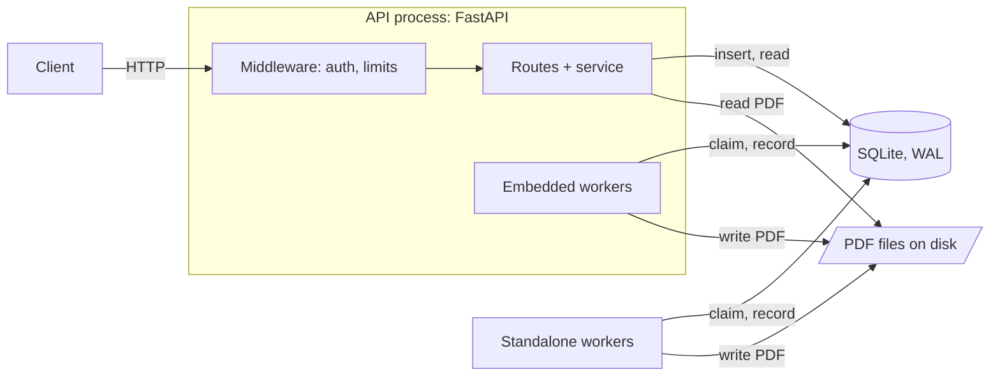
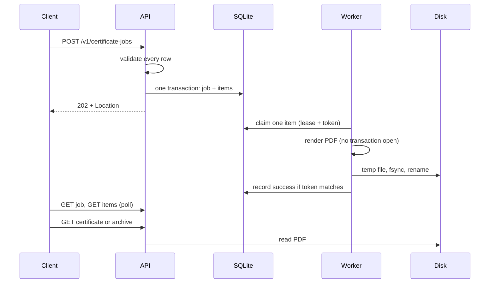
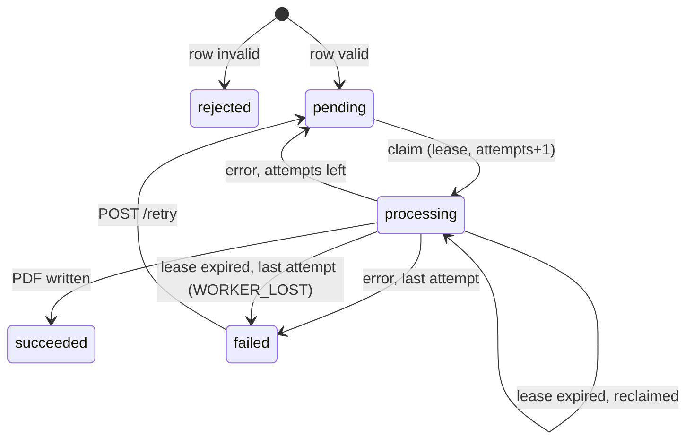

# Architecture

How certgen is built and where things live. For what it does and how to run it, see [README.md](README.md). For how it was verified, see [METHODOLOGY.md](METHODOLOGY.md).

## 60-second version

- **Problem.** One API call lists up to 10,000 recipients. The service returns one PDF certificate per valid recipient, with per-recipient status and a ZIP download.
- **Approach.** The API validates rows and writes them to SQLite. Worker threads or processes claim rows one at a time, render a PDF, and write the file. Clients poll for status.
- **Quality goals, in order.** (1) Correct under crashes: no lost and no duplicated certificates. (2) Bounded resource use: every queue, body, request and file has a limit. (3) Simple operation: `pip install` and one command, no broker, no Docker.
- **One-sentence design: the database is the queue.** Jobs, items, progress and leases all live in one SQLite file, so status and work cannot disagree.
- **Size.** About 3,200 lines in `certgen/`, one process by default, no external services.

## System overview

The client talks only to the API. The API never calls a worker; it writes rows. Workers poll the database, so embedded threads and standalone processes can run together. Files are written by workers and read by the API.

## Request lifecycle

Valid rows become `pending` items, invalid rows become `rejected` items with error codes. Both are stored in the same transaction as the job. Job status is computed from item counts on each read.

## Item state machine

`rejected` and `succeeded` are terminal. A claim counts as an attempt, so a crash uses one. A failed attempt waits `retry_delay` (2 s) before it can be claimed again. Defaults: 3 attempts, 30 s lease. Job status (`queued`, `processing`, `completed`, `completed_with_errors`, `failed`) is derived in `status.py` and never stored.

## Code map

Rows without a path prefix are files in `certgen/`; the last three are repo-root directories. Search by name; links are omitted on purpose.

| Module | Responsibility |
|---|---|
| `main.py` | App factory, lifespan (schema, token, embedded `WorkerPool`), middleware order, `serve()`. |
| `__main__.py` | `python -m certgen` entry point. |
| `api.py` | HTTP routes (plain `def`), request parsing, Idempotency-Key handling, response shaping. |
| `middleware.py` | Pure ASGI: Host allowlist, token auth, concurrency, body size and time, send deadline, no-store. |
| `auth.py` | Token store (SHA-256 digests, constant-time compare), token file creation. |
| `service.py` | All database use cases: create job, replay, list, retry, archive rows. No FastAPI, no rendering. |
| `worker.py` | Claim, render, fenced result writes, `WorkerPool` and monitor thread, `python -m certgen.worker`. |
| `status.py` | Pure function: item counts to job status and progress. |
| `db.py` | Two SQLAlchemy engines (read: `BEGIN`; write: `BEGIN IMMEDIATE`), WAL, schema version check. |
| `tables.py` | Table definitions with `CHECK` constraints that make invalid row shapes impossible. |
| `models.py` | Pydantic shapes for JSON requests and responses only. |
| `validation.py` | JSON body decoding, row rules, canonical JSON for the idempotency hash. |
| `layout.py` | Text fitting shared by validation and rendering. |
| `fonts.py` | Vendored DejaVu fonts (`assets/`), supported character set. |
| `rendering.py` | The one template: `CertificateData` to PDF bytes. Pure, byte-deterministic. |
| `storage.py` | Files on disk: id-checked paths, atomic write, symlink-safe read, orphan sweep. |
| `archive.py` | ZIP plus `manifest.csv` with CSV-injection guard. |
| `errors.py` | RFC 9457 `problem+json`, stable error codes, exception handlers. |
| `config.py` | `Settings` from `CERTGEN_*` environment variables, ranges, cross-checks. |
| `clock.py` | Injectable clock (epoch ms) so tests control lease expiry. |
| `demo/` (repo root) | Static browser demo (`index.html`, `app.js`, `style.css`) served by `scripts/live_demo.py`. |
| `scripts/` (repo root) | `benchmark.py`, `live_demo.py` (+ `demo-live.sh`), `check_live_demo.py` (end-to-end over HTTP), `demo.sh` (terminal tour). |
| `tests/` (repo root) | One file per concern; `conftest.py` has the fake clock and synchronous `drain` fixture. |

Dependencies point one way: `api` to `service` to `db`/`tables`; `worker` to `service` (for `dump_errors`), `rendering`, `storage`. `api` never imports `worker` or `rendering`; `service` never imports `fastapi`; `rendering` imports no database, clock or environment code.

## Key invariants

Rules the code relies on. Where there is no test, it says so.

| Invariant | Enforced by |
|---|---|
| A render never runs inside a database transaction. | `Worker.process` in `worker.py`; `test_render_runs_outside_write_transaction`. |
| Only the current lease token can record a result; a stale worker updates 0 rows. | `WHERE lease_token = :token` in `worker.py`; `test_stale_worker_done_write_rejected_by_fencing`, `test_same_worker_reclaim_is_fenced`. |
| A claim is atomic across threads and processes. | `BEGIN IMMEDIATE` in `db.py`; `test_two_worker_processes_never_double_process`, `test_many_threads_claim_each_item_exactly_once`. |
| Readers never block writers, and writers never block readers. | WAL plus a plain `BEGIN` read engine; `test_open_read_does_not_block_claim`. |
| File paths are built only from server-generated 32-hex ids; no user text reaches a path. | `_check_id` in `storage.py`; `test_path_traversal_id_404`, `test_symlinked_certificate_refused`. |
| A reader never sees a half-written PDF. | Temp file, fsync, `os.replace` in `storage.py`; `test_atomic_write_no_partial_file`. |
| A row is accepted only if it will fit on the page. | Validation and renderer both call `layout.fit_text`; `test_name_too_wide_does_not_fit`, `test_unfittable_text_raises_instead_of_overflowing`. |
| Equal input gives byte-identical PDFs, so a retry rewrites the same file. | `rendering.py` (no clock, no env); `test_render_is_byte_deterministic`. |
| Job status is never stored, so it cannot drift from the items. | `status.py`; `test_derivation_table`. |
| Invalid item states cannot be written (for example `processing` without a lease token). | `CHECK` constraints in `tables.py`; `test_check_constraints_reject_invalid_rows`. |
| Time is read after the lock is taken, so timestamps follow commit order. | `now = clock()` after `BEGIN IMMEDIATE`; `test_clock_read_after_lock`. |
| Routes are plain `def`; the only async code is middleware. | Convention stated in `api.py` and `middleware.py`; no test. |
| Error bodies never contain exception text, and SQL errors never carry bound values. | `errors.py`, `hide_parameters` in `db.py`; `test_sql_errors_do_not_carry_parameters`. |
| An archive reads its rows in one snapshot and closes the connection before reading any file. | `archive_rows` in `service.py`; `test_archive_while_running_is_snapshot`. |

## Concurrency and crash recovery

- **Claim.** `claim_next` runs in one `BEGIN IMMEDIATE` transaction. It retires exhausted leases, picks an expired lease first, otherwise the oldest `pending` item, and sets a lease.
- **Lease.** 30 s by default. A claim sets `lease_expires_at`; an item in `processing` past that time is reclaimable by any worker.
- **Fencing token.** Each claim writes a fresh random `lease_token`. Success, retry and failure updates all say `WHERE lease_token = :token`, so a worker that lost its lease changes nothing. `lease_owner` is for logs only.
- **Attempts.** `attempts` increments at claim. A render error returns the item to `pending` after a delay, or `failed` (`GENERATION_FAILED`) on the last attempt. An expired lease on the last attempt ends as `failed` (`WORKER_LOST`), so a crash loop is bounded.
- **Monitor thread.** `WorkerPool` restarts dead worker threads (3 restarts per 60 s per slot, then gives up) and retires exhausted leases even when no worker is running. A hung but live thread is not replaced; its lease expires instead.
- **Atomic file write.** Unique temp name, fsync, rename, directory fsync. A killed writer leaves a `.tmp` file; each worker deletes old ones at start (`sweep_orphans`).
- **Guarantee.** At-least-once execution with an idempotent effect: a re-run writes the same bytes to the same path. A test sends SIGKILL to a real worker process mid-job (`test_kill_mid_job_no_duplicates`).
- **Retry.** `POST .../retry` resets failed items to `pending` with `attempts = 0`. Old workers are fenced out because failed rows carry no token.

## Data model

Two tables, created in `tables.py`. Schema version is `PRAGMA user_version = 1`; a different version is refused at start.

| Table | Columns that matter |
|---|---|
| `jobs` | `id` (32 hex), `title`, `issuer`, `issued_on`, `print_email` (snapshot at creation), `idempotency_key` (unique, prefixed with the client id), `request_hash`, `request_json`, `created_at` |
| `items` | `id` (claim order), `job_id`, `row_index` (unique per job), `name`, `email`, `status`, `attempts`, `errors` (JSON), `certificate_id` (unique, null if rejected), `lease_token`, `lease_expires_at`, `lease_owner`, `available_at`, `completed_at`, `input_json` |

Indexes serve the three hot queries: next claimable item `(status, id)`, expired leases `(status, lease_expires_at)`, and paging a job's items `(job_id, status, row_index)`. Files live at `certificates/{job_id}/{certificate_id}.pdf`.

## Decisions and trade-offs

| Decision | Chosen | Rejected | Why |
|---|---|---|---|
| Framework ([ADR-001](docs/decisions/ADR-001-framework.md)) | FastAPI | Flask, Django + DRF | Built-in validation and OpenAPI, little boilerplate. |
| Store ([ADR-002](docs/decisions/ADR-002-database-and-schema.md)) | SQLite (WAL) via SQLAlchemy | PostgreSQL, raw `sqlite3` | No service to run; one writer is enough at this size. |
| Generation ([ADR-003](docs/decisions/ADR-003-sync-vs-background.md)) | Database-backed queue, `202` | Synchronous, `BackgroundTasks`, Celery + Redis | Real progress, survives restarts, no broker. |
| Recovery ([ADR-004](docs/decisions/ADR-004-worker-model-and-crash-recovery.md)) | Lease + fencing token, 3 attempts | Startup sweep, heartbeat | Safe with any number of workers; items take about 11 ms, so a heartbeat buys nothing. |
| Validation ([ADR-005](docs/decisions/ADR-005-validation.md)) | Per-row `rejected`, whole-request `422` only for structural errors | Reject all on any bad row | One typo does not block 4,999 good rows. |
| Retries ([ADR-006](docs/decisions/ADR-006-idempotency.md)) | Optional `Idempotency-Key` | Body-hash dedupe | Explicit intent; identical runs do not collapse. |
| PDF ([ADR-007](docs/decisions/ADR-007-pdf-library-and-template.md)) | ReportLab, template in code, bundled DejaVu | WeasyPrint, fpdf2, PDF forms | Pure pip install; measurable text width. |
| Files ([ADR-008](docs/decisions/ADR-008-file-storage.md)) | Local directory, server ids | BLOBs in SQLite, S3 | Keeps PDF bytes off the single SQLite writer; `Storage` is the S3 seam. |
| Retrieval ([ADR-009](docs/decisions/ADR-009-retrieval-api.md)) | Per-certificate download, ZIP, paged items | One of them only | Both are needed for 1,000 results. |
| Errors ([ADR-010](docs/decisions/ADR-010-error-model.md)) | RFC 9457 `problem+json` with codes | FastAPI default `detail` | One shape everywhere, stable codes. |
| Limits ([ADR-011](docs/decisions/ADR-011-limits.md)) | Explicit caps on rows, body, queue, disk, requests | None; rate limiting | Cheap to enforce; rate limiting belongs at a gateway. |
| Tests ([ADR-012](docs/decisions/ADR-012-test-strategy.md)) | Fake clock, synchronous drain, real-process kill test | Sleeps and polling | No flaky timing. |
| Identity ([ADR-013](docs/decisions/ADR-013-certificate-identity-and-verification.md)) | Random 128-bit certificate id | Integer ids | Not enumerable; id exists before rendering. |

## What changes at 100x scale

- **Database.** SQLite has one writer. Move to PostgreSQL and claim with `FOR UPDATE SKIP LOCKED`; the claim SQL in `worker.py` is the only part that changes. Two engines already separate readers from writers.
- **Files.** Swap `Storage` for object storage and serve downloads by signed URL. A 10,000-PDF ZIP is about 440 MB and is built on the API host today.
- **Workers.** Rendering is CPU-bound; add worker processes, not threads. The measured scaling is sublinear (about 84 certificates/s with one process, 168 with four; see [README.md](README.md)), because every claim and result write passes through one SQLite writer.
- **Input.** A 45 MB JSON body does not scale; accept CSV upload instead.
- **Fairness.** One token cannot hold more than 32 request slots, but there is no per-client queue quota or rate limit.

## Non-goals

- Multiple templates or template upload: there is one design.
- Public certificate verification or QR codes (ADR-013 describes how to add them).
- Multi-tenant accounts, per-user quotas, or rate limiting: auth is a shared bearer token.
- Email delivery of certificates.
- Hosting on the open internet: it binds to loopback by default and checks the Host header.
- Schema migrations: a database with another schema version is refused at start.
