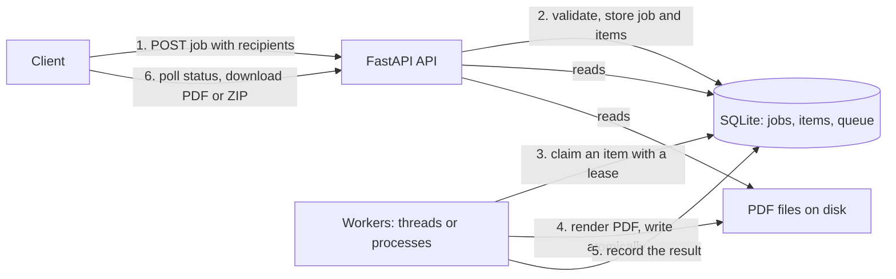

# certgen: Bulk Certificate Generator

A FastAPI service for training providers and event organisers: one API request lists many recipients, and
workers turn each valid one into a PDF certificate. Python 3.11+, SQLite and local files; no Docker, Redis
or message broker.

## At a glance

**Workflow**

1. `POST /v1/certificate-jobs` with the shared certificate data and up to 10,000 recipients. Every row is
   validated; bad rows are reported individually and the valid rows are queued. The reply is `202`.
2. Workers claim queued items one at a time, render each PDF from a single template and record the result.
3. `GET` the job to poll status and progress; `GET .../items` shows which recipients succeeded or failed and why.
4. Download one PDF, or a ZIP of all of them plus `manifest.csv`.
5. Re-queue failed certificates with `POST .../retry`; use `?dry_run=true` and `Idempotency-Key` for safe submits.

**Engineering highlights**

- **The database is the queue.** Status, progress and work items live in one SQLite file, so they cannot disagree.
- **Crash-safe.** Workers hold 30 s leases and a per-claim fencing token. A test SIGKILLs a real worker
  mid-job and checks that nothing is lost or duplicated (`tests/test_crash_recovery.py`).
- **Bad rows do not sink the batch.** Invalid rows are `rejected`; one rendering failure fails only that
  certificate (`failed`).
- **Only renderable input is accepted.** Validation and rendering share one text-fitting function, and
  characters the font cannot draw are rejected. The same input gives byte-identical PDFs.
- **Safe to retry.** `Idempotency-Key` replays, dry-run validation and one-call retry of failed items.
- **Measured.** About 84 certificates/s with one worker process and 168/s with four (1,000 recipients,
  [benchmarks](#tests-and-benchmarks)). The suite has 450+ tests, including real-subprocess and HTTP tests.

## Architecture



The API only writes rows; workers poll the database, so they can run inside the API process (default) or as
separate `python -m certgen.worker` processes. Details: [ARCHITECTURE.md](ARCHITECTURE.md).

## Quick start

Python 3.11 or newer and pip (Windows: `py -3.11 -m venv .venv` and `.venv\Scripts\activate`):

```bash
python3 -m venv .venv && source .venv/bin/activate
pip install -r requirements.txt
python -m certgen        # http://127.0.0.1:8000 with 2 embedded worker threads
```

In a second terminal. The server writes the API token to `data/api-token` on first start:

```bash
TOKEN=$(cat data/api-token)
curl -s -X POST http://127.0.0.1:8000/v1/certificate-jobs \
  -H "Authorization: Bearer $TOKEN" \
  -H 'Content-Type: application/json' \
  -d '{"certificate": {"title": "Python for Data Engineering", "issuer": "Acme Academy", "issued_on": "2026-10-01"}, "recipients": [{"name": "Zoë Łukasz", "email": "zoe@example.com"}, {"name": "Bob", "email": "not-an-email"}, {"name": "Νίκος Παπαδόπουλος", "email": "nikos@example.org"}]}'
```

The reply is `202` with the job `id`: row 1 is reported as `INVALID_EMAIL`, rows 0 and 2 are generated.
Retrieve the results with that `id`:

```bash
curl -s -H "Authorization: Bearer $TOKEN" http://127.0.0.1:8000/v1/certificate-jobs/{job_id}           # status, progress
curl -s -H "Authorization: Bearer $TOKEN" -o certificates.zip http://127.0.0.1:8000/v1/certificate-jobs/{job_id}/archive
```

Interactive docs: `http://127.0.0.1:8000/docs` (Swagger UI loads from `cdn.jsdelivr.net`, so it needs internet; the schema is served locally at `/openapi.json`).

**Live browser demo:** `./scripts/demo-live.sh` starts a real server and worker on a throwaway data
directory (port 8010) and walks through validation, generation, a real worker crash and recovery, and retry.
`.venv/bin/python scripts/check_live_demo.py` runs the same story headless over localhost HTTP.
`./scripts/demo.sh` is the terminal version.

## API

All `/v1` routes need `Authorization: Bearer <token>`. Errors are RFC 9457 `application/problem+json` with
stable `code` values ([ADR-010](docs/decisions/ADR-010-error-model.md)).

| Endpoint | Purpose |
|---|---|
| `POST /v1/certificate-jobs` | Create a job. `?dry_run=true` validates only; `Idempotency-Key` makes retries safe. |
| `GET /v1/certificate-jobs/{job_id}` | Job status, per-status counts and progress. |
| `GET /v1/certificate-jobs/{job_id}/items` | Per-recipient results, filterable by status and keyset-paginated. |
| `GET /v1/certificates/{certificate_id}` | Download one PDF. |
| `GET /v1/certificate-jobs/{job_id}/archive` | ZIP of all succeeded PDFs plus `manifest.csv`. |
| `POST /v1/certificate-jobs/{job_id}/retry` | Re-queue the job's `failed` items. |
| `GET /healthz` | Open health check: database and live embedded workers. |
| `GET /metrics` | Prometheus text format (needs the token): queue depth, items by status, render-time histogram, lease losses. |

Standalone workers serve their own `/metrics` when `CERTGEN_WORKER_METRICS_PORT` is set ([ADR-014](docs/decisions/ADR-014-metrics.md)).

Request shape and rules: [ADR-005](docs/decisions/ADR-005-validation.md),
[ADR-006](docs/decisions/ADR-006-idempotency.md), [ADR-009](docs/decisions/ADR-009-retrieval-api.md).

## Key settings

Environment variables, validated at startup. The full list is in [certgen/config.py](certgen/config.py) and
[ADR-011](docs/decisions/ADR-011-limits.md).

| Variable | Default | Meaning |
|---|---|---|
| `CERTGEN_DATA_DIR` | `./data` | SQLite file, PDFs and the generated API token |
| `CERTGEN_EMBEDDED_WORKER` | `true` | run worker threads inside the API; `false` for separate worker processes |
| `CERTGEN_LEASE_SECONDS` | `30` | an unfinished claim is reclaimed after this |
| `CERTGEN_MAX_ATTEMPTS` | `3` | attempts per item before `failed` |
| `CERTGEN_MAX_RECIPIENTS` | `10000` | recipients per request (also sets the body-size limit) |
| `CERTGEN_API_TOKENS` | empty | comma-separated bearer tokens; empty uses `{CERTGEN_DATA_DIR}/api-token` |

Rendering is CPU-bound: scale with processes by running `CERTGEN_EMBEDDED_WORKER=false python -m certgen`
plus one or more `python -m certgen.worker` on the same data directory.

## Tests and benchmarks

```bash
pip install -r requirements-dev.txt
pytest                                   # full suite, including slow subprocess crash tests
pytest -m "not slow"                     # fast loop
ruff check . && ruff format --check . && mypy --strict certgen
python scripts/benchmark.py --recipients 1000 --processes 4 --output /tmp/bench.json   # see the table below
```

Every test carries `@pytest.mark.req("R#")` linking it to [docs/REQUIREMENTS.md](docs/REQUIREMENTS.md), and
`tests/test_spec_traceability.py` fails if a requirement has no test. How the suite is built and what each
layer proves: [METHODOLOGY.md](METHODOLOGY.md).

1,000 recipients, one local ext4 disk with real `fsync`s, produced by `scripts/benchmark.py` on the author's
machine; this table is checked against the evidence files by `tests/test_docs.py`:

| Processes | Wall (s) | Throughput (certs/s) | Evidence |
|---|---|---|---|
| 1 | 11.95 | 83.7 | [benchmark-1p.json](tests/fixtures/benchmarks/benchmark-1p.json) |
| 2 | 7.18 | 139.3 | [benchmark-2p.json](tests/fixtures/benchmarks/benchmark-2p.json) |
| 4 | 5.97 | 167.6 | [benchmark-4p.json](tests/fixtures/benchmarks/benchmark-4p.json) |

## Key design decisions

- **Background processing, not a synchronous POST:** 10,000 recipients would hold the connection open ([ADR-003](docs/decisions/ADR-003-sync-vs-background.md)).
- **SQLite as database and queue,** with claim, lease and fence for crash recovery ([ADR-002](docs/decisions/ADR-002-database-and-schema.md), [ADR-004](docs/decisions/ADR-004-worker-model-and-crash-recovery.md)).
- **Partial acceptance:** per-row errors, `422` only for structural problems ([ADR-005](docs/decisions/ADR-005-validation.md)); idempotent submits ([ADR-006](docs/decisions/ADR-006-idempotency.md)).
- **ReportLab, vendored fonts, one fixed template** ([ADR-007](docs/decisions/ADR-007-pdf-library-and-template.md)); atomic file writes ([ADR-008](docs/decisions/ADR-008-file-storage.md)).
- **Metrics without extra services:** queue gauges read from the database at scrape time, worker timings per process ([ADR-014](docs/decisions/ADR-014-metrics.md)).
- **Explicit limits** on rows, body size, queue depth, disk and concurrent requests ([ADR-011](docs/decisions/ADR-011-limits.md)).

## Documentation

- [ARCHITECTURE.md](ARCHITECTURE.md): components, codemap, data flow, invariants.
- [METHODOLOGY.md](METHODOLOGY.md): requirements, decisions, tests and how they are verified.
- [docs/decisions/](docs/decisions/): fourteen decision records, including the full
  [error-code tables](docs/decisions/ADR-010-error-model.md) and
  [supported characters](docs/decisions/ADR-005-validation.md).
- [docs/REQUIREMENTS.md](docs/REQUIREMENTS.md), [docs/problem_statement.md](docs/problem_statement.md): the assignment and its traceability.

## Known limitations

- **One trust level per token:** any valid token can read any job. There is no public verification endpoint
  ([ADR-013](docs/decisions/ADR-013-certificate-identity-and-verification.md)).
- **Built for a trusted local deployment:** one token per client, and a reverse proxy that limits idle
  connections before exposing it to untrusted clients ([ADR-011](docs/decisions/ADR-011-limits.md)).
- **SQLite is a single writer on one machine's local disk;** PostgreSQL with `SKIP LOCKED` is the scale-out path.
- **At-least-once rendering:** after a crash an item may render again, with identical bytes; exactly-once is not claimed.
- **No lease renewal:** an item stalled longer than the lease is re-run, and after 3 expiries ends `WORKER_LOST`.
  With zero workers running, an expired item stays `processing`.
- **Scripts:** Latin, Greek and Cyrillic; no CJK, right-to-left scripts or emoji (`UNSUPPORTED_CHARACTERS`).
- **Metrics are counts and durations only:** no tracing, alert rules or dashboard, and a scrape scans every
  item's status index, so its cost grows with total items (no retention).
- **FIFO claiming:** a very large job delays smaller jobs submitted after it. No retention or cleanup;
  idempotency keys never expire.
- Emails are printed by default (`CERTGEN_PRINT_EMAIL_ON_CERTIFICATE=false` opts out). PDF checks cover text
  and layout bounds, not human visual review; POSIX-signal tests are skipped on Windows.

## Repository layout

```
certgen/      FastAPI app, validation, worker, rendering, storage, config, errors (assets/ holds the fonts)
demo/         static pages for the live browser demo
scripts/      benchmark.py, demo-live.sh, check_live_demo.py, demo.sh
tests/        pytest suite; fixtures/benchmarks/ holds the benchmark evidence
docs/         REQUIREMENTS.md, problem_statement.md, decisions/ (ADRs)
```
