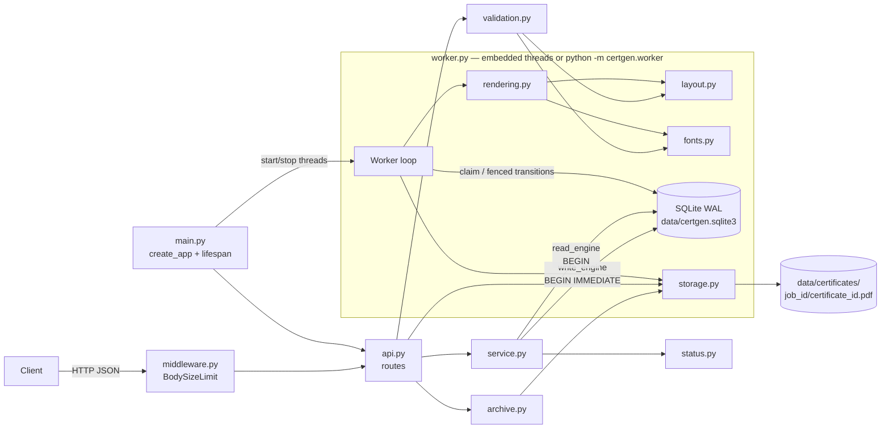

# BLUEPRINT — Bulk Certificate Generator

> Self-contained build specification. With this file and `docs/problem_statement.pdf`, the whole project can be built.
> ADR links are supporting evidence only; every decision is stated here in full.
> Words "must", "never", "always" are binding. Nothing in this file is optional unless it says "differentiator".

## 0. Header

| Field | Value |
|---|---|
| Author tool / model | Claude Code, model Claude Opus 5.5 (`claude-opus-5-5`) |
| Date | 2026-10-11 |
| Inputs commit | `b7c5d93` (REQUIREMENTS, RESEARCH, ADR-001…013, PLAN incl. Gate 1 decisions and Phase 4 audit log) |
| Gate status | Gate 1 decided; Phase 4 audit applied. Gate 2: the five auditor disagreements in PLAN §6 are treated as accepted, because the user proceeded to Phase 4.5 without objection (listed as risk K1 in §21). |
| Authoritative spec | `docs/problem_statement.pdf` (wins over this file on conflict) |
| Freeze | After Gate 3, read-only. Changes go through `docs/BLUEPRINT_AMENDMENTS.md` + user approval. |

Probes run on 2026-10-11 to fix numbers in this file (scratch scripts, not project code): render speed 20.3 ms/PDF; 10,000-item insert 56 ms; 10,000-row validation 534 ms; claim + complete 0.30 ms/item over 10,000 items with index-only plans; text-fit outcomes in §10; FastAPI 0.143.0 error types in §6.1; read/write engine blocking in §13.

---

## 1. Requirement coverage

Endpoints are abbreviated: `POST /jobs` = `POST /v1/certificate-jobs`, `GET /jobs/{id}` = `GET /v1/certificate-jobs/{job_id}`.

| R# | Requirement (PDF) | Component(s) | Endpoint(s) | Test(s) (file::case, §16) |
|---|---|---|---|---|
| R1 | Bulk request: list of recipients + certificate info in one call | `api.py:create_job`, `service.py:create_job`, `models.py:CreateJobRequest` | `POST /jobs` | `test_jobs_api::test_create_job_returns_202_with_location_and_counts`, `::test_job_and_items_are_atomic`, `test_smoke::test_end_to_end_embedded_worker` |
| R2 | Validate recipient data; invalid rows reported with row index, field, code | `validation.py`, `errors.py` | `POST /jobs` | `test_validation.py` (all cases), `test_errors::test_problem_json_shape_for_422` |
| R3 | One certificate per valid recipient | `worker.py:Worker.process`, `service.py:create_job` | — | `test_worker::test_drain_creates_one_pdf_per_valid_item_and_none_for_rejected` |
| R4 | Single predefined template | `rendering.py:render_certificate` (no template parameter) | — | `test_rendering::test_single_template_only_recipient_fields_differ` |
| R5 | Certificate contains recipient-specific info | `rendering.py`, `layout.py` | — | `test_rendering::test_pdf_text_contains_all_fields`, `::test_email_printed_only_when_job_print_email` |
| R6 | Track status per job and per item | `tables.py`, `worker.py`, `status.py` | — | `test_worker::test_item_transitions_are_recorded`, `test_job_status.py` |
| R7 | Client checks progress/result | `api.py:get_job`, `service.py:get_job`, `status.py` | `GET /jobs/{id}` | `test_jobs_api::test_status_queued_then_completed`, `::test_progress_after_partial_drain` |
| R8 | Retrieve generated certificates | `api.py:download_certificate`, `api.py:download_archive`, `archive.py`, `storage.py` | `GET /v1/certificates/{certificate_id}`, `GET /jobs/{id}/archive` | `test_retrieval.py` |
| R9 | One failure does not block other valid certificates | `worker.py:Worker.process` (per-item try/except, per-item fenced transaction) | — | `test_failure_isolation::test_one_failing_recipient_does_not_block_others` |
| R10 | Job status identifies successes and failures | `service.py:list_items`, `status.py`, `archive.py` (manifest) | `GET /jobs/{id}/items`, `GET /jobs/{id}/archive` | `test_failure_isolation::test_items_listing_identifies_failed_and_succeeded`, `test_retrieval::test_manifest_lists_every_row` |
| R11 | Designed for many recipients (non-blocking, limits, pagination) | `worker.py`, `middleware.py`, `config.py`, `service.py:list_items` | all | `test_jobs_api::test_post_does_not_render_synchronously`, `test_limits.py`, `test_jobs_api::test_items_keyset_pagination` |
| R12 | Sync-vs-background choice documented | `README.md` §Design decisions, this file §7.4, ADR-003 | — | `test_docs::test_readme_documents_background_processing_choice` |
| R13 | Python + FastAPI + relational DB | `main.py`, `db.py` | — | `test_docs::test_stack_is_fastapi_and_sqlite` |
| R14 | Test: creating a job | — | `POST /jobs` | `test_jobs_api.py` |
| R15 | Test: input validation | — | `POST /jobs` | `test_validation.py`, `test_limits.py` |
| R16 | Test: certificate generation | — | — | `test_rendering.py`, `test_worker.py` |
| R17 | Test: job status/progress | — | `GET /jobs/{id}` | `test_jobs_api.py`, `test_job_status.py` |
| R18 | Test: individual certificate failure | — | — | `test_failure_isolation.py` |
| R19 | Test: retrieving certificates | — | downloads | `test_retrieval.py` |
| R20 | README: setup | `README.md` `## Setup` | — | `test_docs::test_readme_has_required_sections` |
| R21 | README: run | `README.md` `## Run` | — | same |
| R22 | README: run tests | `README.md` `## Run tests` | — | same |
| R23 | README: submit request | `README.md` `## Submit a certificate generation request` | — | same |
| R24 | README: retrieve certificates | `README.md` `## Retrieve generated certificates` | — | same |
| R25 | README: design decisions | `README.md` `## Design decisions` | — | same + `::test_readme_adr_links_exist` |
| P1 | Optional must not cost required | git tag `v1.0-required` at M6 with full suite green | — | gate review |
| P2 | Explain every line | `docs/WALKTHROUGH.md` (Phase 7) | — | gate review |
| P3 | pip + one command, no Docker/Redis/broker | `requirements*.txt`, `README.md` | — | Phase 6 clean-venv transcript |

---

## 2. Locked stack

Python **≥ 3.11** (`enum.StrEnum`). Developed on 3.11.9; Phase 6 verifies 3.11.9 and 3.14.

| Layer | Package | Version | Reason |
|---|---|---|---|
| Web framework | `fastapi` | 0.143.0 | Pydantic validation + OpenAPI `/docs` + `lifespan` hook for workers (ADR-001). |
| ASGI toolkit | `starlette` | 1.7.0 | Pinned explicitly because FastAPI depends on it, so its behaviour is reproducible. |
| ASGI server | `uvicorn` | 0.54.0 | Plain install (no `[standard]` extras), so no compiled optional deps. |
| Validation | `pydantic` | 2.14.0 | Request envelope models (FastAPI dependency). |
| Email syntax | `email-validator` | 2.3.0 | Maintained email library (OWASP recommends one); `check_deliverability=False`, so no network. |
| DB toolkit | `sqlalchemy` | 2.1.4 | SQLAlchemy **Core** (Table + `text()`), no ORM. Engine events set pragmas and the BEGIN mode. |
| Database | SQLite (Python stdlib `sqlite3`) | ≥ 3.35.0 runtime check (RETURNING); dev host 3.46.1 | Zero external services (P3); WAL mode. |
| PDF | `reportlab` | 5.0.1 | Pure pip wheel; canvas API; `invariant=1` determinism; TTF embedding. |
| QR code | `reportlab.graphics.barcode.qr.QrCodeWidget` | (in reportlab 5.0.1) | No extra dependency (D1 only). |
| HMAC | **none** | — | Rejected at Gate 1 Q3 (§10.6). |
| Fonts | DejaVu Sans + DejaVu Sans Bold | 2.37 (vendored) | Unicode Latin/Greek/Cyrillic; Bitstream Vera license allows redistribution. SHA-256 in §14. |
| Test runner | `pytest` | 9.1.1 | Markers for traceability. |
| Test timeouts | `pytest-timeout` | 2.4.0 | A hung subprocess test fails instead of hanging CI. |
| Test HTTP client | `httpx2` | 2.13.1 | Starlette 1.7.0's `TestClient` warns that `httpx` is deprecated and asks for `httpx2`; verified warning-free with `-W error`. |
| PDF text extraction (tests) | `pypdf` | 6.20.0 | Proves R5 by reading the generated text. |
| Lint + format | `ruff` | 0.17.0 | `ruff check` + `ruff format --check`. |
| Type check | `mypy` | 2.4.0 | `mypy --strict certgen`. |

`requirements.txt` = a `pip freeze` of a clean venv after installing the runtime rows (direct **and** transitive pins), generated in M1 on Python 3.11. `requirements-dev.txt` = `-r requirements.txt` plus the frozen dev rows. No other dependencies may be added without an amendment.

---

## 3. Architecture



| Component (file) | Single responsibility | Must NOT |
|---|---|---|
| `config.py` | Parse and validate env vars into a frozen `Settings` dataclass. | Be bypassed: no other module reads `os.environ`. |
| `clock.py` | `Clock = Callable[[], int]` (epoch ms) and `system_clock()`. | Hold state. |
| `db.py` | Build `Engines(read, write)`, connection pragmas, BEGIN modes, schema creation, SQLite version check. | Contain business rules or queries other than DDL and pragmas. |
| `tables.py` | SQLAlchemy Core `MetaData`, `jobs` and `items` `Table` definitions. | Execute anything. |
| `errors.py` | `ProblemCode`, `FieldCode` StrEnums; `ApiError` exception; problem+json builders; FastAPI exception handlers. | Know about DB or rendering. |
| `models.py` | Pydantic request envelope models and response models. | Contain validation rules beyond JSON shape. |
| `fonts.py` | Register the two vendored fonts once; expose `FONT_REGULAR`, `FONT_BOLD`, `SUPPORTED_CHARS: frozenset[int]`. | Read files outside `certgen/assets/`. |
| `layout.py` | Pure text fitting: `fit_text(...) -> Fit or None`, layout constants. | Draw anything or touch I/O. |
| `validation.py` | Pure validation and normalization of certificate fields and rows into `ValidatedRequest` + flat errors. | Touch DB, HTTP, files or the clock (the date is passed in). |
| `status.py` | Pure `derive_job_status(counts) -> (status, progress)`. | Query anything. |
| `service.py` | DB use cases: create job (incl. idempotency), get job, list items, find certificate, retry, healthz probe. | Import FastAPI or build HTTP responses; render PDFs. |
| `rendering.py` | `render_certificate(CertificateData) -> bytes` (+ QR in D1). | Touch DB, files, env or the clock. |
| `storage.py` | Path derivation, atomic write, open, existence check, orphan `*.tmp` sweep. | Accept any path component that is not a 32-hex ID. |
| `archive.py` | Build ZIP (PDFs + `manifest.csv`) into a spooled temp file from item rows. | Open DB sessions (it receives rows). |
| `worker.py` | Claim, process, fenced transitions, loops (`run_once`, `run_until_idle`, `run_forever`), `main()` for `python -m certgen.worker`. | Import FastAPI; hold a DB transaction while rendering or writing files. |
| `middleware.py` | Pure ASGI `BodySizeLimitMiddleware` → 413. | Parse JSON. |
| `api.py` | FastAPI `APIRouter`: HTTP ↔ service mapping, status codes, headers. | Contain SQL or validation rules. |
| `main.py` | `create_app(settings, clock, renderer)`, `lifespan` (dirs, schema, warnings, worker threads), module-level `app`. | Do I/O at import time (`create_app` only builds objects; I/O happens in `lifespan`). |

---

## 4. Data model

SQLite file `{CERTGEN_DATA_DIR}/certgen.sqlite3`. Created by `metadata.create_all(write_engine)` inside a write transaction (`BEGIN IMMEDIATE`), so concurrent first boots serialize. The resulting DDL must be exactly equivalent to:

```sql
CREATE TABLE jobs (
    id               TEXT    NOT NULL PRIMARY KEY CHECK (length(id) = 32),   -- uuid4().hex
    title            TEXT    NOT NULL,                                       -- normalized (§9)
    issuer           TEXT    NOT NULL,                                       -- normalized (§9)
    issued_on        TEXT    NOT NULL,                                       -- 'YYYY-MM-DD'
    print_email      INTEGER NOT NULL CHECK (print_email IN (0, 1)),         -- snapshot of setting
    verify_base_url  TEXT    NOT NULL,                                       -- snapshot of CERTGEN_PUBLIC_BASE_URL
    idempotency_key  TEXT    UNIQUE,                                         -- NULL when no header
    request_hash     TEXT,                                                   -- sha256 hex; NULL iff key NULL
    created_at       INTEGER NOT NULL                                        -- epoch ms UTC
);

CREATE TABLE items (
    id               INTEGER NOT NULL PRIMARY KEY,                           -- rowid; FIFO order
    job_id           TEXT    NOT NULL REFERENCES jobs (id) ON DELETE CASCADE,
    row_index        INTEGER NOT NULL CHECK (row_index >= 0),               -- position in request
    name             TEXT,                                                   -- normalized str, or NULL (rejected rows only)
    email            TEXT,                                                   -- stripped str, or NULL (rejected rows only)
    status           TEXT    NOT NULL CHECK (status IN ('rejected','pending','processing','succeeded','failed')),
    attempts         INTEGER NOT NULL DEFAULT 0 CHECK (attempts >= 0),
    errors           TEXT,                                                   -- JSON array, see below; NULL = none
    certificate_id   TEXT    UNIQUE,                                         -- secrets.token_hex(16); NULL iff rejected
    lease_owner      TEXT,                                                   -- worker_id (uuid4 hex), logs only
    lease_token      TEXT,                                                   -- secrets.token_hex(16) per claim
    lease_expires_at INTEGER,                                                -- epoch ms
    available_at     INTEGER,                                                -- epoch ms; NULL = now
    completed_at     INTEGER,                                                -- epoch ms; set on succeeded/failed
    UNIQUE (job_id, row_index),
    CHECK ((status = 'rejected') = (certificate_id IS NULL)),
    CHECK ((status = 'processing') = (lease_token IS NOT NULL)),
    CHECK ((status = 'processing') = (lease_expires_at IS NOT NULL))
);

CREATE INDEX ix_items_status_id    ON items (status, id);
CREATE INDEX ix_items_status_lease ON items (status, lease_expires_at);
CREATE INDEX ix_items_job_status   ON items (job_id, status, row_index);
```

`items.errors` JSON: an array of objects `{"field": str|null, "code": FieldCode, "message": str}` plus, for duplicates only, `"duplicate_of_row_index": int`. Serialized with `json.dumps(..., ensure_ascii=False, separators=(",", ":"))`.

| Index | Exists for | Query it serves (EXPLAIN-verified in probe) |
|---|---|---|
| `jobs.id` PK | job lookup | every job endpoint |
| `UNIQUE jobs.idempotency_key` | one job per key; race backstop | idempotency lookup |
| `UNIQUE items(job_id, row_index)` | integrity (one item per row) | items keyset pagination without status filter; archive row order |
| `UNIQUE items.certificate_id` | global ID uniqueness | download, verify |
| `ix_items_status_id` | FIFO pending claim | `WHERE status='pending' AND (available_at…) ORDER BY id LIMIT 1` → `SEARCH … USING INDEX ix_items_status_id (status=?)` |
| `ix_items_status_lease` | expired-lease reclaim + retire | `WHERE status='processing' AND lease_expires_at < ?` → `SEARCH … USING INDEX ix_items_status_lease` |
| `ix_items_job_status` | per-job counts; status-filtered keyset listing | `GROUP BY status WHERE job_id=?`; `WHERE job_id=? AND status=? AND row_index>? ORDER BY row_index` |

Connection setup (every connection, both engines; `connect` event): `PRAGMA journal_mode=WAL`, `PRAGMA foreign_keys=ON`, `PRAGMA busy_timeout=5000`, and `dbapi_connection.isolation_level = None`. `create_engine(url, connect_args={"check_same_thread": False})`. The `begin` event on **write_engine** emits `BEGIN IMMEDIATE`; on **read_engine** it emits `BEGIN`. `synchronous` stays at SQLite's default (FULL).

---

## 5. State machines

### 5.1 Item states

States: `rejected`, `pending`, `processing`, `succeeded`, `failed`. Terminal: `rejected`, `succeeded`. `failed` is terminal unless `POST /retry`.

| # | From → To | Trigger | Actor | Guard (SQL `WHERE`) | Writes |
|---|---|---|---|---|---|
| T1 | ∅ → `rejected` | Row has ≥ 1 validation error at POST | API | — | `errors`, `certificate_id=NULL`, `attempts=0` |
| T2 | ∅ → `pending` | Row valid at POST | API | — | `certificate_id`, `errors=NULL` |
| T3 | `pending` → `processing` | Claim | Worker | `status='pending' AND (available_at IS NULL OR available_at <= :now)` | `lease_owner`, `lease_token`, `lease_expires_at=:now+lease_ms`, `attempts=attempts+1` |
| T4 | `processing` → `processing` | Reclaim after crash | Worker | `status='processing' AND lease_expires_at < :now AND attempts < :max` | new `lease_owner`, new `lease_token`, new expiry, `attempts+1` |
| T5 | `processing` → `succeeded` | Render + atomic file write OK | Worker | `id=:id AND lease_token=:token AND status='processing'` | lease cols NULL, `errors=NULL`, `available_at=NULL`, `completed_at=:now` |
| T6 | `processing` → `pending` | Render or write raised; `attempts < MAX_ATTEMPTS` | Worker | same fence as T5 | lease cols NULL, `available_at=:now+retry_ms`, `errors=[GENERATION_FAILED last-attempt error]` |
| T7 | `processing` → `failed` | Render or write raised; `attempts >= MAX_ATTEMPTS` | Worker | same fence as T5 | lease cols NULL, `errors=[GENERATION_FAILED]`, `completed_at=:now` |
| T8 | `processing` → `failed` | Lease expired on the last allowed attempt | Worker (retire step of every claim) | `status='processing' AND lease_expires_at < :now AND attempts >= :max` | lease cols NULL, `errors=[WORKER_LOST]`, `completed_at=:now` |
| T9 | `failed` → `pending` | `POST /v1/certificate-jobs/{id}/retry` (D3) | API | `job_id=:job AND status='failed'` | `attempts=0`, `errors=NULL`, `available_at=NULL`, lease cols NULL, `completed_at=NULL` |

Every other transition is forbidden. A fenced update affecting 0 rows means the lease was lost: the worker logs `lease_lost` and does nothing else.

### 5.2 Job states (derived on every read, never stored)

Counts come from `SELECT status, COUNT(*), SUM(attempts > 0) FROM items WHERE job_id=? GROUP BY status`. Let `valid = total − rejected`, `done = succeeded + failed`, `attempted = Σ attempts>0`. Rules are evaluated top to bottom; the first match wins:

| # | Condition | Job status |
|---|---|---|
| J1 | `valid = 0` (unreachable through the API; guard) | `completed_with_errors` |
| J2 | `done = valid` and `failed = 0` and `rejected = 0` | `completed` |
| J3 | `done = valid` and `succeeded = 0` | `failed` |
| J4 | `done = valid` | `completed_with_errors` |
| J5 | `pending = valid` and `attempted = 0` | `queued` |
| J6 | otherwise | `processing` |

`progress = round(done / valid, 4)`, and `1.0` when `valid = 0`. `finished_at` = `MAX(completed_at)` over non-rejected items when the status is J1–J4, else `null`. The derivation can move `completed*/failed → queued` only through `/retry`; it never moves `processing → queued`, because J5 requires `attempted = 0`.

---

## 6. API contract

### 6.1 Conventions
- Base path `/v1`. JSON UTF-8. Requests with a body must send `Content-Type: application/json`. Any other content type, or a body that isn't valid JSON, fails Pydantic and yields 422 with the mapping below.
- Timestamps in responses are ISO-8601 UTC with milliseconds and `Z` (`2026-10-11T08:30:00.123Z`). `issued_on` is `YYYY-MM-DD`.
- IDs: `job_id` and `certificate_id` are 32 lowercase hex characters. A path ID not matching `^[0-9a-f]{32}$` is treated as unknown (404, or `{"valid": false}` for verify), never 422.
- Links are relative paths (no host), so responses never depend on the `Host` header.
- **Every non-2xx response is `application/problem+json`**:
  ```json
  {"type":"about:blank","title":"<short>","status":<int>,"code":"<ProblemCode>","detail":"<sentence>","errors":[...]}
  ```
  `errors` is present only for 422. Each error is `{"row_index": int|null, "field": str|null, "code": FieldCode, "message": str}` plus `duplicate_of_row_index` for duplicates. `row_index` is null for request-level errors.
- **ProblemCode** (top-level `code`): `VALIDATION_FAILED` 422 · `PAYLOAD_TOO_LARGE` 413 · `NOT_FOUND` 404 · `METHOD_NOT_ALLOWED` 405 · `IDEMPOTENCY_KEY_REUSED` 409 · `CERTIFICATE_NOT_READY` 409 · `CERTIFICATE_GENERATION_FAILED` 409 · `NOTHING_TO_RETRY` 409 · `CERTIFICATE_FILE_MISSING` 410 · `INTERNAL_ERROR` 500 · `DB_UNAVAILABLE` 503.
- **FieldCode** (`errors[].code`): `INVALID_JSON`, `REQUIRED`, `INVALID_TYPE`, `UNKNOWN_FIELD`, `INVALID_VALUE`, `INVALID_FORMAT`, `TOO_LONG`, `TOO_MANY_RECIPIENTS`, `DATE_IN_FUTURE`, `INVALID_CHARACTERS`, `UNSUPPORTED_CHARACTERS`, `DOES_NOT_FIT`, `INVALID_EMAIL`, `DUPLICATE_RECIPIENT`, `GENERATION_FAILED`, `WORKER_LOST`.
- Pydantic error `type` → FieldCode (verified against FastAPI 0.143.0): `json_invalid`→`INVALID_JSON`; `missing`→`REQUIRED`; `string_type`, `dict_type`, `list_type`, `model_attributes_type`, `model_type`→`INVALID_TYPE`; `extra_forbidden`→`UNKNOWN_FIELD`; anything else→`INVALID_VALUE`. `field` = the `loc` after `"body"` joined with `.` (list indexes excluded). `row_index` = the index when the loc starts with `body.recipients.<i>`. An empty body gives `missing` at `body`, which maps to `REQUIRED` with field `null`.
- Starlette `404` (no route) → `NOT_FOUND`; `405` → `METHOD_NOT_ALLOWED`. Unhandled exception → 500 `INTERNAL_ERROR`, `detail` = "Internal server error" (no traceback), logged with `logger.exception`.

### 6.2 Shared resources

**Job resource**:
```json
{
  "id": "3f2c0d7e9b1a4c6d8e0f1a2b3c4d5e6f",
  "status": "processing",
  "certificate": {"title": "Python for Data Engineering", "issuer": "Acme Academy", "issued_on": "2026-10-01"},
  "counts": {"total": 3, "rejected": 2, "pending": 0, "processing": 1, "succeeded": 0, "failed": 0},
  "progress": 0.0,
  "created_at": "2026-10-11T08:30:00.123Z",
  "finished_at": null,
  "links": {
    "self": "/v1/certificate-jobs/3f2c0d7e9b1a4c6d8e0f1a2b3c4d5e6f",
    "items": "/v1/certificate-jobs/3f2c0d7e9b1a4c6d8e0f1a2b3c4d5e6f/items",
    "archive": "/v1/certificate-jobs/3f2c0d7e9b1a4c6d8e0f1a2b3c4d5e6f/archive"
  }
}
```

**Item resource**:
```json
{
  "row_index": 0, "name": "Zoë Łukasz", "email": "zoe@example.com",
  "status": "succeeded", "attempts": 1, "errors": [],
  "certificate_id": "a1b2c3d4e5f60718293a4b5c6d7e8f90",
  "download_url": "/v1/certificates/a1b2c3d4e5f60718293a4b5c6d7e8f90"
}
```
`errors` is `[]` when the column is NULL. Item errors carry no `row_index`. `download_url` is non-null only when `status = succeeded`. `name`/`email` may be `null` for rejected rows.

### 6.3 `POST /v1/certificate-jobs` — create job

Query: `dry_run` (bool, default `false`). Header: `Idempotency-Key` (optional; 1–255 chars, each in `0x21–0x7E`).

Request schema (`extra="forbid"` at both object levels; strings are `StrictStr`):
```json
{
  "certificate": {"title": "Python for Data Engineering", "issuer": "Acme Academy", "issued_on": "2026-10-01"},
  "recipients": [
    {"name": "Zoë Łukasz", "email": "zoe@example.com"},
    {"name": "Bob", "email": "not-an-email"},
    {"name": "Zoe Again", "email": " ZOE@example.com "}
  ]
}
```
`recipients` is `list[dict[str, Any]]`: a non-object element is a structural 422 (`INVALID_TYPE`, `row_index` = i). Field rules are in §9.

Responses:

| Status | When | Body | Headers |
|---|---|---|---|
| 202 | Job created (≥ 1 valid row, no request-level error) | Job resource + `"errors": [flat row errors of rejected rows]` | `Location: /v1/certificate-jobs/{id}` |
| 200 | Idempotent replay (same key + same body hash) | Same shape as 202, **current** state | `Location`, `Idempotent-Replayed: true` |
| 200 | `dry_run=true` with no request-level error | Dry-run report (below) | — |
| 409 | Same key, different body hash | problem `IDEMPOTENCY_KEY_REUSED` | — |
| 413 | Body larger than `MAX_BODY_BYTES` | problem `PAYLOAD_TOO_LARGE` | — |
| 422 | Request-level errors, or every row invalid, or a bad `Idempotency-Key` | problem `VALIDATION_FAILED` with every request-level **and** row-level error | — |

202 example for the request above:
```json
{
  "id": "3f2c0d7e9b1a4c6d8e0f1a2b3c4d5e6f", "status": "queued",
  "certificate": {"title": "Python for Data Engineering", "issuer": "Acme Academy", "issued_on": "2026-10-01"},
  "counts": {"total": 3, "rejected": 2, "pending": 1, "processing": 0, "succeeded": 0, "failed": 0},
  "progress": 0.0, "created_at": "2026-10-11T08:30:00.123Z", "finished_at": null,
  "links": {"self": "/v1/certificate-jobs/3f2c…", "items": "/v1/certificate-jobs/3f2c…/items", "archive": "/v1/certificate-jobs/3f2c…/archive"},
  "errors": [
    {"row_index": 1, "field": "email", "code": "INVALID_EMAIL", "message": "The email address is not valid. It must have exactly one @-sign."},
    {"row_index": 2, "field": "email", "code": "DUPLICATE_RECIPIENT", "message": "Duplicate of row 0 (same email, case-insensitive).", "duplicate_of_row_index": 0}
  ]
}
```
(`…` abbreviates the same 32-hex id. `INVALID_EMAIL` messages are the `email-validator` exception text, verbatim.)

Dry-run report (200):
```json
{"dry_run": true, "would_create_job": true,
 "counts": {"total": 3, "valid": 1, "rejected": 2},
 "errors": [ "...same flat errors as the 202 example..." ]}
```
`would_create_job` is `false` when `valid = 0`, and the status is **still 200**. A dry run never creates rows and never reads or stores an `Idempotency-Key`.

422 example (all rows invalid):
```json
{"type": "about:blank", "title": "Validation failed", "status": 422, "code": "VALIDATION_FAILED",
 "detail": "2 of 2 recipients are invalid; no job was created.",
 "errors": [
   {"row_index": 0, "field": "name", "code": "REQUIRED", "message": "name is required."},
   {"row_index": 1, "field": "name", "code": "UNSUPPORTED_CHARACTERS", "message": "Character U+674E is not supported by the certificate font."}
 ]}
```
`detail` is "Request is invalid." when request-level errors exist, else "N of N recipients are invalid; no job was created.".

### 6.4 `GET /v1/certificate-jobs/{job_id}` — job status
200 → job resource (§6.2). 404 `NOT_FOUND` for unknown or malformed id.

### 6.5 `GET /v1/certificate-jobs/{job_id}/items` — per-recipient results
Query: `status` ∈ {`rejected`,`pending`,`processing`,`succeeded`,`failed`} (optional); `after` int ≥ −1 (default −1; returns rows with `row_index > after`); `limit` int 1–1000 (default 100). An invalid value → 422 `VALIDATION_FAILED` with `field` = the param name and code `INVALID_VALUE`.
Ordered by `row_index` ascending. The server fetches `limit + 1` rows: if more exist, `next_after` = the last returned `row_index`, else `null`.
```json
{"job_id": "3f2c0d7e9b1a4c6d8e0f1a2b3c4d5e6f", "limit": 2, "next_after": 1,
 "items": [
   {"row_index": 0, "name": "Zoë Łukasz", "email": "zoe@example.com", "status": "succeeded", "attempts": 1, "errors": [],
    "certificate_id": "a1b2c3d4e5f60718293a4b5c6d7e8f90", "download_url": "/v1/certificates/a1b2c3d4e5f60718293a4b5c6d7e8f90"},
   {"row_index": 1, "name": "Bob", "email": "not-an-email", "status": "rejected", "attempts": 0,
    "errors": [{"field": "email", "code": "INVALID_EMAIL", "message": "The email address is not valid. It must have exactly one @-sign."}],
    "certificate_id": null, "download_url": null}
 ]}
```
404 for unknown job.

### 6.6 `GET /v1/certificates/{certificate_id}` — download one PDF

| Item state | Response |
|---|---|
| `succeeded`, file present | 200 `application/pdf`, `Content-Disposition: attachment; filename="certificate-{certificate_id}.pdf"` |
| `pending` / `processing` | 409 `CERTIFICATE_NOT_READY` |
| `failed` | 409 `CERTIFICATE_GENERATION_FAILED` |
| `succeeded`, file missing on disk | 410 `CERTIFICATE_FILE_MISSING` |
| unknown / malformed id (rejected rows have no id) | 404 `NOT_FOUND` |

### 6.7 `GET /v1/certificate-jobs/{job_id}/archive` — ZIP
200 `application/zip`, `Content-Disposition: attachment; filename="certificates-{job_id}.zip"`. Allowed in any job state (a snapshot). 404 for unknown job. Contents in §11.3.

### 6.8 `POST /v1/certificate-jobs/{job_id}/retry` — D3
No body. 202 → job resource. 404 unknown job. 409 `NOTHING_TO_RETRY` when no item is `failed`. Effect: T9 for all `failed` items of the job.

### 6.9 `GET /v1/verify/{certificate_id}` — D1 (public)
Always 200.
```json
{"valid": true, "certificate_id": "a1b2c3d4e5f60718293a4b5c6d7e8f90", "recipient_name": "Zoë Łukasz",
 "title": "Python for Data Engineering", "issuer": "Acme Academy", "issued_on": "2026-10-01"}
```
Any id that is unknown, malformed, or whose item is not `succeeded` → `{"valid": false}`, with no other fields. The email is never returned.

### 6.10 `GET /healthz`
200 `{"status": "ok", "db": "ok", "embedded_workers_alive": 2, "embedded_workers_expected": 2}`. If `SELECT 1` on read_engine fails → 503 problem `DB_UNAVAILABLE`.

`GET /docs` and `GET /openapi.json` are FastAPI defaults and remain enabled.

---

## 7. Processing workflow

### 7.1 Request lifecycle (POST to download)
1. `BodySizeLimitMiddleware`: if `Content-Length` > `MAX_BODY_BYTES` → 413. Otherwise it buffers the body chunks; if they exceed the limit → 413, else it replays them to the app.
2. FastAPI parses JSON into `CreateJobRequest` (envelope). On failure → 422 via the §6.1 mapping.
3. `api.create_job` reads `dry_run` and `Idempotency-Key`. If `dry_run=false` and the key is present: check the key format (→ 422 `INVALID_VALUE`, field `Idempotency-Key`); compute `request_hash = sha256(canonical JSON of body.model_dump(mode="json"))`, where canonical = `json.dumps(sort_keys=True, separators=(",",":"), ensure_ascii=False)`; read-engine lookup of the key. Found + same hash → **200 replay** (no validation). Found + different hash → **409**.
4. `validation.validate_request(body, today=clock date UTC, print_email=settings.print_email)` → `ValidatedRequest(certificate, rows, request_errors, row_errors)`. No DB, no I/O.
5. If `request_errors` or `valid rows = 0` → **422** with all errors. Nothing is stored.
6. If `dry_run=true` → **200 report**. Nothing is stored.
7. `service.create_job` in **one write transaction** (`BEGIN IMMEDIATE`): re-check the key (another request may have inserted it since step 3 → replay or 409 as in step 3); insert the `jobs` row (`id=uuid4().hex`, snapshots `print_email` and `verify_base_url`, `created_at=now`); bulk-insert all `items` (valid → `pending` + `certificate_id=secrets.token_hex(16)`; invalid → `rejected` + `errors`); commit. Any exception → rollback; nothing is stored.
8. Respond **202** with the job resource + flat row errors + `Location`.
9. A worker claims items (§7.3), renders, writes `{data}/certificates/{job_id}/{certificate_id}.pdf` atomically, and marks them `succeeded`.
10. The client polls `GET /jobs/{id}` (status/progress) and `GET /jobs/{id}/items?status=failed` (failures).
11. The client downloads one certificate, `GET /v1/certificates/{certificate_id}` (read engine lookup → path from DB values → `FileResponse`), or all of them, `GET /jobs/{id}/archive` (read engine: load rows, **close the connection**, then build and stream the ZIP).

### 7.2 Worker loop (pseudocode, normative)
```python
class Worker:
    def __init__(self, engines, storage, settings, clock, renderer, worker_id=None):
        self.worker_id = worker_id or uuid4().hex          # logs only

    def run_forever(self, stop: threading.Event) -> None:
        self.storage.sweep_orphans(older_than_ms=2 * settings.lease_ms, now_ms=clock())
        while not stop.is_set():
            try:
                did_work = self.run_once() is not None
            except Exception:                                # includes "database is locked" past busy_timeout
                log.exception("worker_iteration_failed worker_id=%s", self.worker_id)
                did_work = False
            if not did_work:
                stop.wait(settings.poll_interval_seconds)

    def run_until_idle(self) -> list[int]:                   # tests + benchmark: no sleeping
        processed = []
        while (item_id := self.run_once()) is not None:
            processed.append(item_id)
        return processed

    def run_once(self) -> int | None:                        # id of the processed item, or None if idle
        claim = self.claim_next()                            # one write txn, §7.3
        if claim is None:
            return None
        self.process(claim)
        return claim.item_id

    def process(self, claim: Claim) -> None:
        data = self.load_certificate_data(claim.item_id)     # read engine; job snapshot + item
        try:
            pdf = self.renderer(data)                        # no DB transaction open
            self.storage.save_atomic(data.job_id, data.certificate_id, pdf)
        except Exception as exc:
            self.record_failure(claim, exc)                  # fenced T6 / T7
            return
        self.record_success(claim)                           # fenced T5
```
`record_failure`: if `claim.attempts < MAX_ATTEMPTS` → T6 with `available_at = now + RETRY_DELAY_SECONDS*1000`, else T7. The error message is `f"{type(exc).__name__}: {exc}"` truncated to 500 chars; no traceback is stored. Both use the token fence; 0 rows → log `lease_lost`.

Embedded mode: `lifespan` starts `CERTGEN_WORKER_THREADS` daemon threads, each `Worker(...).run_forever(stop)` with its own `worker_id`, sharing the app's engines. Shutdown: `stop.set()`, then join each thread with timeout `LEASE_SECONDS`. Standalone mode, `python -m certgen.worker`: builds the engines from `Settings`, creates the schema, runs **one** `Worker.run_forever` in the main thread, and sets `stop` on SIGINT/SIGTERM. Scale out by starting more processes.

`CERTGEN_TEST_SLOW_RENDER_MS > 0` (default 0) wraps the renderer in `worker.main()` and `lifespan` with `time.sleep(ms/1000)` before rendering. It exists only for the subprocess tests and the kill demo, and it is documented as such.

### 7.3 Claim / lease / recovery algorithm (heartbeat: none)
One `write_engine` transaction (`BEGIN IMMEDIATE` takes SQLite's single write lock first, so steps 1–3 are atomic against every other thread and process):
```sql
-- 1. retire (T8)
UPDATE items SET status='failed', errors=:worker_lost_json, lease_owner=NULL, lease_token=NULL,
       lease_expires_at=NULL, completed_at=:now
 WHERE status='processing' AND lease_expires_at < :now AND attempts >= :max_attempts;
-- 2a. expired lease first (crash recovery has priority)
SELECT id FROM items WHERE status='processing' AND lease_expires_at < :now AND attempts < :max_attempts
 ORDER BY lease_expires_at LIMIT 1;
-- 2b. else oldest available pending
SELECT id FROM items WHERE status='pending' AND (available_at IS NULL OR available_at <= :now)
 ORDER BY id LIMIT 1;
-- 3. claim (T3 or T4)
UPDATE items SET status='processing', lease_owner=:worker_id, lease_token=:token,
       lease_expires_at=:now + :lease_ms, attempts=attempts + 1
 WHERE id=:id RETURNING id, attempts;
```
`:token = secrets.token_hex(16)`. Return `Claim(item_id, token, attempts)` or `None`.
- Lease `LEASE_SECONDS=30` vs render ≈ 20 ms + claim/complete ≈ 0.3 ms: a 1,500× margin per item.
- Fencing is by `lease_token` only; `worker_id` is never part of a guard.
- **Heartbeat: none** (Gate 1 Q4). Add one only when a single item can legitimately exceed ~10% of `LEASE_SECONDS` (email delivery to slow SMTP servers is the known case).
- Crash recovery: a killed worker's item keeps an expired lease; the next claim by any worker picks it up (2a), counting another attempt; at `MAX_ATTEMPTS` the retire step ends it as `WORKER_LOST`.
- Output idempotency: same item → same `certificate_id` → same path. Render inputs come only from the DB row, and `invariant=1` makes equal inputs give equal bytes (verified across 3 processes with different `PYTHONHASHSEED`). A stale worker's late `os.replace` therefore writes identical bytes. Guarantee: at-least-once execution, idempotent effect. We do not claim exactly-once execution.

### 7.4 Sync vs background (the PDF requires this to be documented)
**Decision: background processing with a DB-backed queue, workers embedded in the API process by default.**
- Measured: ~20 ms per certificate, so 1,000 recipients ≈ 20 s and 10,000 ≈ 3.4 min. A synchronous POST would hold the connection that long, hit common 30–60 s proxy timeouts, offer no progress (R7), and lose all work if the client disconnects or retries.
- `FastAPI BackgroundTasks` was rejected: the tasks live only in memory, so a restart loses them silently with no status trail.
- Celery/RQ + Redis was rejected: it needs a broker, which violates "pip install + one command" (P3).
- The DB queue gives real per-item progress, survives restarts (state is in SQLite), isolates failures per item, and still starts with one command. The same `Worker` code runs as embedded threads or as `python -m certgen.worker` processes. Correctness holds for any combination of them, because the claim is atomic (§7.3).
- Cost: clients poll. Throughput is CPU-bound on rendering, and threads share the GIL, so scale with worker **processes**; the README shows measured numbers.

---

## 8. Failure matrix

| Failure | Detected by | System behavior | Resulting item / job state | Proving test |
|---|---|---|---|---|
| Body > `MAX_BODY_BYTES` | middleware byte count / Content-Length | 413, nothing parsed | none | `test_limits::test_body_over_limit_413`, `::test_chunked_body_over_limit_413` |
| Malformed JSON / wrong shape | Pydantic | 422 mapped codes | none | `test_validation::test_invalid_json_422`, `::test_row_not_object_422` |
| Certificate field invalid | `validation.py` | 422 with request + row errors | none | `test_validation::test_certificate_title_required_too_long_unsupported_does_not_fit` |
| A subset of rows invalid | `validation.py` | 202; rows stored `rejected` with errors | rejected items; job reaches `completed_with_errors` | `test_validation::test_partial_acceptance_three_row_trace` |
| All rows invalid | `validation.py` | 422, nothing stored | none | `test_validation::test_all_rows_invalid_422` |
| DB error during job insert | exception in write txn | rollback, 500 `INTERNAL_ERROR` | no job, no items | `test_jobs_api::test_job_and_items_are_atomic` |
| Renderer raises once | `try/except` in `process` | T6, retried after delay | succeeded, attempts 2 | `test_failure_isolation::test_transient_failure_then_success` |
| Renderer always raises for one item | same | T6, T6, T7 | that item `failed/GENERATION_FAILED`, others succeeded; job `completed_with_errors` | `test_failure_isolation::test_one_failing_recipient_does_not_block_others` |
| Disk write error (`OSError`) | same (raised by `save_atomic`) | tmp removed, T6/T7 | as above | `test_failure_isolation::test_storage_error_is_isolated` |
| Worker crash mid-item (in-process simulation) | lease expiry seen by next claim | T4 reclaim | succeeded, attempts 2 | `test_crash_recovery::test_expired_lease_is_reclaimed` |
| Worker SIGKILL mid-job (real process) | same | second process finishes | all succeeded, 1 PDF per item, no tmp | `test_crash_recovery::test_kill_mid_job_no_duplicates` |
| Crash loop on one item | retire step | T8 at max attempts | `failed/WORKER_LOST` | `test_crash_recovery::test_crash_loop_ends_failed_after_max_attempts` |
| Stale worker finishes after lease taken | token fence rowcount 0 | logs `lease_lost`, no DB change | new owner's state kept | `test_crash_recovery::test_stale_worker_done_write_rejected_by_fencing`, `::test_same_worker_reclaim_is_fenced` |
| Two workers race for one item | `BEGIN IMMEDIATE` serialization | exactly one claim | no double processing | `test_worker::test_two_concurrent_workers_never_double_process`, `test_crash_recovery::test_two_worker_processes_never_double_process` |
| Long read during writes | — (prevented by design) | read engine never takes the write lock | no `database is locked` | `test_db::test_open_read_does_not_block_claim` |
| Lock wait > busy_timeout in worker | `OperationalError` | iteration logged, loop continues | item untouched or lease expires → reclaimed | `test_worker::test_loop_survives_db_error` |
| Orphan `*.tmp` after kill | `sweep_orphans` at worker start | deleted if older than 2×lease | — | `test_worker::test_orphan_tmp_sweep_age_rule` |
| PDF file deleted externally | `storage.exists` false | 410 on download; archive lists `CERTIFICATE_FILE_MISSING` | item stays `succeeded` | `test_retrieval::test_missing_file_410`, `::test_archive_marks_missing_file` |
| Download before ready / after failure | item state | 409 `NOT_READY` / `GENERATION_FAILED` | unchanged | `test_retrieval::test_download_pending_409`, `test_failure_isolation::test_download_failed_item_409` |
| Path traversal / malformed id | regex | 404 | — | `test_retrieval::test_path_traversal_id_404` |
| Client retries POST after timeout (with key) | idempotency lookup | 200 replay, no new job | same job | `test_idempotency::test_replay_returns_same_job` (D4) |
| Concurrent first boot of N processes | `BEGIN IMMEDIATE` DDL | one creates, others no-op | — | `test_db::test_concurrent_schema_creation_two_processes` |
| Graceful shutdown mid-item | stop event | current item completes; loop exits | no attempt wasted | `test_worker::test_graceful_shutdown_costs_no_attempts` |
| Unhandled exception in a route | exception handler | 500 problem, no traceback in body | — | `test_errors::test_internal_error_is_problem_json_without_traceback` |
| SQLite < 3.35 | startup check | refuse to start, clear message | — | `test_db::test_sqlite_version_check` |

---

## 9. Validation rules

Normalization `norm(s)` for name, title and issuer: `unicodedata.normalize("NFC", s)`, then strip leading/trailing U+0020, then collapse runs of U+0020 into one. The checks for one field run **in order and stop at the first failure** (one error per field). Different fields of the same row each report their own error.

Shared charset checks (C1–C2), applied to the normalized string:
- **C1 `INVALID_CHARACTERS`**: any character whose Unicode category starts with `C` (control, format, surrogate, private use, unassigned), or with `Z` other than U+0020 (so tab `Cc`, NBSP `Zs` and U+2028 `Zl` are all rejected). Message: `"Character U+XXXX is not allowed."` (first offender).
- **C2 `UNSUPPORTED_CHARACTERS`**: any character that is (a) category `M*` (combining marks, which ReportLab cannot position without shaping), or (b) of bidi class `R`, `AL` or `AN` (right-to-left, which ReportLab cannot shape), or (c) not in `SUPPORTED_CHARS` = the intersection of both bundled fonts' cmaps (5,778 code points). Message: `"Character U+XXXX is not supported by the certificate font."`

### 9.1 Certificate (request level → 422; `field` = `certificate.<name>`, `row_index` = null)

| Field | Pydantic | Then, in order |
|---|---|---|
| `title` | required `StrictStr` | `norm`; empty → `REQUIRED`; len > 200 → `TOO_LONG`; C1; C2; `fit_text(TITLE)` is None → `DOES_NOT_FIT` |
| `issuer` | required `StrictStr` | `norm`; empty → `REQUIRED`; len > 200 → `TOO_LONG`; C1; C2; `fit_text(ISSUER)` is None → `DOES_NOT_FIT` |
| `issued_on` | required `StrictStr` | not matching `^\d{4}-\d{2}-\d{2}$` or `date.fromisoformat` fails → `INVALID_FORMAT`; date > today(UTC) + 1 day → `DATE_IN_FUTURE` |
| unknown key in `certificate` or top level | `extra_forbidden` | `UNKNOWN_FIELD` |
| `recipients` | required `list[dict]` | len 0 → `REQUIRED`; len > `MAX_RECIPIENTS` → `TOO_MANY_RECIPIENTS` (rows are then **not** validated) |

### 9.2 Recipient row (row level → row `rejected`; `row_index` = position)

| Field | In order |
|---|---|
| `name` | key missing or `null` → `REQUIRED`; not `str` → `INVALID_TYPE` (stored NULL); `norm`; empty → `REQUIRED`; len > 120 → `TOO_LONG`; C1; C2; `fit_text(NAME)` None → `DOES_NOT_FIT` |
| `email` | key missing or `null` → `REQUIRED`; not `str` → `INVALID_TYPE` (stored NULL); strip U+0020; empty → `REQUIRED`; `email_validator.validate_email(v, check_deliverability=False)` raises → `INVALID_EMAIL` (message = exception text; covers > 254 chars and bad syntax); **only if the job's `print_email` is true**: C1, C2, `fit_text(EMAIL)` None → `DOES_NOT_FIT` |
| any other key | `UNKNOWN_FIELD`, one error per key, sorted by key, `field` = the key |
| duplicate | Evaluated **only for rows with no other error**, in row order. `key = email.strip().casefold()`. If `key` was registered by an earlier error-free row r → `DUPLICATE_RECIPIENT` on `email`, message `"Duplicate of row r (same email, case-insensitive)."`, `duplicate_of_row_index = r`. Otherwise register `key → row_index`. Scope: one request; duplicates across jobs are allowed. |

Stored values: valid rows store the normalized name and the stripped email (the original case is kept). Rejected rows store the normalized name / stripped email when the value was a string, else NULL.

SQL safety: all statements use bound parameters (SQLAlchemy Core / `text()` with binds). A name like `Robert'); DROP TABLE items;--` passes C1/C2 and is stored verbatim.

---

## 10. Certificate design

### 10.1 Page and fonts
- A4 landscape: 841.89 × 595.28 pt. `canvas.Canvas(buf, pagesize=landscape(A4), invariant=1)`. Metadata: `setTitle(f"Certificate {certificate_id}")`, `setAuthor(issuer)`, `setCreator("certgen")`.
- Fonts registered once in `fonts.py`: `CertSans` = `certgen/assets/DejaVuSans.ttf`, `CertSans-Bold` = `certgen/assets/DejaVuSans-Bold.ttf`.
- Colors: primary `#1F3A5F`; body text `#333333`; recipient name `#111111`.

### 10.2 Layout (all text horizontally centered on x = 420.945 unless stated)
| Element | Font / size | Position |
|---|---|---|
| Outer border | stroke 2.5 pt, primary | rect inset 20 pt on all sides |
| Inner border | stroke 0.75 pt, primary | rect inset 28 pt |
| Heading "Certificate of Completion" | Bold 34, primary | baseline y = 500 |
| "This is to certify that" | Regular 14 | baseline y = 458 |
| Recipient name | Bold, fit `NAME` | block center y = 405 |
| Email (only if job `print_email`) | Regular, fit `EMAIL` | block center y = 352 |
| "has successfully completed" | Regular 14 | baseline y = 322 |
| Title | Bold, fit `TITLE`, primary | block center y = 276 |
| "Issued by" | Regular 11 | baseline y = 226 |
| Issuer | Regular, fit `ISSUER` | block center y = 196 |
| "Date of issue: {D Month YYYY}" | Regular 11, left-aligned x = 60 | baseline y = 110 |
| "Certificate ID: {certificate_id}" | Regular 9, left-aligned x = 60 | baseline y = 92 |
| D1: "Verify: {verify_url}" | Regular 7, left-aligned x = 60 | baseline y = 76 |
| D1: QR code | 80 × 80 pt, error correction `M` | lower-left corner (701.89, 50) |

Date format: `f"{d.day} {MONTH_NAMES[d.month-1]} {d.year}"` with English month names (`2026-10-01` renders as `1 October 2026`), independent of locale.

### 10.3 Text fitting (`layout.fit_text`, shared by validation and rendering, so validated text always fits)
Parameters per block (`max_width` = 680 pt for all):

| Block | Font | Max size | Min size | Max lines | Box height |
|---|---|---|---|---|---|
| `NAME` | Bold | 40 | 16 | 2 | 70 |
| `TITLE` | Bold | 24 | 12 | 3 | 66 |
| `ISSUER` | Regular | 16 | 10 | 2 | 40 |
| `EMAIL` | Regular | 14 | 9 | 1 | 20 |

Algorithm: for `size` from max down to min in 1 pt steps, greedily word-wrap the text on single spaces at `size`. If any single word is wider than `max_width`, this size fails. Accept the first size where `lines ≤ max_lines` and `lines × 1.2 × size ≤ box_height`. If none fits → `None` (validation reports `DOES_NOT_FIT`). Line `i` (0-based) of `n` is drawn with baseline `center_y + (n−1)×L/2 − i×L − 0.35×size`, where `L = 1.2 × size`.

Measured outcomes (probe, DejaVu 2.37): 25-char name → 40 pt / 1 line; 61-char name → 28 pt / 2 lines; 120-char ordinary name → 16 pt / 2 lines; 120 × "W" → **DOES_NOT_FIT**; 85-char title → 24 pt / 2 lines; 200-char ordinary title → 16 pt / 3 lines; 200-char issuer → 13 pt / 2 lines; 48-char email → 14 pt; 250-char email → DOES_NOT_FIT (only matters when `print_email`).

### 10.4 Determinism
Render inputs are exactly the `CertificateData` fields: `job_id`, `certificate_id`, `name`, `email` (or None when `print_email` is false), `title`, `issuer`, `issued_on`, `verify_url` (None before D1). They are built from the DB row only. Same inputs → byte-identical PDF.

### 10.5 ID format and QR
- `certificate_id = secrets.token_hex(16)`: 32 lowercase hex characters, 128 bits from the OS CSPRNG, assigned at job creation to valid rows. `job_id = uuid4().hex`.
- QR (D1): `QrCodeWidget(verify_url, barLevel="M")`, drawn via `Drawing` + `renderPDF.draw`, scaled to 80 pt. `verify_url = f"{job.verify_base_url}/v1/verify/{certificate_id}"`.

### 10.6 HMAC: none
Rejected at Gate 1 Q3. Verification is online against the DB: unguessable 128-bit IDs prevent forging new certificates, and `/v1/verify` returns the **stored** name, so an edited PDF is detected by comparison. An HMAC would prove nothing more and would add a secret to manage. **Condition for adding a signature:** a requirement to verify offline without DB access. In that case use Ed25519 with a published public key (with HMAC, every verifier would hold the secret and be able to forge). We claim "verifiable", never "tamper-evident".

---

## 11. Storage layout

### 11.1 Directories
```
{CERTGEN_DATA_DIR}/                 default ./data (relative to the process cwd)
├── certgen.sqlite3 (+ -wal, -shm)
└── certificates/
    └── {job_id}/                   created on first write (mkdir parents, exist_ok)
        ├── {certificate_id}.pdf
        └── {certificate_id}.{uuid4hex}.tmp   only transiently
```
`lifespan` and `worker.main()` create `{data}` and `{data}/certificates` at startup.

### 11.2 Naming, sanitization, writes, cleanup
- Path components come only from DB values, and `storage.py` asserts each matches `^[0-9a-f]{32}$` (`ValueError` otherwise). No user-supplied string ever reaches a path or a `Content-Disposition` filename.
- `save_atomic(job_id, certificate_id, data)`: mkdir; open tmp `{certificate_id}.{uuid4().hex}.tmp` with mode `xb`; write; `flush`; `os.fsync`; close; `os.replace(tmp, final)`. On any exception: unlink tmp if it exists, then re-raise.
- `sweep_orphans(older_than_ms, now_ms)`: delete `certificates/*/*.tmp` whose mtime is older than `now − older_than_ms` (2 × lease). Runs at each worker start; logs `orphan_tmp_removed path=...`.
- Retention: none in v1. Jobs, items and files are kept forever (§20).

### 11.3 Archive (`archive.py`)
- Entries: `certificates/{row_index:05d}_{certificate_id}.pdf` (`ZIP_STORED`) for each `succeeded` item whose file exists; `manifest.csv` (`ZIP_DEFLATED`).
- `manifest.csv`: UTF-8 without BOM, `csv` module defaults (`\r\n`). Header `row_index,name,email,status,certificate_id,error_codes,error_messages`, then one line per submitted row in `row_index` order. Multiple errors are joined with `"; "`. A `succeeded` item whose file is missing has `error_codes=CERTIFICATE_FILE_MISSING` and no PDF entry.
- CSV-injection guard: any cell starting with `=`, `+`, `-`, `@`, `\t`, `\r`, `\n`, `＝`, `＋`, `－`, or `＠` gets a leading `'` (OWASP; the Excel save-and-reopen caveat is listed as a limitation).
- Built in `tempfile.SpooledTemporaryFile(max_size=8 * 1024 * 1024)`, streamed in 64 KiB chunks via `StreamingResponse`; the temp file is closed after streaming.

---

## 12. Security and limits

| Limit / control | Value | Threat addressed |
|---|---|---|
| `MAX_RECIPIENTS` | 10,000 (env) | One request monopolizing workers and disk (10k × ~24 KB ≈ 240 MB, ~3.4 min of rendering) |
| `MAX_BODY_BYTES` | `MAX_RECIPIENTS × 2,600 + 65,536` = 26,065,536 at default | Memory exhaustion from huge bodies. Derived from the worst legal row (120 + 254 chars, `\uXXXX`-escaped = 2,244 B, + structure), so a request within the field limits is never 413'd |
| name | ≤ 120 chars + must fit (§10.3) | Layout overflow; storage bloat |
| title, issuer | ≤ 200 chars + must fit | same |
| email | ≤ 254 (email-validator) | same |
| `Idempotency-Key` | 1–255 chars, `0x21–0x7E` | Header abuse; log injection |
| items page `limit` | 1–1000 | Oversized responses |
| `CERTGEN_PUBLIC_BASE_URL` | ≤ 100 chars, `^https?://[!-~]+$`, trailing `/` stripped, validated at startup | Broken QR / footer overflow |
| SQLite `busy_timeout` | 5,000 ms | Unbounded lock waits |
| `LEASE_SECONDS` / `MAX_ATTEMPTS` | 30 / 3 | Stuck work; infinite crash loops |
| Charset rules C1/C2 | §9 | Silent glyph boxes; bidi spoofing via format characters |
| SQL | Bound parameters only | Injection (OWASP) |
| Paths | Server-generated hex IDs only, regex-asserted | Path traversal (OWASP) |
| `Content-Disposition` | Fixed ASCII template with hex IDs | Header injection |
| CSV manifest | Formula-prefix guard | CSV injection |
| Verify endpoint | Uniform `{"valid": false}`; no email | Enumeration oracle; PII leak |
| Error bodies | No tracebacks | Information disclosure |
| Logs | Item/job IDs and codes only; never names or emails | PII in logs |
| Auth | **None** (§20). Job IDs are 128-bit unguessable capability URLs | Documented limitation |
| Rate limiting | **None** (§20) | Documented limitation |

---

## 13. Concurrency and idempotency

| Race | Prevention | Test |
|---|---|---|
| Two workers (threads/processes) claim the same item | Claim = one `BEGIN IMMEDIATE` transaction (§7.3) | `test_worker::test_two_concurrent_workers_never_double_process` (each worker ≥ 1 claim), `test_crash_recovery::test_two_worker_processes_never_double_process` |
| Stale worker completes after its lease was reclaimed | Token fence; rowcount 0 → discard | `test_crash_recovery::test_stale_worker_done_write_rejected_by_fencing` |
| Same worker id reclaims its own expired item | Token is per claim, not per worker | `::test_same_worker_reclaim_is_fenced` |
| Stale and current worker write the same file | Unique tmp names + atomic replace + identical bytes | `test_rendering::test_render_is_byte_deterministic`, `test_worker::test_atomic_write_no_partial_file` |
| `/retry` while a stale worker still runs an old claim | T9 clears `lease_token`; the old token no longer matches | `test_retry::test_retry_fences_out_stale_worker` (D3) |
| Status polling during writes | Read engine uses deferred `BEGIN`; WAL readers never block writers (measured: 0.001 s vs `database is locked`) | `test_db::test_open_read_does_not_block_claim` |
| Archive build during completions | Rows read first, connection closed, files read after; `succeeded` is terminal and its file was renamed before commit | `test_retrieval::test_archive_while_running_is_snapshot` |
| Concurrent POSTs with the same `Idempotency-Key` | Key re-check + insert in one `BEGIN IMMEDIATE` txn; `UNIQUE` backstop | `test_idempotency::test_concurrent_same_key_creates_one_job` (D4) |
| N processes creating the schema on first boot | DDL inside `BEGIN IMMEDIATE`; `checkfirst` | `test_db::test_concurrent_schema_creation_two_processes` |

**Idempotency-Key semantics (D4):** optional header on `POST /v1/certificate-jobs` only. Key and `request_hash` are stored on the job row. Same key + same hash → 200 replay with **current** job state + `Idempotent-Replayed: true` (no re-validation). Same key + different hash → 409 `IDEMPOTENCY_KEY_REUSED`. 422/413 outcomes are never stored, so the client can fix the body and reuse the key. `dry_run=true` ignores the header. Keys never expire in v1 and are global (no auth). The `IntegrityError` handler (re-read, then replay/409) is a backstop that is unreachable under `BEGIN IMMEDIATE`; that is stated, not claimed as tested.

---

## 14. Project tree

```
.
├── README.md                         Required sections (§17 M6) + limitations + benchmark + blueprint conformance
├── pyproject.toml                    Metadata (requires-python >=3.11); pytest, ruff, mypy config
├── requirements.txt                  Runtime pins (full freeze, generated in M1)
├── requirements-dev.txt              -r requirements.txt + test/lint pins
├── .gitignore                        venv, caches, data/
├── certgen/
│   ├── __init__.py                   Package marker; __version__ = "1.0.0"
│   ├── config.py                     Settings dataclass + from_env() validation
│   ├── clock.py                      Clock type, system_clock()
│   ├── db.py                         Engines(read, write), pragmas, BEGIN modes, create_schema, version check
│   ├── tables.py                     Core Table definitions (§4)
│   ├── errors.py                     ProblemCode/FieldCode, ApiError, problem+json, exception handlers
│   ├── models.py                     Pydantic envelope + response models
│   ├── fonts.py                      Font registration, SUPPORTED_CHARS
│   ├── layout.py                     fit_text + layout constants (§10)
│   ├── validation.py                 Certificate + row validation and normalization (§9)
│   ├── status.py                     derive_job_status (§5.2)
│   ├── service.py                    DB use cases (create/get/list/find/retry/health)
│   ├── rendering.py                  CertificateData, render_certificate (§10)
│   ├── storage.py                    Paths, save_atomic, open, exists, sweep_orphans (§11)
│   ├── archive.py                    ZIP + manifest builder (§11.3)
│   ├── worker.py                     Worker, Claim, loops, main() for python -m certgen.worker
│   ├── middleware.py                 BodySizeLimitMiddleware
│   ├── api.py                        APIRouter with all endpoints (§6)
│   ├── main.py                       create_app, lifespan, module-level app
│   └── assets/
│       ├── DejaVuSans.ttf            sha256 b4c632e3cdf9acc7f28758fb5a323c8524d7fc6660d46904d9b6cbe2809c419c
│       ├── DejaVuSans-Bold.ttf       sha256 e1d733afbbfce842a1b43dced0c9885a76a4e67290dc7e690c4e9b76ebfc7d23
│       └── LICENSE-DejaVu.txt        Bitstream Vera license text (from fonts-dejavu-core 2.37)
├── scripts/
│   └── benchmark.py                  1,000-recipient benchmark (§17 M8)
├── tests/
│   ├── conftest.py                   Fixtures: settings, FakeClock, app, client, drain, payload builders, spawn_worker
│   ├── test_spec_traceability.py     Every R# cited by ≥ 1 test (exists)
│   ├── test_jobs_api.py              Job creation, status, listing
│   ├── test_job_status.py            derive_job_status table
│   ├── test_validation.py            §9 rules over HTTP and unit
│   ├── test_limits.py                §12 limits
│   ├── test_layout.py                fit_text outcomes
│   ├── test_rendering.py             PDF content, single template, determinism
│   ├── test_worker.py                Claim/process/loops/storage atomicity
│   ├── test_failure_isolation.py     Per-item failure handling
│   ├── test_crash_recovery.py        Leases, fencing, SIGKILL (slow), multi-process (slow)
│   ├── test_db.py                    Pragmas, engines, schema, version
│   ├── test_retrieval.py             Downloads, archive, manifest
│   ├── test_errors.py                problem+json behavior
│   ├── test_docs.py                  README sections, ADR links, stack
│   ├── test_smoke.py                 Real embedded workers end to end
│   ├── test_verify.py                D1
│   ├── test_dry_run.py               D3
│   ├── test_retry.py                 D3
│   └── test_idempotency.py           D4
└── docs/
    ├── problem_statement.pdf / .md   Spec (PDF authoritative) / transcription
    ├── REQUIREMENTS.md  RESEARCH.md  PLAN.md  decisions/ADR-001…013
    ├── BLUEPRINT.md                  This file (frozen after Gate 3)
    ├── BLUEPRINT.sha256              sha256 of this file at freeze
    ├── BLUEPRINT_AMENDMENTS.md       Approved deviations during Phase 5
    └── WALKTHROUGH.md                Phase 7 interview pack
```

---

## 15. Configuration

All variables are read only by `config.Settings.from_env()`. An invalid value → startup fails with `ValueError` naming the variable. Booleans accept `1/0/true/false` (case-insensitive).

| Env var | Default | Allowed | Meaning |
|---|---|---|---|
| `CERTGEN_DATA_DIR` | `./data` | path | Root for the SQLite file and certificates |
| `CERTGEN_EMBEDDED_WORKER` | `true` | bool | Start worker threads inside the API process |
| `CERTGEN_WORKER_THREADS` | `2` | 1–16 | Embedded worker threads |
| `CERTGEN_LEASE_SECONDS` | `30` | 1–3600 | Claim lease length |
| `CERTGEN_MAX_ATTEMPTS` | `3` | 1–10 | Attempts per item before `failed` |
| `CERTGEN_RETRY_DELAY_SECONDS` | `2` | 0–3600 (float) | Delay before retrying a failed attempt |
| `CERTGEN_POLL_INTERVAL_SECONDS` | `0.5` | 0.05–10 (float) | Idle sleep when nothing is claimable |
| `CERTGEN_MAX_RECIPIENTS` | `10000` | 1–100000 | Rows per request (also derives `MAX_BODY_BYTES`) |
| `CERTGEN_PRINT_EMAIL_ON_CERTIFICATE` | `false` | bool | Print the email under the name (snapshotted per job; Gate 1 A3) |
| `CERTGEN_PUBLIC_BASE_URL` | `http://localhost:8000` | §12 rule | Base of the verify URL (snapshotted per job). Warning logged at startup when unset |
| `CERTGEN_LOG_LEVEL` | `INFO` | DEBUG/INFO/WARNING/ERROR | Root `certgen` logger level |
| `CERTGEN_TEST_SLOW_RENDER_MS` | `0` | 0–60000 | Test-only render delay (subprocess tests, kill demo) |

Derived (not configurable): `MAX_BODY_BYTES = MAX_RECIPIENTS × 2600 + 65536`; DB path `{DATA_DIR}/certgen.sqlite3`; storage `{DATA_DIR}/certificates`. The Gate 1 flag `PRINT_EMAIL_ON_CERTIFICATE` is exposed as `CERTGEN_PRINT_EMAIL_ON_CERTIFICATE` (consistent prefix).

---

## 16. Test plan

### 16.1 Determinism
- `tests/conftest.py`: each test gets `tmp_path` as `CERTGEN_DATA_DIR`. `Settings(embedded_worker=False, …)` is passed to `create_app(settings, clock=fake_clock)`. `client` = `with TestClient(app) as c` (runs lifespan). `drain(renderer=render_certificate)` builds a `Worker` on the app's engines with the same `FakeClock` and calls `run_until_idle()` synchronously.
- `FakeClock`: starts at `2026-10-11T08:00:00Z`; `advance(ms)`. Leases and retry delays are tested by advancing it, never by sleeping.
- Fault injection: the renderer is a parameter (`Renderer = Callable[[CertificateData], bytes]`): `failing_for(names)`, `fail_n_times(n)`, `sleeping(ms)`. Storage errors come from a monkeypatched `save_atomic` raising `OSError`.
- Marker `slow` (registered) for subprocess tests; they run by default. `pytest -m "not slow"` gives the fast loop. Global `timeout = 60` (pytest-timeout).
- Only `test_smoke.py` uses real threads, with a bounded poll (≤ 10 s, 20 ms step).
- Every test carries `@pytest.mark.req(...)`.

### 16.2 Cases (file → case → R#)

**test_jobs_api.py**: `test_create_job_returns_202_with_location_and_counts` R1 R14 · `test_job_and_items_are_atomic` (insert raises → no job row) R1 R14 · `test_created_items_have_ids_only_when_valid` R1 R3 · `test_post_does_not_render_synchronously` (1,000 rows → 202, renderer call count 0) R11 · `test_get_job_unknown_404` R7 · `test_get_job_malformed_id_404` R7 · `test_status_queued_then_completed` R7 R17 · `test_progress_after_partial_drain` (one `run_once` of 3 → 0.3333) R7 R17 · `test_items_keyset_pagination` (5 rows, limit 2 → next_after 1, 3, null) R10 R11 · `test_items_status_filter` R10 · `test_items_invalid_params_422` R11.

**test_job_status.py**: `test_derivation_table` (parametrized J1–J6 incl. all-failed → `failed`, rejected + succeeded → `completed_with_errors`) R6 R17 · `test_progress_zero_valid_guard` R17 · `test_no_regression_to_queued_during_retry_delay` R17 · `test_finished_at_only_when_terminal` R7.

**test_validation.py** (HTTP unless marked unit): `test_valid_row_normalized` (NFC, space collapse) R2 R15 · `test_apostrophe_and_hyphen_names_valid` R15 · `test_name_missing_required` R15 · `test_name_blank_required` R15 · `test_name_non_string_rejected_not_500` (stored NULL) R2 R15 · `test_name_120_ok_121_too_long` R15 · `test_control_and_format_chars_invalid` (tab, U+200D, U+202E) R15 · `test_cjk_unsupported` R15 · `test_rtl_unsupported` (Arabic, Hebrew) R15 · `test_leftover_combining_mark_unsupported` R15 · `test_supported_unicode_names_valid` (`Zoë Łukasz Ngọc`, `Ελένη`, `Дмитрий`) R15 · `test_name_too_wide_does_not_fit` (120 × W) R15 · `test_invalid_email` R15 · `test_email_over_254_invalid` R15 · `test_duplicate_email_case_and_whitespace` (message names first row; `duplicate_of_row_index`) R2 R15 · `test_duplicate_of_rejected_row_is_not_duplicate` R15 · `test_duplicates_across_jobs_allowed` R15 · `test_multiple_field_errors_all_reported` R2 · `test_unknown_row_field` R15 · `test_row_not_object_422` R15 · `test_invalid_json_422` R15 · `test_unknown_top_level_field_422` R15 · `test_empty_recipients_422` R15 · `test_certificate_title_required_too_long_unsupported_does_not_fit` (parametrized) R15 · `test_issued_on_format` R15 · `test_issued_on_tomorrow_ok_day_after_rejected` R15 · `test_all_rows_invalid_422` R2 R15 · `test_partial_acceptance_three_row_trace` (valid / bad email / duplicate → 202, counts.rejected 2, errors for rows 1 and 2, job ends `completed_with_errors`) R2 R3 R10 · `test_sql_meta_chars_stored_verbatim` R2 · `test_print_email_job_validates_email_glyphs_and_fit` R5 R15.

**test_limits.py**: `test_too_many_recipients_422` (MAX 5) R11 R15 · `test_body_over_limit_413` (Content-Length) R11 · `test_chunked_body_over_limit_413` R11 · `test_worst_case_body_at_limit_accepted` (MAX 200, max-length `\u`-escaped Cyrillic) R11 · `test_idempotency_key_too_long_422` R11.

**test_layout.py** (unit): `test_fit_outcomes_match_blueprint` (the §10.3 measured cases) R5 · `test_single_word_wider_than_box_fails` R5 · `test_baseline_formula` R5.

**test_rendering.py** (unit): `test_output_is_pdf` R16 · `test_pdf_text_contains_all_fields` (pypdf extraction: name, title, issuer, date, certificate id) R5 R16 · `test_email_printed_only_when_job_print_email` R5 · `test_single_template_only_recipient_fields_differ` (two renders: extracted text equal after removing recipient-specific strings) R4 · `test_unicode_name_round_trips` R5 · `test_long_name_renders` (120-char ordinary) R5 R16 · `test_render_is_byte_deterministic` R16.

**test_worker.py**: `test_drain_creates_one_pdf_per_valid_item_and_none_for_rejected` R3 R16 · `test_item_transitions_are_recorded` (attempts, completed_at, lease cleared) R6 · `test_claim_returns_none_when_empty` R6 · `test_render_runs_outside_write_transaction` (renderer opens BEGIN IMMEDIATE on another connection with busy_timeout 0 → succeeds) R11 · `test_two_concurrent_workers_never_double_process` (2 workers, own engines, 100 items, 5 ms renderer; each item claimed once; each worker ≥ 1) R3 R9 · `test_retry_after_transient_failure_needs_delay` (not claimable until clock passes RETRY_DELAY) R9 · `test_atomic_write_no_partial_file` R9 · `test_orphan_tmp_sweep_age_rule` R9 · `test_loop_survives_db_error` R9 · `test_graceful_shutdown_costs_no_attempts` R6.

**test_failure_isolation.py**: `test_one_failing_recipient_does_not_block_others` (failing_for "Bob"; 3 attempts; others succeeded; job `completed_with_errors`) R9 R18 · `test_items_listing_identifies_failed_and_succeeded` R10 R18 · `test_transient_failure_then_success` R9 R18 · `test_storage_error_is_isolated` R9 R18 · `test_download_failed_item_409` R8 R18 · `test_failed_error_message_has_no_traceback` R10.

**test_crash_recovery.py**: `test_expired_lease_is_reclaimed` R6 R9 · `test_stale_worker_done_write_rejected_by_fencing` R9 · `test_same_worker_reclaim_is_fenced` R9 · `test_crash_loop_ends_failed_after_max_attempts` R9 R18 · slow `test_kill_mid_job_no_duplicates` (subprocess, `CERTGEN_LEASE_SECONDS=2`, `CERTGEN_TEST_SLOW_RENDER_MS=300`, 6 items; kill triggered when DB shows ≥ 1 succeeded and 1 processing; second worker finishes; asserts all succeeded, 6 PDFs, unique ids, killed item attempts 2, no `*.tmp`) R9 · slow `test_two_worker_processes_never_double_process` R9. On Windows the slow tests are skipped with reason "requires POSIX signals".

**test_db.py**: `test_pragmas_applied` (wal, foreign_keys 1, busy_timeout 5000) R13 · `test_open_read_does_not_block_claim` R11 · `test_schema_creation_idempotent` R13 · slow `test_concurrent_schema_creation_two_processes` R13 · `test_sqlite_version_check` (monkeypatched version 3.34 → RuntimeError) R13.

**test_retrieval.py**: `test_download_succeeded_pdf` (type, disposition, bytes start `%PDF`) R8 R19 · `test_download_pending_409` R19 · `test_unknown_certificate_404` R19 · `test_path_traversal_id_404` R19 · `test_missing_file_410` R19 · `test_rejected_item_has_no_download` R19 · `test_archive_contains_all_succeeded_pdfs` R8 R19 · `test_manifest_lists_every_row` R10 R19 · `test_manifest_neutralizes_formula_cells` (`=HYPERLINK(...)`, `＠SUM(1)`) R19 · `test_archive_marks_missing_file` R19 · `test_archive_while_running_is_snapshot` R19 · `test_archive_unknown_job_404` R19.

**test_errors.py**: `test_problem_json_shape_for_422` R2 · `test_problem_json_for_404_and_405` R10 · `test_internal_error_is_problem_json_without_traceback` R10 · `test_error_codes_are_documented` (every `ProblemCode`/`FieldCode` value appears in BLUEPRINT §6.1) R2.

**test_docs.py**: `test_readme_has_required_sections` R20 R21 R22 R23 R24 R25 · `test_readme_adr_links_exist` R25 · `test_readme_documents_background_processing_choice` R12 · `test_stack_is_fastapi_and_sqlite` R13.

**test_smoke.py**: `test_end_to_end_embedded_worker` (2 threads; POST 3 → poll ≤ 10 s → completed → download) R1 R7 R8.

**test_verify.py** (D1): `test_verify_valid_round_trip` R8 · `test_verify_unknown_and_malformed_invalid` R8 · `test_verify_not_succeeded_invalid` R8 · `test_verify_never_returns_email` R8 · `test_qr_url_passed_to_widget` (renderer seam) R5 · `test_footer_verify_url_in_pdf_text` R5.

**test_dry_run.py** (D3): `test_dry_run_creates_nothing` R2 · `test_dry_run_all_invalid_returns_200_report` R2 · `test_dry_run_ignores_idempotency_key` R2.

**test_retry.py** (D3): `test_retry_requeues_only_failed` R9 · `test_retry_resets_all_columns` R9 · `test_retry_nothing_to_retry_409` R9 · `test_retry_fences_out_stale_worker` R9 · `test_retry_unknown_job_404` R9.

**test_idempotency.py** (D4): `test_replay_returns_same_job` R1 · `test_replay_header_and_200` R1 · `test_same_key_different_body_409` R1 · `test_key_order_and_whitespace_do_not_change_hash` R1 · `test_validation_failure_not_stored` R1 · `test_concurrent_same_key_creates_one_job` (8 threads) R1 R11.

---

## 17. Build order

Each milestone ends with: tests listed green, `ruff check .`, `ruff format --check .`, `mypy --strict certgen` clean, and one commit `feat(Mx): …`. Traceability turns green at M6.

| M | Scope | Acceptance criteria | Definition of done |
|---|---|---|---|
| M1 | Walking skeleton: requirements files, pyproject, config, clock, db (two engines, pragmas, schema), tables, minimal models/errors, `POST` (envelope only, all rows valid) → 202, `Worker.run_until_idle`, placeholder renderer (name only), `GET` job, `GET` certificate, conftest | 3 rows: POST → drain → `completed` → download starts `%PDF` | `test_jobs_api` skeleton cases + `test_db::test_pragmas_applied` green |
| M2 | Full validation §9, fonts + `SUPPORTED_CHARS`, layout `fit_text`, problem+json §6.1, middleware, limits | `test_validation`, `test_errors`, `test_limits`, `test_layout` green | 422/413 shapes match §6 examples |
| M3 | Real template §10 (no QR), print_email snapshot, determinism | `test_rendering` green | Visual check of 3 sample PDFs (short / long / Unicode name) committed as screenshots in the PR description only (not in repo) |
| M4 | Worker hardening §7: claim algorithm, token fencing, retry delay, attempts, retire, unique tmp + sweep, embedded threads, standalone `python -m certgen.worker`, graceful shutdown, derived status §5.2, `/healthz` | `test_worker`, `test_failure_isolation`, `test_crash_recovery` (incl. slow), `test_job_status`, `test_db`, `test_smoke` green | Kill test passes 3 consecutive runs |
| M5 | Items listing (keyset + filter), downloads §6.6, archive + manifest §11.3 | `test_retrieval`, listing cases green | — |
| M6 | README (sections: `## Setup`, `## Run`, `## Run tests`, `## Submit a certificate generation request`, `## Retrieve generated certificates`, `## Design decisions`, `## Limitations`, `## Blueprint conformance`), `test_docs` | **Full suite green incl. traceability** | **git tag `v1.0-required`** |
| M7 | D1 verifiable certificates | `test_verify` green; README section | branch `d1-verify` merged |
| M8 | D2 proof layer: `scripts/benchmark.py`, README benchmark + kill-demo transcript | raw outputs pasted in README | branch `d2-proof` merged |
| M9 | D3 dry-run + retry | `test_dry_run`, `test_retry` green | branch `d3-fix-retry` merged |
| M10 | D4 Idempotency-Key | `test_idempotency` green | branch `d4-idempotency` merged |
| M11 | Phase 6 verification (clean venv on 3.11 and 3.14, README commands verbatim, 3× suite, benchmark, lint/type) + hostile review fixes; README `## Blueprint conformance` states match/deviations with amendment links | transcripts kept | tag `v1.0` |

`scripts/benchmark.py` (M8): `python scripts/benchmark.py --recipients 1000 --processes 1|2|4`. It uses a temp data dir, submits through `TestClient` with the embedded worker off, spawns N `python -m certgen.worker` processes, polls the DB until terminal, and prints POST latency, total wall time, certificates/s and p50/p95 per-item time. It exits non-zero if any item is not `succeeded`.

---

## 18. Differentiators

Each is built on its own branch after `v1.0-required`, in this order. It is dropped (branch not merged) if its kill criterion triggers.

| D | Scope | Files touched | Tests | Kill criterion |
|---|---|---|---|---|
| D1 Verifiable certificates | QR + footer verify URL on the PDF; `GET /v1/verify/{certificate_id}` | `rendering.py`, `layout.py` (constants), `api.py`, `service.py`, `models.py`, README | `test_verify.py` | QR breaks determinism or the §10.2 layout, or any required test regresses, or it isn't done within 1 working day |
| D2 Crash-safety proof | Benchmark script; README transcript of the kill test and benchmark numbers (mechanism already in M4) | `scripts/benchmark.py`, README | the M4 slow tests (must pass 3× consecutively) | The kill test is flaky (any failure in 5 runs): keep the mechanism, drop the README claim and demo |
| D3 Fix-and-retry | `?dry_run=true`; `POST /…/retry` | `api.py`, `service.py`, `models.py`, README | `test_dry_run.py`, `test_retry.py` | Retry can't be fenced correctly (`test_retry_fences_out_stale_worker` red), or it requires a schema change |
| D4 Idempotency-Key | Header semantics §13 | `api.py`, `service.py`, `tables.py` (columns already in §4), README | `test_idempotency.py` | Concurrent test flaky, or the replay path needs validation changes |
| manifest.csv | Part of the archive in **required** M5 (it is how R10 is visible offline) | `archive.py` | `test_retrieval` manifest cases | not droppable (required scope) |

---

## 19. Concepts and patterns used

| Pattern | Plain-English explanation | Where | Source (RESEARCH.md) |
|---|---|---|---|
| DB-backed job queue | The table of items *is* the queue; workers pick rows instead of messages, so status and work are one source of truth. | `worker.py`, `tables.py` | River README (transactional enqueue); malthe/pq |
| Transactional enqueue | Job and items are inserted in one transaction, so there is never a job without items. | `service.create_job` | River README |
| Lease (visibility timeout) | Claiming an item borrows it for 30 s; if the borrower vanishes, anyone may take it back after expiry. | §7.3 | Procrastinate stalled jobs; River rescuer; AlgoMaster job scheduler |
| Fencing token | Each claim gets a fresh random token; only the holder of the current token may finish the item, so a "zombie" worker's late write is ignored. | §7.3, T5–T7 | Gap identified in AlgoMaster scheduler article; River overlap caveat |
| Heartbeat (not used) | Periodically extending a lease. Unnecessary when the work (20 ms) is far shorter than the lease (30 s). | §7.3 | Procrastinate heartbeats |
| At-least-once + idempotent effect ("effectively once") | Work may run twice after a crash, but running it twice gives the same result (same file, same bytes), so duplicates are harmless. | §7.3, §11.2 | AlgoMaster message queues; DDIA concept (secondary notes) |
| Attempt cap / dead-letter | After 3 attempts an item stops retrying and is marked `failed` for inspection and manual retry (D3). | T7, T8, T9 | AlgoMaster message queues (DLQ); River max attempts |
| Retry delay (fixed) | Wait 2 s before retrying a failed attempt; no jitter, because there's no shared downstream to protect. | T6 | Stripe blog (backoff + jitter, adapted) |
| State machine | Items move only along listed transitions, each guarded in SQL, so invalid states can't occur. | §5 | AlgoMaster job scheduler (status tracking) |
| Derived state | Job status is computed from item counts on read, so it can never disagree with the items. | `status.py` | — (ADR-002 reasoning) |
| Pessimistic claim / optimistic completion | Claiming takes the write lock up front (`BEGIN IMMEDIATE`); completion is a compare-and-set on the token. | §7.3 | AlgoMaster optimistic vs pessimistic (intro) |
| WAL readers/writers | SQLite WAL lets readers and the single writer proceed concurrently, provided readers don't take the write lock. | `db.py` | sqlite.org/wal; measured probe |
| Idempotency key | A client-chosen key makes a POST safe to retry; same key + same body = same result, different body = error. | §13 | Stripe docs; brandur.org |
| Problem details | One standard error format with machine-readable codes. | `errors.py` | RFC 9457 |
| Allowlist validation | Accept exactly what we can render correctly; never silently degrade. | §9 | OWASP Input Validation |
| Server-generated file names | Paths come from random IDs, never user input. | `storage.py` | OWASP File Upload |
| Atomic file replace | Write to a temp file, then rename over the target, so readers never see half a file. | `storage.save_atomic` | Python docs (os.replace semantics); ADR-008 |
| CSV injection guard | Prefix formula-looking cells so spreadsheets show text instead of executing it. | `archive.py` | OWASP CSV Injection |

---

## 20. Scope guard

| Not built | Why |
|---|---|
| Authentication, API keys, multi-tenancy | Not in the PDF; job IDs are unguessable capability URLs. First production change (README lists the files). |
| Rate limiting | No identity to key on; belongs at a gateway. Static limits (§12) cover resource exhaustion. |
| Template editor / multiple designs / branding upload | The PDF explicitly says not needed. |
| Email delivery, webhooks | Not required; covered in WALKTHROUGH as changed-requirement scenarios. |
| PostgreSQL, Docker, Redis, Celery, any broker | Violates P3; untested paths aren't shipped. The scale story (§22) gives the migration. |
| CSV upload | JSON bulk satisfies R1; CSV is the 100× path. |
| Alembic migrations | Single schema version. |
| Data retention / deletion endpoints / key expiry | Not required; documented limitation. |
| CJK and RTL rendering | Needs shaping/fonts beyond ReportLab basics; rejected at validation instead of rendered wrongly. |
| Frontend, dashboard, metrics stack | Not required. |
| HMAC / digital signatures | Gate 1 Q3 (§10.6). |
| Heartbeats | Gate 1 Q4 (§7.3). |

---

## 21. Assumptions and open risks

| # | Assumption / risk | Mitigation |
|---|---|---|
| K1 | Gate 2 disagreements (email not printed by default, D4 kept, localhost QR default, process rules kept, `processing` with a dead worker) were accepted implicitly | Raised explicitly at Gate 3; changing any of them before the freeze costs nothing. |
| K2 | `httpx2` is new and tied to Starlette 1.7's deprecation path; API drift may break TestClient | Exact pins; Phase 6 verifies in a clean venv; fallback = `httpx==0.28.1` with that one warning filtered (amendment needed). |
| K3 | Transitive dependencies are frozen on 3.11; a pin may lack a 3.14 wheel | Phase 6 installs on 3.14. If a wheel is missing, an amendment bumps that pin. |
| K4 | Layout constants are numerically checked but not yet visually reviewed | M3 includes a visual check of three sample PDFs before `test_rendering` is accepted. |
| K5 | Subprocess tests are slower and POSIX-only | State-triggered kill, short env-configured lease, pytest-timeout, 3× consecutive-pass rule; skipped with reason on Windows. |
| K6 | Inserting 10,000 items inside `BEGIN IMMEDIATE` blocks workers for the insert duration | **Measured: 56 ms** for 10,000 rows (Core `executemany`). Accepted; re-measured in the M8 benchmark. |
| K7 | Validating 10,000 rows (NFC, charset, fit_text, email-validator) runs on the request thread | **Measured: 534 ms** for 10,000 rows. Accepted; the number goes into README limitations. |
| K8 | Embedded rendering threads share the GIL with request handling, which may raise API latency under load | README recommends `CERTGEN_EMBEDDED_WORKER=false` + `python -m certgen.worker` for heavy use; the benchmark reports both modes. |
| K9 | SQLite on a network filesystem breaks WAL | README: the data dir must be on local disk. |
| K10 | Job IDs act as bearer secrets; anyone with a job URL can read names and emails | Documented; auth is the first production change. |
| K11 | email-validator error messages may change across versions, but they're returned verbatim | Tests assert codes, never message text; the version is pinned. |
| K12 | FIFO claiming starves small jobs behind huge ones | Documented limitation; the fair-scheduling fix is in §22. |

---

## 22. Scale story

| File / area | Change at 100× |
|---|---|
| `db.py` | `DATABASE_URL` → PostgreSQL; a single engine (MVCC removes the read/write split); connection pooling (PgBouncer). |
| `tables.py` | Alembic migrations; `TIMESTAMPTZ`; partition `items` by `job_id` hash or created month; `jobs.counts_*` maintained in the same transaction as item transitions if `GROUP BY` gets hot. |
| `worker.py` | Claim sub-select gets `FOR UPDATE SKIP LOCKED`; batch claims of N with per-item fencing; fair scheduling (round-robin over `job_id`); heartbeat if items become long (email); per-attempt history table. Workers run as an autoscaled deployment on queue depth. |
| `service.py` | Idempotency keys scoped per tenant `UNIQUE(tenant_id, key)` with a 24 h reaper; create job streams CSV to object storage and validates in a worker (`validating` job state). |
| `validation.py` | Moves into the worker for CSV jobs; the request path only checks the envelope. |
| `storage.py` | S3-compatible object store, same key layout; downloads via pre-signed URLs (302). |
| `archive.py` | Built once by a worker when the job turns terminal; stored in S3; served pre-signed. |
| `api.py` | Auth (OAuth2 client credentials / API keys); per-tenant rate limits and quotas (token bucket in Redis/Postgres); webhooks on job completion. |
| `rendering.py` | Template registry keyed by `job.template_id`; Noto fonts + shaping (fpdf2 or HarfBuzz) for CJK/RTL. |
| `main.py` | No embedded workers; API pods stay stateless behind a load balancer. |
| Observability | Structured JSON logs, metrics (queue depth, claim latency, failures by code), tracing. |
| `/v1/verify` | CDN-cached (immutable once succeeded); revocation column; Ed25519 if offline verification becomes a requirement. |

---

## 23. Frozen decisions

| Decision | Choice | Alternatives rejected | One-line reason |
|---|---|---|---|
| Framework | FastAPI 0.143.0 | Flask, Django+DRF | Declarative validation, `/docs`, lifespan hook; least boilerplate. |
| Database | SQLite (WAL) via SQLAlchemy Core 2.1.4 | raw sqlite3, PostgreSQL, ORM | Zero services; Core keeps SQL visible and explainable. |
| Read/write split | Two engines: `BEGIN` vs `BEGIN IMMEDIATE` | One IMMEDIATE engine; one deferred engine | Measured: one engine blocks writers on reads; deferred-only breaks claim atomicity. |
| Processing model | Background, DB queue, embedded threads by default | Synchronous; BackgroundTasks; Celery+Redis | Real progress, crash safety, one command. |
| Claim granularity | One item per claim | Batches of N | Honest lease margins; a crash costs one attempt. |
| Crash recovery | 30 s lease + per-claim token fence + 3 attempts | Startup sweep; no recovery; heartbeat | Safe with any worker count; heartbeat buys nothing at 20 ms per item. |
| Retry delay | Fixed 2 s | Exponential + jitter | No shared downstream to protect. |
| Job status | Derived from item counts | Stored column | Can't drift. |
| Timestamps | INTEGER epoch ms | ISO strings, DATETIME | Correct comparisons in raw SQL. |
| Validation policy | Partial acceptance; 422 only for structural or all-invalid | Reject all; strict-mode flag | "each valid recipient" (Gate 1 Q1). |
| Duplicates | Same email (trim + casefold) within a job → later row rejected, names first row | Allow; name+email key | Gate 1 Q2. |
| Charset | Allowlist = glyphs in both fonts, no combining/RTL/control | Render anything | Never print a wrong certificate silently. |
| Text fitting | Shared `fit_text`, validation rejects `DOES_NOT_FIT` | Truncate; overflow | Validated input always renders correctly. |
| Error format | RFC 9457 + flat `errors[]` + StrEnum codes | FastAPI default; custom envelope | Standard, one shape everywhere. |
| PDF library | ReportLab 5.0.1 canvas, `invariant=1` | WeasyPrint, fpdf2, PDF form fill | Pure pip, deterministic, built-in QR. |
| Fonts | Vendored DejaVu Sans 2.37 (regular + bold) | System fonts, Helvetica | Machine-independent output; Unicode coverage. |
| Email on certificate | Not printed by default; `CERTGEN_PRINT_EMAIL_ON_CERTIFICATE` snapshotted per job | Always print; never print | Gate 1 A3: PII off public documents, strict reading one flag away. |
| Certificate identity | `secrets.token_hex(16)` + DB lookup | Integer IDs, HMAC, Ed25519 | Unguessable and sufficient for online verification (Gate 1 Q3). |
| Storage | Local FS `{job_id}/{certificate_id}.pdf`, unique tmp + `os.replace` | SQLite BLOBs, S3 | Simple, atomic, path-safe. |
| Retrieval | Single PDF + ZIP with manifest + keyset-paginated items | Single only; ZIP only; offset pagination | Covers one/all/inspect; stable pages. |
| Idempotency | Optional `Idempotency-Key`, replay current state, 409 on mismatch, dry-run ignores | None; body-hash dedupe | Stripe model, explicit intent. |
| Limits | 10k recipients, derived body cap, field caps | No limits; rate limiting | Protect the scarce resources. |
| Tests | Deterministic drain + FakeClock + injected renderer; slow subprocess tests for real crashes | Sleep-based; mocks only | Fast, non-flaky, proves crash claims. |
| Python | ≥ 3.11 | ≥ 3.10 | `StrEnum`; 3.10 untestable here. |
| Config names | `CERTGEN_` prefix for all env vars | Unprefixed | Avoid collisions with generic env names. |
