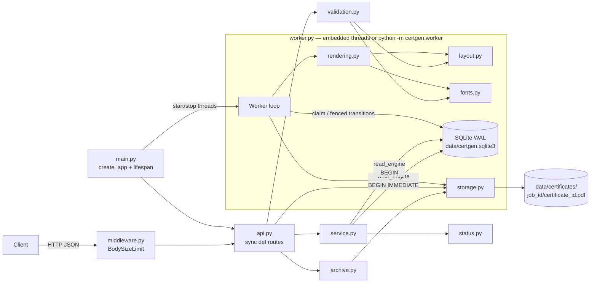

# BLUEPRINT — Bulk Certificate Generator (merged, Gate 3 candidate)

> Self-contained build specification. With this file and `docs/problem_statement.pdf`, the whole project can be built.
> ADR links are supporting evidence only; every decision is stated here in full.
> "must", "never" and "always" are binding. Nothing here is optional unless it is labelled a differentiator (D1–D4).
> Base: Blueprint B. Sections changed by the merge carry a **[merge]** note naming what was borrowed from Blueprint A or newly fixed.

## 0. Header

| Field | Value |
|---|---|
| Document | Merged blueprint, produced by review of Blueprint A and Blueprint B |
| Date | 2026-10-11 |
| Inputs commit | Recorded at freeze: the HEAD commit at the moment of Gate 3 approval is written into `docs/BLUEPRINT.sha256` next to the file hash |
| Gate status | **Gate 3 candidate. Not approved, not frozen.** No implementation or performance evidence is claimed. |
| Authoritative spec | `docs/problem_statement.pdf` (wins over this file on conflict) |

**[merge] Explicit approval, no implied acceptance (from A).** Approval must explicitly confirm these five decisions, each of which was previously contested:

1. Email **is printed** on the certificate by default; operators may turn it off (§9, §10, §15).
2. D4 (Idempotency-Key) is kept as the last differentiator.
3. The QR/verify base URL defaults to `http://localhost:8000` and is snapshotted per job.
4. A dead worker's item stays `processing` until any worker's next claim retires or reclaims it (§21 K13).
5. Guarantees are **at-least-once execution with an idempotent effect**, not exactly-once computation (§7.3).

**Freeze procedure (from A).** After explicit approval: write `sha256sum docs/BLUEPRINT.md` and the inputs commit into `docs/BLUEPRINT.sha256`, commit both, and tag that commit `blueprint-locked`. The file is then read-only. Any deviation first gets an entry in `docs/BLUEPRINT_AMENDMENTS.md` (date, affected sections, what, why, impact, approval status) and needs user approval before code changes. The final README states whether the implementation matched the blueprint and lists the approved amendments. Do not create the checksum, the amendments file or the tag before approval.

Probe numbers in this file (render 20.3 ms/PDF; 10,000-item insert 56 ms; 10,000-row validation 534 ms; claim+complete 0.30 ms/item) come from scratch probes and are **planning inputs, not evidence**. README numbers must come only from `docs/evidence/benchmark-*.json` produced by `scripts/benchmark.py` (§17 M8). No number is ever written into the README by hand.

---

## 1. Requirement coverage

`POST /jobs` = `POST /v1/certificate-jobs`; `GET /jobs/{id}` = `GET /v1/certificate-jobs/{job_id}`. Every test listed carries `@pytest.mark.req("R#")`. All tests are planned, not passing evidence.

| R# | Requirement (PDF) | Component(s) | Endpoint(s) | Test(s) (file::case, §16) |
|---|---|---|---|---|
| R1 | Bulk request: list of recipients + certificate info in one call | `api.py:create_job`, `service.py:create_job`, `models.py:CreateJobRequest` | `POST /jobs` | `test_jobs_api::test_create_job_returns_202_with_location_and_counts`, `::test_job_and_items_are_atomic`, `test_smoke::test_end_to_end_embedded_worker` |
| R2 | Validate recipient data; invalid rows reported with row index, field, code | `validation.py`, `errors.py` | `POST /jobs` | `test_validation.py`, `test_errors::test_problem_json_shape_for_422` |
| R3 | One certificate per valid recipient | `worker.py:Worker.process`, `service.py:create_job` | — | `test_worker::test_drain_creates_one_pdf_per_valid_item_and_none_for_rejected` |
| R4 | Single predefined template | `rendering.py:render_certificate` (no template parameter) | — | `test_rendering::test_single_template_only_recipient_fields_differ` |
| R5 | Certificate contains the recipient-specific information provided | `rendering.py`, `layout.py` | — | `test_rendering::test_pdf_text_contains_all_fields`, `::test_email_printed_by_default_and_opt_out`, `test_layout::test_worst_case_email_fits` |
| R6 | Track status per job and per item | `tables.py`, `worker.py`, `status.py` | — | `test_worker::test_item_transitions_are_recorded`, `test_job_status.py` |
| R7 | Client checks progress/result | `api.py:get_job`, `service.py:get_job`, `status.py` | `GET /jobs/{id}` | `test_jobs_api::test_status_queued_then_completed`, `::test_progress_after_partial_drain` |
| R8 | Retrieve generated certificates | `api.py:download_certificate`, `api.py:download_archive`, `archive.py`, `storage.py` | `GET /v1/certificates/{certificate_id}`, `GET /jobs/{id}/archive` | `test_retrieval.py` |
| R9 | One failure does not block other valid certificates | `worker.py:Worker.process` (per-item try/except, per-item fenced transaction) | — | `test_failure_isolation::test_one_failing_recipient_does_not_block_others` |
| R10 | Job status identifies successes and failures | `service.py:list_items`, `status.py`, `archive.py` (manifest) | `GET /jobs/{id}/items`, `GET /jobs/{id}/archive` | `test_failure_isolation::test_items_listing_identifies_failed_and_succeeded`, `test_retrieval::test_manifest_lists_every_row` |
| R11 | Designed for many recipients (non-blocking, limits, pagination) | `worker.py`, `middleware.py`, `config.py`, `service.py:list_items` | all | `test_jobs_api::test_post_does_not_render_synchronously`, `test_limits.py`, `test_jobs_api::test_items_keyset_pagination` |
| R12 | Sync-vs-background choice documented | `README.md` §Design decisions, this file §7.4 | — | `test_docs::test_readme_documents_background_processing_choice` |
| R13 | Python + FastAPI + relational DB | `main.py`, `db.py` | — | `test_docs::test_stack_is_fastapi_and_sqlite` |
| R14 | Test: creating a job | — | `POST /jobs` | `test_jobs_api.py` |
| R15 | Test: input validation | — | `POST /jobs` | `test_validation.py`, `test_limits.py` |
| R16 | Test: certificate generation | — | — | `test_rendering.py`, `test_worker.py` |
| R17 | Test: job status/progress | — | `GET /jobs/{id}` | `test_jobs_api.py`, `test_job_status.py` |
| R18 | Test: individual certificate failure | — | — | `test_failure_isolation.py` |
| R19 | Test: retrieving certificates | — | downloads | `test_retrieval.py` |
| R20 | README: setup | `README.md` `## Setup` | — | `test_docs::test_readme_has_required_sections` |
| R21 | README: run | `README.md` `## Run` | — | same |
| R22 | README: run tests | `README.md` `## Run tests` | — | same |
| R23 | README: submit request | `README.md` `## Submit a certificate generation request` | — | same |
| R24 | README: retrieve certificates | `README.md` `## Retrieve generated certificates` | — | same |
| R25 | README: design decisions | `README.md` `## Design decisions` | — | same + `::test_readme_adr_links_exist` |
| P1 | Optional must not cost required | tag `v1.0-required` at M6 with the full suite green | — | gate review |
| P2 | Explain, modify and debug the code (interview) | `docs/WALKTHROUGH.md` | — | human walkthrough + one live modification; tests cannot certify understanding |
| P3 | pip + one command, no Docker/Redis/broker | `requirements*.txt`, `README.md` | — | Phase 6 clean-venv transcript |

---

## 2. Locked stack

Python **≥ 3.11** (`enum.StrEnum`). Developed on 3.11.9; Phase 6 verifies on 3.11 and on the newest CPython available on the reviewer machine. No exact-interpreter startup gate exists. **[merge]** A's "certified runtime" refusal (exact CPython/SQLite/zlib) was rejected: it puts the reviewer's setup at risk for a reproducibility guarantee the PDF does not ask for.

| Layer | Package | Version | Reason |
|---|---|---|---|
| Web framework | `fastapi` | 0.143.0 | Pydantic validation + OpenAPI `/docs` + `lifespan` hook for workers |
| ASGI toolkit | `starlette` | 1.7.0 | Pinned explicitly because FastAPI depends on it |
| ASGI server | `uvicorn` | 0.54.0 | Plain install (no `[standard]` extras), no compiled optional deps |
| Validation | `pydantic` | 2.14.0 | Request envelope models |
| Email syntax | `email-validator` | 2.3.0 | Maintained library; `check_deliverability=False`, `allow_smtputf8=False` (ASCII only, so every email is renderable) |
| DB toolkit | `sqlalchemy` | 2.1.4 | SQLAlchemy **Core** (Table + `text()`), no ORM; engine events set pragmas and BEGIN mode |
| Database | SQLite (stdlib `sqlite3`) | ≥ 3.35.0 runtime check (RETURNING) | Zero external services; WAL mode |
| PDF | `reportlab` | 5.0.1 | Pure pip wheel; canvas API; `invariant=1` determinism; TTF embedding |
| QR code | `reportlab.graphics.barcode.qr.QrCodeWidget` | (in reportlab) | No extra dependency (D1 only) |
| HMAC | **none** | — | §10.6 |
| Fonts | DejaVu Sans + DejaVu Sans Bold | 2.37 (vendored) | Latin/Greek/Cyrillic coverage; redistributable license |
| Test runner | `pytest` | 9.1.1 | Markers for traceability |
| Test timeouts | `pytest-timeout` | 2.4.0 | A hung subprocess test fails instead of hanging |
| Test HTTP client | `httpx2` | 2.13.1 | Starlette 1.7.0's `TestClient` asks for it; fallback in §21 K2 |
| PDF text extraction (tests) | `pypdf` | 6.20.0 | Proves R5 by reading generated text |
| Lint + format | `ruff` | 0.17.0 | `ruff check` + `ruff format --check` |
| Type check | `mypy` | 2.4.0 | `mypy --strict certgen` |

`requirements.txt` = `pip freeze` of a clean venv after installing the runtime rows (direct and transitive pins), generated in M1. `requirements-dev.txt` = `-r requirements.txt` plus the frozen dev rows.

**[merge] Pin discipline (from A).** M1 starts by resolving exactly these pins in a clean venv. If any pin does not resolve or a wheel is missing, M1 is blocked and an amendment proposes the replacement pin; no implicit "latest" substitution. No dependency is added without an amendment.

---

## 3. Architecture



| Component (file) | Single responsibility | Must NOT |
|---|---|---|
| `config.py` | Parse and validate env vars into a frozen `Settings` dataclass | Be bypassed: no other module reads `os.environ` |
| `clock.py` | `Clock = Callable[[], int]` (epoch ms) and `system_clock()` | Hold state |
| `db.py` | `Engines(read, write)`, pragmas, BEGIN modes, schema creation, SQLite version check | Contain business rules |
| `tables.py` | SQLAlchemy Core `MetaData`, `jobs` and `items` | Execute anything |
| `errors.py` | `ProblemCode`, `FieldCode`; `ApiError`; problem+json builders; exception handlers (incl. `OperationalError` → 503) | Know about rendering |
| `models.py` | Pydantic request envelopes and response models | Contain validation rules beyond JSON shape |
| `fonts.py` | Register vendored fonts once; expose `FONT_REGULAR`, `FONT_BOLD`, `SUPPORTED_CHARS` | Read files outside `certgen/assets/` |
| `layout.py` | Pure text fitting `fit_text(...) -> Fit | None`, layout constants | Draw or do I/O |
| `validation.py` | Pure validation/normalization into `ValidatedRequest` + flat errors | Touch DB, HTTP, files or clock (date is passed in) |
| `status.py` | Pure `derive_job_status(counts) -> (status, progress)` | Query anything |
| `service.py` | DB use cases: create (incl. idempotency), get, list, find certificate, retry, health probe | Import FastAPI; render PDFs |
| `rendering.py` | `render_certificate(CertificateData) -> bytes` (+ QR in D1) | Touch DB, files, env or clock |
| `storage.py` | Path derivation, atomic write, open, exists, orphan `*.tmp` sweep | Accept any path component that is not 32-hex |
| `archive.py` | Build ZIP (PDFs + `manifest.csv`) from item rows | Open DB sessions |
| `worker.py` | Claim, process, fenced transitions, loops, `main()` | Import FastAPI; hold a DB transaction while rendering or writing |
| `middleware.py` | Pure ASGI `BodySizeLimitMiddleware` → 413 | Parse JSON |
| `api.py` | HTTP ↔ service mapping, status codes, headers | Contain SQL or validation rules |
| `main.py` | `create_app(settings, clock, renderer)`, `lifespan`, module-level `app` | Do I/O at import time |

**[merge] Handler concurrency (from A).** Every route function is a plain `def`, never `async def`, so FastAPI runs it in its threadpool. Validation of a 10,000-row request (~0.5 s) and SQLite calls therefore never block the event loop. Middleware is the only async code.

---

## 4. Data model

SQLite file `{CERTGEN_DATA_DIR}/certgen.sqlite3`, created by `metadata.create_all(write_engine)` inside `BEGIN IMMEDIATE`, so concurrent first boots serialize. The DDL must be equivalent to:

```sql
CREATE TABLE jobs (
    id               TEXT    NOT NULL PRIMARY KEY CHECK (length(id) = 32),   -- uuid4().hex
    title            TEXT    NOT NULL,                                       -- normalized (§9)
    issuer           TEXT    NOT NULL,                                       -- normalized (§9)
    issued_on        TEXT    NOT NULL,                                       -- 'YYYY-MM-DD'
    print_email      INTEGER NOT NULL CHECK (print_email IN (0, 1)),         -- snapshot of setting
    verify_base_url  TEXT    NOT NULL,                                       -- snapshot of CERTGEN_PUBLIC_BASE_URL
    idempotency_key  TEXT    UNIQUE,                                         -- NULL when no header
    request_hash     TEXT,                                                   -- sha256 hex; NULL iff key NULL
    created_at       INTEGER NOT NULL,                                       -- epoch ms UTC
    CHECK ((idempotency_key IS NULL) = (request_hash IS NULL))
);

CREATE TABLE items (
    id               INTEGER NOT NULL PRIMARY KEY,                           -- rowid; FIFO order
    job_id           TEXT    NOT NULL REFERENCES jobs (id) ON DELETE CASCADE,
    row_index        INTEGER NOT NULL CHECK (row_index >= 0),
    name             TEXT,                                                   -- NULL only for rejected rows
    email            TEXT,                                                   -- NULL only for rejected rows
    status           TEXT    NOT NULL CHECK (status IN ('rejected','pending','processing','succeeded','failed')),
    attempts         INTEGER NOT NULL DEFAULT 0 CHECK (attempts >= 0),
    errors           TEXT,                                                   -- JSON array; NULL = none
    certificate_id   TEXT    UNIQUE,                                         -- secrets.token_hex(16); NULL iff rejected
    lease_owner      TEXT,                                                   -- worker_id, logs only
    lease_token      TEXT,                                                   -- secrets.token_hex(16) per claim
    lease_expires_at INTEGER,
    available_at     INTEGER,                                                -- NULL = now
    completed_at     INTEGER,                                                -- set on succeeded/failed
    UNIQUE (job_id, row_index),
    CHECK ((status = 'rejected') = (certificate_id IS NULL)),
    CHECK ((status = 'processing') = (lease_token IS NOT NULL)),
    CHECK ((status = 'processing') = (lease_expires_at IS NOT NULL)),
    CHECK ((status IN ('succeeded','failed')) = (completed_at IS NOT NULL)),
    CHECK (status <> 'rejected' OR attempts = 0),
    CHECK (status = 'rejected' OR (name IS NOT NULL AND email IS NOT NULL))
);

CREATE INDEX ix_items_status_id    ON items (status, id);
CREATE INDEX ix_items_status_lease ON items (status, lease_expires_at);
CREATE INDEX ix_items_job_status   ON items (job_id, status, row_index);
```

**[merge]** The last four CHECKs (idempotency pair, `completed_at`, rejected attempts, non-null valid rows) are borrowed from A's constraint style: invalid row shapes become impossible, not merely untested.

`items.errors` JSON: array of `{"field": str|null, "code": FieldCode, "message": str}`, plus `"duplicate_of_row_index": int` for duplicates. Serialized with `json.dumps(..., ensure_ascii=False, separators=(",", ":"))`.

| Index | Exists for | Query it serves |
|---|---|---|
| `jobs.id` PK | Job lookup | Every job endpoint |
| `UNIQUE jobs.idempotency_key` | One job per key; race backstop | Idempotency lookup |
| `UNIQUE items(job_id, row_index)` | One item per row | Unfiltered keyset pagination; archive order |
| `UNIQUE items.certificate_id` | Global ID uniqueness | Download, verify |
| `ix_items_status_id` | FIFO pending claim | `WHERE status='pending' AND (available_at…) ORDER BY id LIMIT 1` |
| `ix_items_status_lease` | Expired-lease reclaim + retire | `WHERE status='processing' AND lease_expires_at < ?` |
| `ix_items_job_status` | Per-job counts; filtered listing | `GROUP BY status WHERE job_id=?`; `WHERE job_id=? AND status=? AND row_index>?` |

Connection setup (every connection, both engines, `connect` event): `PRAGMA journal_mode=WAL`, `PRAGMA foreign_keys=ON`, `PRAGMA busy_timeout=5000`, `dbapi_connection.isolation_level = None`. `create_engine(url, connect_args={"check_same_thread": False})`. The `begin` event emits `BEGIN IMMEDIATE` on **write_engine** and `BEGIN` on **read_engine**. `synchronous` stays at the default (FULL).

---

## 5. State machines

### 5.1 Item states

States: `rejected`, `pending`, `processing`, `succeeded`, `failed`. Terminal: `rejected`, `succeeded`. `failed` is terminal unless `POST /retry` (D3).

| # | From → To | Trigger | Actor | Guard (SQL `WHERE`) | Writes |
|---|---|---|---|---|---|
| T1 | ∅ → `rejected` | Row has ≥ 1 validation error | API | — | `errors`, `certificate_id=NULL`, `attempts=0` |
| T2 | ∅ → `pending` | Row valid | API | — | `certificate_id`, `errors=NULL` |
| T3 | `pending` → `processing` | Claim | Worker | `status='pending' AND (available_at IS NULL OR available_at <= :now)` | `lease_owner`, `lease_token`, `lease_expires_at=:now+lease_ms`, `attempts+1` |
| T4 | `processing` → `processing` | Reclaim after crash | Worker | `status='processing' AND lease_expires_at < :now AND attempts < :max` | new owner, new token, new expiry, `attempts+1` |
| T5 | `processing` → `succeeded` | Render + atomic write OK | Worker | `id=:id AND lease_token=:token AND status='processing'` | lease cols NULL, `errors=NULL`, `available_at=NULL`, `completed_at=:now` |
| T6 | `processing` → `pending` | Render/write raised; `attempts < MAX_ATTEMPTS` | Worker | same fence as T5 | lease cols NULL, `available_at=:now+retry_ms`, `errors=[GENERATION_FAILED]` |
| T7 | `processing` → `failed` | Render/write raised; `attempts >= MAX_ATTEMPTS` | Worker | same fence as T5 | lease cols NULL, `errors=[GENERATION_FAILED]`, `completed_at=:now` |
| T8 | `processing` → `failed` | Lease expired on the last allowed attempt | Worker (retire step) | `status='processing' AND lease_expires_at < :now AND attempts >= :max` | lease cols NULL, `errors=[WORKER_LOST]`, `completed_at=:now` |
| T9 | `failed` → `pending` | `POST /v1/certificate-jobs/{id}/retry` (D3) | API | `job_id=:job AND status='failed'` | `attempts=0`, `errors=NULL`, `available_at=NULL`, lease cols NULL, `completed_at=NULL` |

Every other transition is forbidden. A fenced update affecting 0 rows means the lease was lost: the worker logs `lease_lost` and does nothing else.

Why the fence is the token alone (no `lease_expires_at > :now` predicate as in A): if the token still matches, nobody has reclaimed (T4 and T8 both replace or clear the token), so letting a slightly-late owner finish is correct and avoids wasting an attempt. A reclaim always invalidates the old token before any new owner can publish.

### 5.2 Job states (derived on every read, never stored)

Counts: `SELECT status, COUNT(*), SUM(attempts > 0) FROM items WHERE job_id=? GROUP BY status`, read in one transaction. Let `valid = total − rejected`, `done = succeeded + failed`, `attempted = Σ attempts>0`. First match wins:

| # | Condition | Job status |
|---|---|---|
| J1 | `valid = 0` (unreachable via API; guard) | `completed_with_errors` |
| J2 | `done = valid` and `failed = 0` and `rejected = 0` | `completed` |
| J3 | `done = valid` and `succeeded = 0` | `failed` |
| J4 | `done = valid` | `completed_with_errors` |
| J5 | `pending = valid` and `attempted = 0` | `queued` |
| J6 | otherwise | `processing` |

`progress = round(done / valid, 4)` (`1.0` when `valid = 0`). `finished_at` = `MAX(completed_at)` over non-rejected items when J1–J4, else `null`. Only `/retry` can move a terminal job back to `queued`; `processing → queued` cannot happen because J5 requires `attempted = 0`.

---

## 6. API contract

### 6.1 Conventions
- Base path `/v1`. JSON UTF-8. Requests with a body send `Content-Type: application/json`; anything else, or invalid JSON, fails Pydantic → 422.
- Timestamps: ISO-8601 UTC with milliseconds and `Z`. `issued_on` is `YYYY-MM-DD`.
- `job_id`, `certificate_id`: 32 lowercase hex. A path ID not matching `^[0-9a-f]{32}$` is treated as unknown (404, or `{"valid": false}` for verify), never 422.
- Links are relative paths.
- **[merge]** Every response carries `Cache-Control: no-store` (from A). Unknown query parameters are ignored.
- Every non-2xx response is `application/problem+json`:
  ```json
  {"type":"about:blank","title":"<short>","status":<int>,"code":"<ProblemCode>","detail":"<sentence>","errors":[...]}
  ```
  `errors` is present only for 422. Each error is `{"row_index": int|null, "field": str|null, "code": FieldCode, "message": str}` plus `duplicate_of_row_index` for duplicates.
- **ProblemCode**: `VALIDATION_FAILED` 422 · `PAYLOAD_TOO_LARGE` 413 · `NOT_FOUND` 404 · `METHOD_NOT_ALLOWED` 405 · `IDEMPOTENCY_KEY_REUSED` 409 · `CERTIFICATE_NOT_READY` 409 · `CERTIFICATE_GENERATION_FAILED` 409 · `NOTHING_TO_RETRY` 409 · `CERTIFICATE_FILE_MISSING` 410 · `INTERNAL_ERROR` 500 · `DB_UNAVAILABLE` 503 · `ARCHIVE_BUSY` 503.
- **[merge] 503 mapping (from A).** `sqlalchemy.exc.OperationalError` whose message contains `database is locked` or `database is busy` → 503 `DB_UNAVAILABLE` with `Retry-After: 1`. All 503s carry `Retry-After: 1`.
- **FieldCode**: `INVALID_JSON`, `REQUIRED`, `INVALID_TYPE`, `UNKNOWN_FIELD`, `INVALID_VALUE`, `INVALID_FORMAT`, `TOO_LONG`, `TOO_MANY_RECIPIENTS`, `DATE_IN_FUTURE`, `INVALID_CHARACTERS`, `UNSUPPORTED_CHARACTERS`, `DOES_NOT_FIT`, `INVALID_EMAIL`, `DUPLICATE_RECIPIENT`, `GENERATION_FAILED`, `WORKER_LOST`.
- Pydantic error `type` → FieldCode: `json_invalid`→`INVALID_JSON`; `missing`→`REQUIRED`; `string_type`, `dict_type`, `list_type`, `model_attributes_type`, `model_type`→`INVALID_TYPE`; `extra_forbidden`→`UNKNOWN_FIELD`; anything else→`INVALID_VALUE`. `field` = the `loc` after `"body"` joined with `.` (list indexes excluded). `row_index` = the index when the loc starts with `body.recipients.<i>`. Empty body → `REQUIRED`, field `null`.
- Starlette 404 → `NOT_FOUND`; 405 → `METHOD_NOT_ALLOWED`. Unhandled exception → 500 `INTERNAL_ERROR`, detail "Internal server error", logged with `logger.exception`, no traceback in the body.

### 6.2 Shared resources

**Job resource**:
```json
{
  "id": "3f2c0d7e9b1a4c6d8e0f1a2b3c4d5e6f",
  "status": "processing",
  "certificate": {"title": "Python for Data Engineering", "issuer": "Acme Academy", "issued_on": "2026-10-01"},
  "print_email": true,
  "counts": {"total": 3, "rejected": 2, "pending": 0, "processing": 1, "succeeded": 0, "failed": 0},
  "progress": 0.0,
  "created_at": "2026-10-11T08:30:00.123Z",
  "finished_at": null,
  "links": {
    "self": "/v1/certificate-jobs/3f2c0d7e9b1a4c6d8e0f1a2b3c4d5e6f",
    "items": "/v1/certificate-jobs/3f2c0d7e9b1a4c6d8e0f1a2b3c4d5e6f/items",
    "archive": "/v1/certificate-jobs/3f2c0d7e9b1a4c6d8e0f1a2b3c4d5e6f/archive"
  }
}
```

**Item resource**:
```json
{
  "row_index": 0, "name": "Zoë Łukasz", "email": "zoe@example.com",
  "status": "succeeded", "attempts": 1, "errors": [],
  "certificate_id": "a1b2c3d4e5f60718293a4b5c6d7e8f90",
  "download_url": "/v1/certificates/a1b2c3d4e5f60718293a4b5c6d7e8f90"
}
```
`errors` is `[]` when the column is NULL. Item errors carry no `row_index`. `download_url` is non-null only when `succeeded`. `name`/`email` may be `null` for rejected rows.

### 6.3 `POST /v1/certificate-jobs` — create job

Query: `dry_run` (bool, default `false`; D3 — before D3, the parameter is ignored). Header: `Idempotency-Key` (D4; optional; 1–255 chars, each in `0x21–0x7E`; before D4 ignored).

Request (`extra="forbid"` at both object levels; strings are `StrictStr`):
```json
{
  "certificate": {"title": "Python for Data Engineering", "issuer": "Acme Academy", "issued_on": "2026-10-01"},
  "recipients": [
    {"name": "Zoë Łukasz", "email": "zoe@example.com"},
    {"name": "Bob", "email": "not-an-email"},
    {"name": "Zoe Again", "email": " ZOE@example.com "}
  ]
}
```
`recipients` is `list[dict[str, Any]]`: a non-object element is a structural 422 (`INVALID_TYPE`, `row_index` = i). Field rules in §9.

| Status | When | Body | Headers |
|---|---|---|---|
| 202 | Job created (≥ 1 valid row, no request-level error) | Job resource + `"errors": [flat row errors of rejected rows]` | `Location: /v1/certificate-jobs/{id}` |
| 200 | Idempotent replay (same key + same body hash) (D4) | Same shape as 202, **current** state | `Location`, `Idempotent-Replayed: true` |
| 200 | `dry_run=true` with no request-level error (D3) | Dry-run report | — |
| 409 | Same key, different body hash (D4) | `IDEMPOTENCY_KEY_REUSED` | — |
| 413 | Body larger than `MAX_BODY_BYTES` | `PAYLOAD_TOO_LARGE` | — |
| 422 | Request-level errors, every row invalid, or bad `Idempotency-Key` | `VALIDATION_FAILED` with every request-level and row-level error | — |
| 503 | DB lock wait exceeded | `DB_UNAVAILABLE` | `Retry-After: 1` |

202 example for the request above:
```json
{
  "id": "3f2c0d7e9b1a4c6d8e0f1a2b3c4d5e6f", "status": "queued",
  "certificate": {"title": "Python for Data Engineering", "issuer": "Acme Academy", "issued_on": "2026-10-01"},
  "print_email": true,
  "counts": {"total": 3, "rejected": 2, "pending": 1, "processing": 0, "succeeded": 0, "failed": 0},
  "progress": 0.0, "created_at": "2026-10-11T08:30:00.123Z", "finished_at": null,
  "links": {"self": "/v1/certificate-jobs/3f2c0d7e9b1a4c6d8e0f1a2b3c4d5e6f", "items": "/v1/certificate-jobs/3f2c0d7e9b1a4c6d8e0f1a2b3c4d5e6f/items", "archive": "/v1/certificate-jobs/3f2c0d7e9b1a4c6d8e0f1a2b3c4d5e6f/archive"},
  "errors": [
    {"row_index": 1, "field": "email", "code": "INVALID_EMAIL", "message": "The email address is not valid. It must have exactly one @-sign."},
    {"row_index": 2, "field": "email", "code": "DUPLICATE_RECIPIENT", "message": "Duplicate of row 0 (same email, case-insensitive).", "duplicate_of_row_index": 0}
  ]
}
```
`INVALID_EMAIL` messages are the `email-validator` exception text verbatim; tests assert codes, never that text.

Dry-run report (200, D3):
```json
{"dry_run": true, "would_create_job": true,
 "counts": {"total": 3, "valid": 1, "rejected": 2},
 "errors": ["...same flat errors as the 202 example..."]}
```
`would_create_job` is `false` when `valid = 0`, and the status is still 200. A dry run never writes and never reads or stores an `Idempotency-Key`.

422 example (all rows invalid):
```json
{"type": "about:blank", "title": "Validation failed", "status": 422, "code": "VALIDATION_FAILED",
 "detail": "2 of 2 recipients are invalid; no job was created.",
 "errors": [
   {"row_index": 0, "field": "name", "code": "REQUIRED", "message": "name is required."},
   {"row_index": 1, "field": "name", "code": "UNSUPPORTED_CHARACTERS", "message": "Character U+674E is not supported by the certificate font."}
 ]}
```
`detail` is "Request is invalid." when request-level errors exist, else "N of N recipients are invalid; no job was created.".

### 6.4 `GET /v1/certificate-jobs/{job_id}`
200 → job resource. 404 `NOT_FOUND` for unknown or malformed id. 503 on lock timeout.

### 6.5 `GET /v1/certificate-jobs/{job_id}/items`
Query: `status` ∈ {`rejected`,`pending`,`processing`,`succeeded`,`failed`} (optional); `after` int ≥ −1 (default −1; returns `row_index > after`); `limit` int 1–1000 (default 100). Invalid value → 422 with `field` = param name, code `INVALID_VALUE`. Ordered by `row_index`. Server fetches `limit + 1`; if more exist, `next_after` = last returned `row_index`, else `null`. Each page reflects current state; pages are not a cross-page snapshot.
```json
{"job_id": "3f2c0d7e9b1a4c6d8e0f1a2b3c4d5e6f", "limit": 2, "next_after": 1,
 "items": [
   {"row_index": 0, "name": "Zoë Łukasz", "email": "zoe@example.com", "status": "succeeded", "attempts": 1, "errors": [],
    "certificate_id": "a1b2c3d4e5f60718293a4b5c6d7e8f90", "download_url": "/v1/certificates/a1b2c3d4e5f60718293a4b5c6d7e8f90"},
   {"row_index": 1, "name": "Bob", "email": "not-an-email", "status": "rejected", "attempts": 0,
    "errors": [{"field": "email", "code": "INVALID_EMAIL", "message": "The email address is not valid. It must have exactly one @-sign."}],
    "certificate_id": null, "download_url": null}
 ]}
```
404 for unknown job.

### 6.6 `GET /v1/certificates/{certificate_id}`

| Item state | Response |
|---|---|
| `succeeded`, file present | 200 `application/pdf`, `Content-Disposition: attachment; filename="certificate-{certificate_id}.pdf"` |
| `pending` / `processing` | 409 `CERTIFICATE_NOT_READY` |
| `failed` | 409 `CERTIFICATE_GENERATION_FAILED` |
| `succeeded`, file missing | 410 `CERTIFICATE_FILE_MISSING` |
| unknown / malformed id | 404 `NOT_FOUND` |

### 6.7 `GET /v1/certificate-jobs/{job_id}/archive`
200 `application/zip`, `Content-Disposition: attachment; filename="certificates-{job_id}.zip"`. Allowed in any job state (a snapshot). 404 unknown job. **[merge]** At most `ARCHIVE_CONCURRENCY = 2` archives build at once per process (non-blocking `threading.BoundedSemaphore`); a third concurrent request → 503 `ARCHIVE_BUSY`. Contents in §11.3.

### 6.8 `POST /v1/certificate-jobs/{job_id}/retry` — D3
No body. 202 → job resource. 404 unknown job. 409 `NOTHING_TO_RETRY` when no item is `failed`. Effect: T9 for all `failed` items of the job, in one write transaction.

### 6.9 `GET /v1/verify/{certificate_id}` — D1 (public)
Always 200.
```json
{"valid": true, "certificate_id": "a1b2c3d4e5f60718293a4b5c6d7e8f90", "recipient_name": "Zoë Łukasz",
 "title": "Python for Data Engineering", "issuer": "Acme Academy", "issued_on": "2026-10-01"}
```
Unknown, malformed or not-`succeeded` id → `{"valid": false}` only. Email is never returned. The response states the issued record, not the integrity of a given PDF file.

### 6.10 `GET /healthz`
200 `{"status": "ok", "db": "ok", "embedded_workers_alive": 2, "embedded_workers_expected": 2}`. `SELECT 1` on read_engine fails → 503 `DB_UNAVAILABLE`.

`GET /docs` and `GET /openapi.json` stay enabled (useful for review and the interview demo).

---

## 7. Processing workflow

### 7.1 Request lifecycle
1. `BodySizeLimitMiddleware`: `Content-Length` > `MAX_BODY_BYTES` → 413. Otherwise buffer chunks; exceeding → 413; else replay to the app.
2. FastAPI parses JSON into `CreateJobRequest`. Failure → 422 (§6.1 mapping).
3. (D4) If `dry_run=false` and the key is present: check format (→ 422 `INVALID_VALUE`, field `Idempotency-Key`); `request_hash = sha256(json.dumps(body.model_dump(mode="json"), sort_keys=True, separators=(",",":"), ensure_ascii=False))`; read-engine lookup. Same hash → 200 replay (no validation). Different → 409.
4. `validation.validate_request(body, today=UTC date from clock, print_email=settings.print_email)` → `ValidatedRequest`. Pure.
5. Request errors or zero valid rows → 422 with all errors. Nothing stored.
6. (D3) `dry_run=true` → 200 report. Nothing stored.
7. `service.create_job` in **one** write transaction: (D4) re-check key → replay/409; insert `jobs` (`id=uuid4().hex`, snapshots `print_email` and `verify_base_url`, `created_at=now`); bulk-insert all `items` (valid → `pending` + `certificate_id=secrets.token_hex(16)`; invalid → `rejected` + `errors`); commit. Any exception → rollback.
8. Respond 202 with job resource + flat row errors + `Location`.
9. Workers claim (§7.3), render, write `{data}/certificates/{job_id}/{certificate_id}.pdf` atomically, mark `succeeded`.
10. Client polls `GET /jobs/{id}` and `GET /jobs/{id}/items?status=failed`.
11. Client downloads one (`GET /v1/certificates/{id}`) or all (`GET /jobs/{id}/archive`: load rows, close the connection, then build and stream the ZIP).

### 7.2 Worker loop (normative)
```python
class Worker:
    def __init__(self, engines, storage, settings, clock, renderer, worker_id=None):
        self.worker_id = worker_id or uuid4().hex          # logs only

    def run_forever(self, stop: threading.Event) -> None:
        self.storage.sweep_orphans(older_than_ms=2 * settings.lease_ms, now_ms=clock())
        while not stop.is_set():
            try:
                did_work = self.run_once() is not None
            except Exception:                                # incl. "database is locked" past busy_timeout
                log.exception("worker_iteration_failed worker_id=%s", self.worker_id)
                did_work = False
            if not did_work:
                stop.wait(settings.poll_interval_seconds)

    def run_until_idle(self) -> list[int]:                   # tests + benchmark: no sleeping
        processed = []
        while (item_id := self.run_once()) is not None:
            processed.append(item_id)
        return processed

    def run_once(self) -> int | None:
        claim = self.claim_next()                            # one write txn, §7.3
        if claim is None:
            return None
        self.process(claim)
        return claim.item_id

    def process(self, claim: Claim) -> None:
        data = self.load_certificate_data(claim.item_id)     # read engine; job snapshot + item
        try:
            pdf = self.renderer(data)                        # no DB transaction open
            self.storage.save_atomic(data.job_id, data.certificate_id, pdf)
        except Exception as exc:
            self.record_failure(claim, exc)                  # fenced T6 / T7
            return
        self.record_success(claim)                           # fenced T5
```
`record_failure`: `claim.attempts < MAX_ATTEMPTS` → T6 with `available_at = now + RETRY_DELAY_SECONDS*1000`, else T7. Stored message: `f"{type(exc).__name__}"` plus a fixed safe sentence ("Certificate generation failed."), max 500 chars; **[merge]** exception text and tracebacks go to logs only (A's rule that client-visible failure text is fixed and never contains paths or recipient data). Both use the token fence; 0 rows → log `lease_lost`. A DB error inside `record_success`/`record_failure` propagates to `run_forever`, which logs and continues; the lease then expires and the item is reclaimed.

Embedded mode: `lifespan` starts `CERTGEN_WORKER_THREADS` daemon threads, each running `Worker(...).run_forever(stop)` with its own `worker_id`, sharing the app's engines. Shutdown: `stop.set()`, then join all threads within one shared deadline of 10 s total; daemon threads that are still running do not block process exit, and their leases are recovered later. Standalone mode, `python -m certgen.worker`: builds engines, creates the schema, runs one `Worker.run_forever` in the main thread, and sets `stop` on SIGINT/SIGTERM. Scale out by starting more processes.

`CERTGEN_TEST_SLOW_RENDER_MS > 0` (default 0) wraps the renderer with `time.sleep(ms/1000)`. It exists only for subprocess tests and the kill demo, and is documented as such.

### 7.3 Claim / lease / recovery (no heartbeat)
One `write_engine` transaction; `BEGIN IMMEDIATE` takes the single write lock first, so steps 1–3 are atomic across threads and processes. `:now` is read from the clock **after** the transaction has begun (i.e. after the lock is held) **[merge, from A]**.
```sql
-- 1. retire (T8)
UPDATE items SET status='failed', errors=:worker_lost_json, lease_owner=NULL, lease_token=NULL,
       lease_expires_at=NULL, completed_at=:now
 WHERE status='processing' AND lease_expires_at < :now AND attempts >= :max_attempts;
-- 2a. expired lease first
SELECT id FROM items WHERE status='processing' AND lease_expires_at < :now AND attempts < :max_attempts
 ORDER BY lease_expires_at LIMIT 1;
-- 2b. else oldest available pending
SELECT id FROM items WHERE status='pending' AND (available_at IS NULL OR available_at <= :now)
 ORDER BY id LIMIT 1;
-- 3. claim (T3 or T4)
UPDATE items SET status='processing', lease_owner=:worker_id, lease_token=:token,
       lease_expires_at=:now + :lease_ms, attempts=attempts + 1
 WHERE id=:id RETURNING id, attempts;
```
`:token = secrets.token_hex(16)`, fresh on every claim, including the same worker reclaiming its own item. Returns `Claim(item_id, token, attempts)` or `None`.

- Lease 30 s vs ~20 ms render: three orders of magnitude of margin per item. The M8 benchmark records the maximum per-item time; if it exceeds 10% of the lease, an amendment is required (heartbeat or longer lease), never a silent change.
- Fencing uses `lease_token` only; `worker_id` never appears in a guard.
- Crash recovery: a killed worker's item keeps an expired lease; the next claim by any worker takes it (2a), counting an attempt; at `MAX_ATTEMPTS` the retire step ends it as `WORKER_LOST`.
- Output idempotency: same item → same `certificate_id` → same path; render inputs come only from the DB row; `invariant=1` makes equal inputs give equal bytes across processes. A stale worker's late `os.replace` writes identical bytes. **Guarantee: at-least-once execution, idempotent effect, one current claimant.** Exactly-once computation is not claimed.

### 7.4 Sync vs background (required by the PDF)
**Decision: background processing with a DB-backed queue; workers embedded in the API process by default.**
- ~20 ms per certificate (probe; README publishes the measured benchmark value) → 1,000 recipients ≈ 20 s, 10,000 ≈ 3.4 min. A synchronous POST would hold the connection that long, hit common 30–60 s proxy timeouts, give no progress, and lose all work on disconnect or client retry.
- `FastAPI BackgroundTasks` rejected: in-memory only, lost silently on restart, no status trail.
- Celery/RQ + Redis rejected: needs a broker, violating "pip install + one command".
- The DB queue gives per-item progress, survives restarts, isolates failures per item, and still starts with one command. The same `Worker` runs as embedded threads or `python -m certgen.worker` processes; correctness holds for any mix because the claim is atomic.
- Cost: clients poll. Rendering is CPU-bound and threads share the GIL, so throughput scales with worker processes; the README shows measured numbers for 1, 2 and 4 processes and labels `N × median render time` as a serial estimate, not a measured synchronous latency **[merge, from A]**.

---

## 8. Failure matrix

| Failure | Detected by | System behavior | Resulting item / job state | Proving test |
|---|---|---|---|---|
| Body > `MAX_BODY_BYTES` | Middleware byte count / Content-Length | 413, nothing parsed | none | `test_limits::test_body_over_limit_413`, `::test_chunked_body_over_limit_413` |
| Malformed JSON / wrong shape | Pydantic | 422 mapped codes | none | `test_validation::test_invalid_json_422`, `::test_row_not_object_422` |
| Certificate field invalid | `validation.py` | 422 | none | `test_validation::test_certificate_title_required_too_long_unsupported_does_not_fit` |
| Subset of rows invalid | `validation.py` | 202; rows stored `rejected` | rejected items; job ends `completed_with_errors` | `test_validation::test_partial_acceptance_three_row_trace` |
| All rows invalid | `validation.py` | 422, nothing stored | none | `test_validation::test_all_rows_invalid_422` |
| DB error during job insert | Exception in write txn | Rollback, 500 | no job, no items | `test_jobs_api::test_job_and_items_are_atomic` |
| DB lock wait > 5 s on an API call | `OperationalError` | 503 `DB_UNAVAILABLE`, `Retry-After: 1` | unchanged | `test_errors::test_db_locked_maps_to_503` |
| Renderer raises once | try/except in `process` | T6, retried after delay | succeeded, attempts 2 | `test_failure_isolation::test_transient_failure_then_success` |
| Renderer always raises for one item | same | T6, T6, T7 | that item `failed/GENERATION_FAILED`; others succeeded; job `completed_with_errors` | `test_failure_isolation::test_one_failing_recipient_does_not_block_others` |
| Disk write error (`OSError`) | `save_atomic` raises | tmp removed, T6/T7 | as above | `test_failure_isolation::test_storage_error_is_isolated` |
| Worker crash mid-item (in-process) | Lease expiry at next claim | T4 reclaim | succeeded, attempts 2 | `test_crash_recovery::test_expired_lease_is_reclaimed` |
| Worker SIGKILL mid-job (real process) | same | Second process finishes | all succeeded, 1 PDF per item, no tmp | `test_crash_recovery::test_kill_mid_job_no_duplicates` |
| Crash loop on one item | Retire step | T8 at max attempts | `failed/WORKER_LOST` | `test_crash_recovery::test_crash_loop_ends_failed_after_max_attempts` |
| Stale worker finishes after reclaim | Token fence rowcount 0 | Logs `lease_lost`, no DB change | new owner's state kept | `test_crash_recovery::test_stale_worker_done_write_rejected_by_fencing`, `::test_same_worker_reclaim_is_fenced` |
| Two workers race for one item | `BEGIN IMMEDIATE` | Exactly one claim | no double claim | `test_worker::test_two_concurrent_workers_never_double_process`, `test_crash_recovery::test_two_worker_processes_never_double_process` |
| Long read during writes | Prevented by design | Read engine never takes the write lock | no `database is locked` | `test_db::test_open_read_does_not_block_claim` |
| Lock wait > busy_timeout in worker | `OperationalError` | Iteration logged, loop continues | untouched, or lease expires → reclaimed | `test_worker::test_loop_survives_db_error` |
| Orphan `*.tmp` after kill | `sweep_orphans` at worker start | Deleted if older than 2×lease | — | `test_worker::test_orphan_tmp_sweep_age_rule` |
| PDF deleted externally | `storage.exists` false | 410 on download; archive manifest lists `CERTIFICATE_FILE_MISSING` | stays `succeeded` | `test_retrieval::test_missing_file_410`, `::test_archive_marks_missing_file` |
| Download before ready / after failure | Item state | 409 | unchanged | `test_retrieval::test_download_pending_409`, `test_failure_isolation::test_download_failed_item_409` |
| Path traversal / malformed id | Regex | 404 | — | `test_retrieval::test_path_traversal_id_404` |
| Too many concurrent archive builds | Semaphore | 503 `ARCHIVE_BUSY` | — | `test_retrieval::test_archive_concurrency_limit_503` |
| Client retries POST after timeout (with key) | Idempotency lookup | 200 replay, no new job | same job | `test_idempotency::test_replay_returns_same_job` (D4) |
| Concurrent first boot of N processes | DDL in `BEGIN IMMEDIATE` | One creates, others no-op | — | `test_db::test_concurrent_schema_creation_two_processes` |
| Graceful shutdown mid-item | Stop event | Current item completes; loop exits | no attempt wasted | `test_worker::test_graceful_shutdown_costs_no_attempts` |
| Unhandled exception in a route | Exception handler | 500 problem, no traceback | — | `test_errors::test_internal_error_is_problem_json_without_traceback` |
| SQLite < 3.35 | Startup check | Refuse to start with a clear message | — | `test_db::test_sqlite_version_check` |

---

## 9. Validation rules

`norm(s)` for name, title, issuer: `unicodedata.normalize("NFC", s)`, strip leading/trailing U+0020, collapse runs of U+0020 into one. Checks for one field run in order and stop at the first failure (one error per field). Different fields of a row each report their own error.

- **C1 `INVALID_CHARACTERS`**: any character of Unicode category `C*`, or `Z*` other than U+0020 (tab, NBSP, U+2028 rejected). Message: `"Character U+XXXX is not allowed."` (first offender).
- **C2 `UNSUPPORTED_CHARACTERS`**: any character that is (a) category `M*` after NFC (ReportLab cannot position combining marks without shaping), (b) of bidi class `R`, `AL` or `AN`, or (c) not in `SUPPORTED_CHARS` = intersection of both fonts' cmaps. Message: `"Character U+XXXX is not supported by the certificate font."`

### 9.1 Certificate (request level → 422; `field` = `certificate.<name>`, `row_index` null)

| Field | Pydantic | Then, in order |
|---|---|---|
| `title` | required `StrictStr` | `norm`; empty → `REQUIRED`; len > 200 → `TOO_LONG`; C1; C2; `fit_text(TITLE)` None → `DOES_NOT_FIT` |
| `issuer` | required `StrictStr` | same with `ISSUER` |
| `issued_on` | required `StrictStr` | not `^\d{4}-\d{2}-\d{2}$` or `date.fromisoformat` fails → `INVALID_FORMAT`; date > UTC today + 1 day → `DATE_IN_FUTURE` |
| unknown key in `certificate` or top level | `extra_forbidden` | `UNKNOWN_FIELD` |
| `recipients` | required `list[dict]` | len 0 → `REQUIRED`; len > `MAX_RECIPIENTS` → `TOO_MANY_RECIPIENTS` (rows then not validated) |

### 9.2 Recipient row (row level → row `rejected`; `row_index` = position)

| Field | In order |
|---|---|
| `name` | missing or `null` → `REQUIRED`; not `str` → `INVALID_TYPE` (stored NULL); `norm`; empty → `REQUIRED`; len > 120 → `TOO_LONG`; C1; C2; `fit_text(NAME)` None → `DOES_NOT_FIT` |
| `email` | missing or `null` → `REQUIRED`; not `str` → `INVALID_TYPE` (stored NULL); strip U+0020; empty → `REQUIRED`; `validate_email(v, check_deliverability=False, allow_smtputf8=False)` raises → `INVALID_EMAIL` (covers > 254 chars, non-ASCII, bad syntax); **[merge]** then, only when the job's `print_email` is true: `fit_text(EMAIL)` None → `DOES_NOT_FIT` (unreachable by §10.3 arithmetic; kept as a guard) |
| any other key | `UNKNOWN_FIELD`, one error per key, sorted by key, `field` = the key |
| duplicate | Evaluated only for rows with no other error, in row order. `key = email.strip().lower()`. If `key` was registered by an earlier error-free row r → `DUPLICATE_RECIPIENT` on `email`, message `"Duplicate of row r (same email, case-insensitive)."`, `duplicate_of_row_index = r`. Otherwise register. Scope: one request; duplicates across jobs allowed. |

Stored values: valid rows store the normalized name and the stripped email (original case kept). Rejected rows store normalized name / stripped email when the value was a string, else NULL.

**[merge]** Because emails are ASCII-only (`allow_smtputf8=False`) and DejaVu covers all printable ASCII, C1/C2 checks on email are unnecessary and removed. A startup assertion in `fonts.py` checks that every printable ASCII character is in `SUPPORTED_CHARS`.

SQL safety: bound parameters only. `Robert'); DROP TABLE items;--` passes C1/C2 and is stored verbatim.

---

## 10. Certificate design

### 10.1 Page and fonts
- A4 landscape 841.89 × 595.28 pt. `canvas.Canvas(buf, pagesize=landscape(A4), invariant=1)`. Metadata: `setTitle(f"Certificate {certificate_id}")`, `setAuthor(issuer)`, `setCreator("certgen")`.
- Fonts registered once: `CertSans` = `certgen/assets/DejaVuSans.ttf`, `CertSans-Bold` = `certgen/assets/DejaVuSans-Bold.ttf`.
- Colors: primary `#1F3A5F`; body `#333333`; recipient name `#111111`.

### 10.2 Layout (horizontally centered on x = 420.945 unless stated)
| Element | Font / size | Position |
|---|---|---|
| Outer border | stroke 2.5 pt, primary | rect inset 20 pt |
| Inner border | stroke 0.75 pt, primary | rect inset 28 pt |
| Heading "Certificate of Completion" | Bold 34, primary | baseline y = 500 |
| "This is to certify that" | Regular 14 | baseline y = 458 |
| Recipient name | Bold, fit `NAME` | block center y = 405 |
| Email (when job `print_email`, the default) | Regular, fit `EMAIL` | block center y = 352 |
| "has successfully completed" | Regular 14 | baseline y = 322 |
| Title | Bold, fit `TITLE`, primary | block center y = 276 |
| "Issued by" | Regular 11 | baseline y = 226 |
| Issuer | Regular, fit `ISSUER` | block center y = 196 |
| "Date of issue: {D Month YYYY}" | Regular 11, left x = 60 | baseline y = 110 |
| "Certificate ID: {certificate_id}" | Regular 9, left x = 60 | baseline y = 92 |
| D1: "Verify: {verify_url}" | Regular 7, left x = 60 | baseline y = 76 |
| D1: QR code | 80 × 80 pt, error correction M | lower-left (701.89, 50) |

Date: `f"{d.day} {MONTH_NAMES[d.month-1]} {d.year}"` with English month names, locale-independent.

### 10.3 Text fitting (`layout.fit_text`, shared by validation and rendering)
`max_width` = 680 pt for all blocks.

| Block | Font | Max size | Min size | Max lines | Box height | Break rule |
|---|---|---|---|---|---|---|
| `NAME` | Bold | 40 | 16 | 2 | 70 | spaces |
| `TITLE` | Bold | 24 | 12 | 3 | 66 | spaces |
| `ISSUER` | Regular | 16 | 10 | 2 | 40 | spaces |
| `EMAIL` | Regular | 13 | 7 | 3 | 34 | **any character** |

Algorithm: for `size` from max down to min in 1 pt steps, wrap greedily at `size` (on single spaces; for `EMAIL`, at any character boundary because emails contain no spaces). For space-wrapped blocks, a single word wider than `max_width` fails that size. Accept the first size where `lines ≤ max_lines` and `lines × 1.2 × size ≤ box_height`. None fits → `None` (`DOES_NOT_FIT`). Line `i` of `n` is drawn with baseline `center_y + (n−1)×L/2 − i×L − 0.35×size`, `L = 1.2 × size`.

**[merge] Email always fits.** The PDF asks that the certificate contain the recipient information provided, so a valid email must never be rejected for layout. Worst case: 254 copies of the widest printable ASCII glyph in DejaVu Sans (`W`, ≈ 0.99 em) at 7 pt = 254 × 0.99 × 7 ≈ 1,760 pt ≤ 3 lines × 680 pt = 2,040 pt; height 3 × 1.2 × 7 = 25.2 ≤ 34. `test_layout::test_worst_case_email_fits` computes this with the real font metrics; if it fails, M3 is blocked and the EMAIL row needs an amendment. The email box (y 335–369) sits between the name box (lower edge 370) and the "has successfully completed" line (cap height ≈ 332); M3's visual check confirms no overlap.

Probe outcomes (DejaVu 2.37, re-asserted by `test_layout::test_fit_outcomes_match_blueprint`): 25-char name → 40 pt / 1 line; 61-char name → 28 pt / 2 lines; 120-char ordinary name → 16 pt / 2 lines; 120 × "W" → `DOES_NOT_FIT`; 85-char title → 24 pt / 2 lines; 200-char title → 16 pt / 3 lines; 200-char issuer → 13 pt / 2 lines; 48-char email → 13 pt / 1 line.

### 10.4 Determinism
Render inputs are exactly `CertificateData`: `job_id`, `certificate_id`, `name`, `email` (None when `print_email` false), `title`, `issuer`, `issued_on`, `verify_url` (None before D1). Built only from the DB row. Same inputs → byte-identical PDF across processes and `PYTHONHASHSEED` values on the same installed dependency set. Two separate jobs for the same person get different `certificate_id`s and are intentionally different documents.

### 10.5 ID format and QR
- `certificate_id = secrets.token_hex(16)`: 32 lowercase hex, 128 random bits, assigned at job creation to valid rows. `job_id = uuid4().hex`.
- QR (D1): `QrCodeWidget(verify_url, barLevel="M")`, drawn via `Drawing` + `renderPDF.draw`, scaled to 80 pt. `verify_url = f"{job.verify_base_url}/v1/verify/{certificate_id}"`.

### 10.6 HMAC: none
Verification is online against the DB: unguessable 128-bit IDs prevent forging new certificate IDs, and `/v1/verify` returns the stored name for comparison with the printed one. An HMAC adds a secret without proving more. **Condition for adding a signature:** a requirement for offline verification without DB access; then use Ed25519 with a published public key (an HMAC would let every verifier forge). We claim "verifiable issued record", never "tamper-evident PDF".

---

## 11. Storage layout

### 11.1 Directories
```
{CERTGEN_DATA_DIR}/                 default ./data (relative to the process cwd)
├── certgen.sqlite3 (+ -wal, -shm)
└── certificates/
    └── {job_id}/                   created on first write
        ├── {certificate_id}.pdf
        └── {certificate_id}.{uuid4hex}.tmp   transient only
```
`lifespan` and `worker.main()` create `{data}` and `{data}/certificates` at startup. The data dir must be on a local disk (WAL does not work on network filesystems).

### 11.2 Naming, writes, cleanup
- Path components come only from DB values; `storage.py` asserts each matches `^[0-9a-f]{32}$` (`ValueError` otherwise). No user string reaches a path or a `Content-Disposition` filename.
- `save_atomic(job_id, certificate_id, data)`: mkdir; open `{certificate_id}.{uuid4().hex}.tmp` with mode `xb`; write; flush; `os.fsync`; close; `os.replace(tmp, final)`; fsync the directory (POSIX only). On any exception: unlink tmp if present, re-raise.
- `sweep_orphans(older_than_ms, now_ms)`: delete `certificates/*/*.tmp` with mtime older than `now − older_than_ms` (2 × lease). Runs at each worker start; logs `orphan_tmp_removed`.
- A PDF whose item is `failed` (possible after a stale write following T8) is never served (download checks state) and is overwritten by a later D3 retry.
- Retention: none. Jobs, items and files are kept until the operator removes `{DATA_DIR}` with all processes stopped (README documents this).

### 11.3 Archive (`archive.py`)
- Entries: `certificates/{row_index:05d}_{certificate_id}.pdf` (`ZIP_STORED`) for each `succeeded` item whose file exists; `manifest.csv` (`ZIP_DEFLATED`).
- `manifest.csv`: UTF-8 without BOM, `csv` defaults (`\r\n`). Header `row_index,name,email,status,certificate_id,error_codes,error_messages`; one line per submitted row in `row_index` order. Multiple errors joined with `"; "`. A `succeeded` item with a missing file: `error_codes=CERTIFICATE_FILE_MISSING`, no PDF entry.
- CSV-injection guard: any cell starting with `=`, `+`, `-`, `@`, `\t`, `\r`, `\n`, `＝`, `＋`, `－`, `＠` gets a leading `'`.
- Built in `tempfile.SpooledTemporaryFile(max_size=8 * 1024 * 1024)`, streamed in 64 KiB chunks via `StreamingResponse`, closed after streaming. Concurrency limited per §6.7.

---

## 12. Security and limits

| Limit / control | Value | Threat addressed |
|---|---|---|
| `MAX_RECIPIENTS` | 10,000 (env) | One request monopolizing workers and disk |
| `MAX_BODY_BYTES` | `MAX_RECIPIENTS × 2,600 + 65,536` = 26,065,536 at default | Memory exhaustion; derived from the worst legal row (`\uXXXX`-escaped 120-char name + 254-char email ≈ 2,244 B + structure) so a request within field limits is never 413'd |
| name | ≤ 120 chars + must fit | Layout overflow; storage bloat |
| title, issuer | ≤ 200 chars + must fit | same |
| email | ≤ 254, ASCII | same; renderability |
| `Idempotency-Key` | 1–255 chars, `0x21–0x7E` | Header abuse; log injection |
| Items page `limit` | 1–1000 | Oversized responses |
| Archive builds | 2 concurrent per process | Disk/CPU exhaustion from parallel 240 MB ZIPs |
| `CERTGEN_PUBLIC_BASE_URL` | ≤ 100 chars, `^https?://[!-~]+$`, trailing `/` stripped, validated at startup | Broken QR / footer overflow |
| SQLite `busy_timeout` | 5,000 ms | Unbounded lock waits |
| `LEASE_SECONDS` / `MAX_ATTEMPTS` | 30 / 3 | Stuck work; infinite crash loops |
| Charset rules C1/C2 | §9 | Silent glyph boxes; bidi spoofing |
| SQL | Bound parameters only | Injection |
| Paths | Server-generated hex IDs, regex-asserted | Path traversal |
| `Content-Disposition` | Fixed ASCII template with hex IDs | Header injection |
| CSV manifest | Formula-prefix guard | CSV injection |
| Verify endpoint | Uniform `{"valid": false}`; no email | Enumeration oracle; PII leak |
| Error bodies | No tracebacks, no exception text | Information disclosure |
| Logs | IDs and codes only; never names or emails | PII in logs |
| Default bind | `127.0.0.1:8000` | Accidental network exposure |
| Auth / rate limiting | **None** (§20); job IDs are 128-bit capability URLs | Documented limitation |

---

## 13. Concurrency and idempotency

| Race | Prevention | Test |
|---|---|---|
| Two workers claim the same item | Claim = one `BEGIN IMMEDIATE` transaction | `test_worker::test_two_concurrent_workers_never_double_process`, `test_crash_recovery::test_two_worker_processes_never_double_process` |
| Stale worker completes after reclaim | Token fence; rowcount 0 → discard | `test_crash_recovery::test_stale_worker_done_write_rejected_by_fencing` |
| Same worker reclaims its own expired item | Token is per claim | `::test_same_worker_reclaim_is_fenced` |
| Stale and current worker write the same file | Unique tmp names + atomic replace + identical bytes | `test_rendering::test_render_is_byte_deterministic`, `test_worker::test_atomic_write_no_partial_file` |
| `/retry` while a stale worker runs an old claim | T9 clears `lease_token` | `test_retry::test_retry_fences_out_stale_worker` (D3) |
| Status polling during writes | Read engine uses deferred `BEGIN`; WAL readers never block the writer | `test_db::test_open_read_does_not_block_claim` |
| Archive build during completions | Rows read first, connection closed, files read after | `test_retrieval::test_archive_while_running_is_snapshot` |
| Concurrent POSTs with the same key | Re-check + insert in one `BEGIN IMMEDIATE`; `UNIQUE` backstop | `test_idempotency::test_concurrent_same_key_creates_one_job` (D4) |
| N processes creating the schema | DDL inside `BEGIN IMMEDIATE`; `checkfirst` | `test_db::test_concurrent_schema_creation_two_processes` |

**Idempotency-Key semantics (D4):** optional header on `POST /v1/certificate-jobs` only. Key and `request_hash` stored on the job row. Same key + same hash → 200 with the **current** job state + `Idempotent-Replayed: true` (no re-validation, no capacity check). Same key + different hash → 409. 422/413 outcomes are never stored, so the client can fix the body and reuse the key. `dry_run=true` ignores the header completely. Keys never expire and are global (no auth). The `IntegrityError` handler (re-read, then replay/409) is a backstop unreachable under `BEGIN IMMEDIATE`; this is stated, not claimed as tested.

---

## 14. Project tree

```
.
├── README.md                         Required sections + limitations + benchmark + blueprint conformance
├── pyproject.toml                    Metadata (requires-python >=3.11); pytest, ruff, mypy config
├── requirements.txt                  Runtime pins (full freeze, generated in M1)
├── requirements-dev.txt              -r requirements.txt + test/lint pins
├── .gitignore                        venv, caches, data/
├── certgen/
│   ├── __init__.py                   __version__ = "1.0.0"; no side effects
│   ├── config.py                     Settings + from_env()
│   ├── clock.py                      Clock type, system_clock()
│   ├── db.py                         Engines, pragmas, BEGIN modes, create_schema, version check
│   ├── tables.py                     Core Table definitions (§4)
│   ├── errors.py                     Codes, ApiError, problem+json, handlers
│   ├── models.py                     Pydantic envelopes + responses
│   ├── fonts.py                      Font registration, SUPPORTED_CHARS, ASCII coverage assertion
│   ├── layout.py                     fit_text + constants (§10)
│   ├── validation.py                 §9
│   ├── status.py                     derive_job_status (§5.2)
│   ├── service.py                    DB use cases
│   ├── rendering.py                  CertificateData, render_certificate
│   ├── storage.py                    Paths, save_atomic, open, exists, sweep_orphans
│   ├── archive.py                    ZIP + manifest
│   ├── worker.py                     Worker, Claim, loops, main()
│   ├── middleware.py                 BodySizeLimitMiddleware
│   ├── api.py                        APIRouter, sync def routes
│   ├── main.py                       create_app, lifespan, app
│   └── assets/
│       ├── DejaVuSans.ttf            sha256 b4c632e3cdf9acc7f28758fb5a323c8524d7fc6660d46904d9b6cbe2809c419c
│       ├── DejaVuSans-Bold.ttf       sha256 e1d733afbbfce842a1b43dced0c9885a76a4e67290dc7e690c4e9b76ebfc7d23
│       └── LICENSE-DejaVu.txt        Bitstream Vera license
├── scripts/
│   └── benchmark.py                  Benchmark → docs/evidence/benchmark-*.json (§17 M8)
├── tests/
│   ├── conftest.py                   settings, FakeClock, app, client, drain, payload builders, spawn_worker, barriers
│   ├── test_spec_traceability.py     Every R# cited by ≥ 1 test with a real assertion
│   ├── test_jobs_api.py  test_job_status.py  test_validation.py  test_limits.py
│   ├── test_layout.py  test_rendering.py  test_worker.py  test_failure_isolation.py
│   ├── test_crash_recovery.py  test_db.py  test_retrieval.py  test_errors.py
│   ├── test_docs.py  test_smoke.py
│   ├── test_verify.py                D1
│   ├── test_dry_run.py  test_retry.py  D3
│   └── test_idempotency.py           D4
└── docs/
    ├── problem_statement.pdf         Authoritative spec
    ├── REQUIREMENTS.md  RESEARCH.md  PLAN.md  decisions/ADR-001…013
    ├── BLUEPRINT.md                  This file
    ├── BLUEPRINT.sha256              After approval only
    ├── BLUEPRINT_AMENDMENTS.md       After approval, only if a deviation is proposed
    ├── WALKTHROUGH.md                Request-to-PDF walkthrough + interview pack
    └── evidence/
        ├── benchmark-1p.json  benchmark-2p.json  benchmark-4p.json   Real runs only
        └── kill-demo.txt             Raw transcript of the kill test (D2)
```

---

## 15. Configuration

Read only by `config.Settings.from_env()`. Invalid value → startup fails with `ValueError` naming the variable. Booleans accept `1/0/true/false` (case-insensitive).

| Env var | Default | Allowed | Meaning |
|---|---|---|---|
| `CERTGEN_DATA_DIR` | `./data` | path | SQLite file + certificates root |
| `CERTGEN_HOST` | `127.0.0.1` | IP | Bind address used by `python -m certgen` |
| `CERTGEN_PORT` | `8000` | 1–65535 | Port used by `python -m certgen` |
| `CERTGEN_EMBEDDED_WORKER` | `true` | bool | Start worker threads inside the API process |
| `CERTGEN_WORKER_THREADS` | `2` | 1–16 | Embedded worker threads |
| `CERTGEN_LEASE_SECONDS` | `30` | 1–3600 | Claim lease length (tests use 2) |
| `CERTGEN_MAX_ATTEMPTS` | `3` | 1–10 | Attempts per item before `failed` |
| `CERTGEN_RETRY_DELAY_SECONDS` | `2` | 0–3600 (float) | Delay before retrying a failed attempt |
| `CERTGEN_POLL_INTERVAL_SECONDS` | `0.5` | 0.05–10 (float) | Idle sleep |
| `CERTGEN_MAX_RECIPIENTS` | `10000` | 1–100000 | Rows per request (also derives `MAX_BODY_BYTES`) |
| `CERTGEN_PRINT_EMAIL_ON_CERTIFICATE` | **`true`** | bool | Print the email under the name; snapshotted per job. `false` is an explicit privacy opt-out |
| `CERTGEN_PUBLIC_BASE_URL` | `http://localhost:8000` | §12 rule | Verify URL base; snapshotted per job; startup warning when unset |
| `CERTGEN_LOG_LEVEL` | `INFO` | DEBUG/INFO/WARNING/ERROR | `certgen` logger level |
| `CERTGEN_TEST_SLOW_RENDER_MS` | `0` | 0–60000 | Test-only render delay |

Derived: `MAX_BODY_BYTES`; DB path; storage path; `ARCHIVE_CONCURRENCY = 2` (constant). Run: `pip install -r requirements.txt` then `python -m certgen` (which calls `uvicorn.run("certgen.main:app", host, port)`). `uvicorn certgen.main:app` also works.

---

## 16. Test plan

### 16.1 Determinism
- Each test gets `tmp_path` as data dir. `create_app(Settings(embedded_worker=False, …), clock=fake_clock)`. `client` = `with TestClient(app) as c` (runs lifespan). `drain(renderer=...)` builds a `Worker` on the app's engines with the same `FakeClock` and calls `run_until_idle()` synchronously.
- `FakeClock` starts at `2026-10-11T08:00:00Z`; `advance(ms)`. Lease boundaries tested at 29,999 / 30,000 / 30,001 ms **[merge, from A]**; never by sleeping.
- Fault injection via the renderer parameter: `failing_for(names)`, `fail_n_times(n)`, `blocking(event)`. Storage errors from a monkeypatched `save_atomic` raising `OSError`.
- **[merge] Race tests use barriers, not timing (from A).** `test_two_concurrent_workers_never_double_process`: worker A's renderer blocks on an `Event` after claiming; worker B then claims; assert B got a different item; release A; drain both; assert every item claimed exactly once. No "each worker ≥ 1 claim by luck" assertion.
- Marker `slow` for subprocess tests (run by default; `-m "not slow"` for the fast loop). Global `timeout = 60`.
- Only `test_smoke.py` uses real threads, with a bounded poll (≤ 10 s, 20 ms step).
- Every test carries `@pytest.mark.req(...)`. No skipped/xfail test counts toward a milestone, except the documented Windows skip of POSIX-signal tests.

### 16.2 Cases (file → case → R#)

**test_jobs_api.py**: `test_create_job_returns_202_with_location_and_counts` R1 R14 · `test_job_and_items_are_atomic` R1 R14 · `test_created_items_have_ids_only_when_valid` R1 R3 · `test_post_does_not_render_synchronously` (1,000 rows → 202, renderer calls 0) R11 · `test_get_job_unknown_404` R7 · `test_get_job_malformed_id_404` R7 · `test_status_queued_then_completed` R7 R17 · `test_progress_after_partial_drain` (one `run_once` of 3 → 0.3333) R7 R17 · `test_items_keyset_pagination` (5 rows, limit 2 → 1, 3, null) R10 R11 · `test_items_status_filter` R10 · `test_items_invalid_params_422` R11 · `test_no_store_header_on_json_and_pdf` R7.

**test_job_status.py**: `test_derivation_table` (J1–J6) R6 R17 · `test_progress_zero_valid_guard` R17 · `test_no_regression_to_queued_during_retry_delay` R17 · `test_finished_at_only_when_terminal` R7.

**test_validation.py**: `test_valid_row_normalized` R2 R15 · `test_apostrophe_and_hyphen_names_valid` R15 · `test_name_missing_required` R15 · `test_name_blank_required` R15 · `test_name_non_string_rejected_not_500` R2 R15 · `test_name_120_ok_121_too_long` R15 · `test_control_and_format_chars_invalid` (tab, U+200D, U+202E) R15 · `test_cjk_unsupported` R15 · `test_rtl_unsupported` R15 · `test_leftover_combining_mark_unsupported` R15 · `test_supported_unicode_names_valid` (`Zoë Łukasz Ngọc`, `Ελένη`, `Дмитрий`) R15 · `test_name_too_wide_does_not_fit` R15 · `test_invalid_email` R15 · `test_email_over_254_invalid` R15 · `test_non_ascii_email_invalid` R15 · `test_duplicate_email_case_and_whitespace` R2 R15 · `test_duplicate_of_rejected_row_is_not_duplicate` R15 · `test_duplicates_across_jobs_allowed` R15 · `test_multiple_field_errors_all_reported` R2 · `test_unknown_row_field` R15 · `test_row_not_object_422` R15 · `test_invalid_json_422` R15 · `test_unknown_top_level_field_422` R15 · `test_empty_recipients_422` R15 · `test_certificate_title_required_too_long_unsupported_does_not_fit` R15 · `test_issued_on_format` R15 · `test_issued_on_tomorrow_ok_day_after_rejected` R15 · `test_all_rows_invalid_422` R2 R15 · `test_partial_acceptance_three_row_trace` R2 R3 R10 · `test_sql_meta_chars_stored_verbatim` R2.

**test_limits.py**: `test_too_many_recipients_422` R11 R15 · `test_body_over_limit_413` R11 · `test_chunked_body_over_limit_413` R11 · `test_worst_case_body_at_limit_accepted` R11 · `test_idempotency_key_too_long_422` R11 (D4).

**test_layout.py**: `test_fit_outcomes_match_blueprint` R5 · `test_single_word_wider_than_box_fails` R5 · `test_baseline_formula` R5 · `test_worst_case_email_fits` (254 × "W" fits at ≥ 7 pt in ≤ 3 lines) R5.

**test_rendering.py**: `test_output_is_pdf` R16 · `test_pdf_text_contains_all_fields` (name, email, title, issuer, date, certificate id via pypdf) R5 R16 · `test_email_printed_by_default_and_opt_out` R5 · `test_single_template_only_recipient_fields_differ` R4 · `test_unicode_name_round_trips` R5 · `test_long_name_renders` R5 R16 · `test_render_is_byte_deterministic` (same process + 2 subprocesses with `PYTHONHASHSEED` 1 and 777) R16.

**test_worker.py**: `test_drain_creates_one_pdf_per_valid_item_and_none_for_rejected` R3 R16 · `test_item_transitions_are_recorded` R6 · `test_claim_returns_none_when_empty` R6 · `test_render_runs_outside_write_transaction` R11 · `test_two_concurrent_workers_never_double_process` (barrier) R3 R9 · `test_clock_read_after_lock` R9 · `test_retry_after_transient_failure_needs_delay` R9 · `test_atomic_write_no_partial_file` R9 · `test_orphan_tmp_sweep_age_rule` R9 · `test_loop_survives_db_error` R9 · `test_graceful_shutdown_costs_no_attempts` R6.

**test_failure_isolation.py**: `test_one_failing_recipient_does_not_block_others` R9 R18 · `test_items_listing_identifies_failed_and_succeeded` R10 R18 · `test_transient_failure_then_success` R9 R18 · `test_storage_error_is_isolated` R9 R18 · `test_download_failed_item_409` R8 R18 · `test_failed_error_message_has_no_traceback_or_exception_text` R10.

**test_crash_recovery.py**: `test_expired_lease_is_reclaimed` R6 R9 · `test_stale_worker_done_write_rejected_by_fencing` R9 · `test_same_worker_reclaim_is_fenced` R9 · `test_crash_loop_ends_failed_after_max_attempts` R9 R18 · slow `test_kill_mid_job_no_duplicates` (subprocess, lease 2 s, slow render 300 ms, 6 items; kill when DB shows ≥ 1 succeeded and 1 processing; second worker finishes; all succeeded, 6 PDFs, killed item attempts 2, no `*.tmp`) R9 · slow `test_two_worker_processes_never_double_process` R9. Skipped on Windows with reason "requires POSIX signals".

**test_db.py**: `test_pragmas_applied` R13 · `test_open_read_does_not_block_claim` R11 · `test_schema_creation_idempotent` R13 · `test_check_constraints_reject_invalid_rows` R6 · slow `test_concurrent_schema_creation_two_processes` R13 · `test_sqlite_version_check` R13.

**test_retrieval.py**: `test_download_succeeded_pdf` R8 R19 · `test_download_pending_409` R19 · `test_unknown_certificate_404` R19 · `test_path_traversal_id_404` R19 · `test_missing_file_410` R19 · `test_rejected_item_has_no_download` R19 · `test_archive_contains_all_succeeded_pdfs` R8 R19 · `test_manifest_lists_every_row` R10 R19 · `test_manifest_neutralizes_formula_cells` R19 · `test_archive_marks_missing_file` R19 · `test_archive_while_running_is_snapshot` R19 · `test_archive_unknown_job_404` R19 · `test_archive_concurrency_limit_503` R19.

**test_errors.py**: `test_problem_json_shape_for_422` R2 · `test_problem_json_for_404_and_405` R10 · `test_internal_error_is_problem_json_without_traceback` R10 · `test_db_locked_maps_to_503` R11 · `test_error_codes_listed_in_readme` (every enum value appears in README `## Error codes`) R2.

**test_docs.py**: `test_readme_has_required_sections` R20–R25 · `test_readme_adr_links_exist` R25 · `test_readme_documents_background_processing_choice` R12 · `test_readme_numbers_match_evidence` (benchmark numbers in README equal those in `docs/evidence/*.json`) R12 · `test_stack_is_fastapi_and_sqlite` R13.

**test_smoke.py**: `test_end_to_end_embedded_worker` R1 R7 R8.

**test_verify.py** (D1): `test_verify_valid_round_trip` · `test_verify_unknown_and_malformed_invalid` · `test_verify_not_succeeded_invalid` · `test_verify_never_returns_email` · `test_qr_url_passed_to_widget` · `test_footer_verify_url_in_pdf_text` · `test_required_layout_unchanged_outside_qr_area`.

**test_dry_run.py** (D3): `test_dry_run_creates_nothing` · `test_dry_run_all_invalid_returns_200_report` · `test_dry_run_ignores_idempotency_key` · `test_dry_run_matches_real_admission_errors`.

**test_retry.py** (D3): `test_retry_requeues_only_failed` · `test_retry_resets_all_columns` · `test_retry_nothing_to_retry_409` · `test_retry_fences_out_stale_worker` · `test_retry_unknown_job_404`.

**test_idempotency.py** (D4): `test_replay_returns_same_job` · `test_replay_header_and_200` · `test_same_key_different_body_409` · `test_key_order_and_whitespace_do_not_change_hash` · `test_validation_failure_not_stored` · `test_concurrent_same_key_creates_one_job` (8 threads, barrier-released).

---

## 17. Build order

Each milestone ends with: listed tests green, `ruff check .`, `ruff format --check .`, `mypy --strict certgen`, `git diff --check`, one commit `feat(Mx): …`. Traceability turns green at M6; it is never weakened to show progress.

| M | Scope | Acceptance | Definition of done |
|---|---|---|---|
| M0 | Freeze | Explicit Gate 3 approval of §0 items | `BLUEPRINT.sha256` committed; tag `blueprint-locked` |
| M1 | Pin resolution in a clean venv; walking skeleton: config, clock, db, tables, minimal models/errors, POST (all rows valid) → 202, `run_until_idle`, placeholder renderer, GET job, GET certificate, conftest | 3 rows: POST → drain → `completed` → download starts `%PDF` | skeleton tests + `test_db::test_pragmas_applied` green |
| M2 | Full validation §9, fonts, `fit_text`, problem+json, 503 mapping, middleware, limits | `test_validation`, `test_errors`, `test_limits`, `test_layout` green | 422/413/503 shapes match §6 |
| M3 | Real template §10 (no QR), print_email snapshot, determinism | `test_rendering` green | Visual check of short / long / Unicode-name / 254-char-email PDFs shown to the user and approved as legible |
| M4 | Worker hardening §7, derived status, `/healthz`, standalone worker | `test_worker`, `test_failure_isolation`, `test_crash_recovery` (incl. slow), `test_job_status`, `test_db`, `test_smoke` green | Kill test passes 3 consecutive runs |
| M5 | Items listing, downloads, archive + manifest + concurrency limit | `test_retrieval` + listing cases green | — |
| M6 | README (`## Setup`, `## Run`, `## Run tests`, `## Submit a certificate generation request`, `## Retrieve generated certificates`, `## Design decisions`, `## Error codes`, `## Limitations`, `## Blueprint conformance`), `test_docs`, 1-process benchmark recorded to `docs/evidence/benchmark-1p.json` | **Full suite green incl. traceability**; README commands run verbatim in a clean venv | **tag `v1.0-required`** |
| M7 | D1 | `test_verify` green; README section | branch `d1-verify` merged or dropped |
| M8 | D2: 2- and 4-process benchmarks, kill-demo transcript | Raw outputs in `docs/evidence/`, README numbers equal evidence | branch `d2-proof` merged or dropped |
| M9 | D3 | `test_dry_run`, `test_retry` green | branch `d3-fix-retry` merged or dropped |
| M10 | D4 | `test_idempotency` green | branch `d4-idempotency` merged or dropped |
| M11 | Phase 6: clean venv on 3.11 and newest CPython, README verbatim, suite 3×, lint/type, hostile review; README `## Blueprint conformance` with amendment links; human walkthrough + one live modification recorded in `docs/WALKTHROUGH.md` | Transcripts kept | tag `v1.0` |

`scripts/benchmark.py --recipients 1000 --processes 1|2|4 --output docs/evidence/benchmark-{n}p.json`: temp data dir; submit through `TestClient` with embedded workers off; spawn N `python -m certgen.worker`; poll the DB until terminal. JSON fields: `schema_version`, `timestamp_utc`, `git_commit`, `platform`, `python`, `versions`, `processes`, `recipients`, `post_latency_ms`, `wall_ms`, `throughput_per_s`, `per_item_ms {p50,p95,max}`, `attempts_histogram`, `counts`. Exits non-zero if any item is not `succeeded`. **[merge, from A]** Evidence files are never hand-edited.

---

## 18. Differentiators

Each built on its own branch after `v1.0-required`, in order. **[merge]** Kill check is binary at that milestone's review (from A) and time-boxed (from B): green tests + complete README section within the time box → merge; otherwise drop the branch unmerged and mark the feature omitted in README.

| D | Scope | Files touched | Tests | Kill criterion |
|---|---|---|---|---|
| D1 Verifiable certificates | QR + footer verify URL; `GET /v1/verify/{certificate_id}` | `rendering.py`, `layout.py`, `api.py`, `service.py`, `models.py`, README | `test_verify.py` | QR breaks determinism or moves any required layout element, any required test regresses, the verify response leaks email, or not done within 1 working day |
| D2 Crash-safety proof | Benchmarks at 2/4 processes; kill-demo transcript (mechanism already in M4) | `scripts/benchmark.py`, README, `docs/evidence/` | M4 slow tests pass 5 consecutive runs | Any kill-test failure in 5 runs: keep the mechanism, drop the README claim and demo |
| D3 Fix-and-retry | `?dry_run=true`; `POST /…/retry` | `api.py`, `service.py`, `models.py`, README | `test_dry_run.py`, `test_retry.py` | `test_retry_fences_out_stale_worker` red, dry run writes anything, a schema change is needed, or not done within 1 working day |
| D4 Idempotency-Key | §13 | `api.py`, `service.py`, README (columns already in §4) | `test_idempotency.py` | Concurrent test flaky in 5 runs, replay path needs validation changes, or not done within 1 working day |
| manifest.csv | Part of the required archive (M5) | `archive.py` | `test_retrieval` manifest cases | Not droppable (required scope) |

---

## 19. Concepts and patterns used

| Pattern | Plain-English explanation | Where | Source (RESEARCH.md) |
|---|---|---|---|
| DB-backed job queue | The items table is the queue; status and work share one source of truth | `worker.py`, `tables.py` | River README; malthe/pq; Huey |
| Transactional enqueue | Job and items inserted in one transaction | `service.create_job` | River README |
| Lease (visibility timeout) | Claiming borrows an item for 30 s; if the borrower vanishes, anyone may take it after expiry | §7.3 | Procrastinate; River rescuer; AlgoMaster job scheduler |
| Fencing token | Each claim gets a fresh random token; only the current holder may finish the item | §7.3, T5–T7 | Kleppmann, "How to do distributed locking" |
| Heartbeat (not used) | Extending a lease periodically; unnecessary when work (20 ms) is far shorter than the lease | §7.3 | Procrastinate heartbeats |
| At-least-once + idempotent effect | Work may run twice after a crash, but produces the same file and the same bytes | §7.3, §11.2 | AlgoMaster message queues; Kleppmann OLEP |
| Attempt cap / dead-letter | After 3 attempts an item is `failed` for inspection and manual retry | T7, T8, T9 | AlgoMaster (DLQ); River max attempts |
| Fixed retry delay | Wait 2 s before retrying; no jitter needed (no shared downstream) | T6 | Stripe blog (adapted) |
| State machine | Items move only along listed, SQL-guarded transitions; CHECKs make invalid shapes impossible | §4, §5 | AlgoMaster job scheduler |
| Derived state | Job status computed from item counts on read | `status.py` | ADR-002 reasoning |
| Pessimistic claim / optimistic completion | Claim takes the write lock; completion is compare-and-set on the token | §7.3 | SQLite transactions docs |
| WAL readers/writers | Readers and the single writer proceed concurrently | `db.py` | sqlite.org/wal |
| Idempotency key | Client key makes POST safe to retry | §13 | Stripe docs; brandur.org |
| Problem details | One standard error format with codes | `errors.py` | RFC 9457 |
| Allowlist validation | Accept exactly what renders correctly; never silently degrade | §9 | OWASP Input Validation |
| Server-generated file names | Paths come from random IDs only | `storage.py` | OWASP File Upload |
| Atomic file replace | Temp file then rename; readers never see half a file | `storage.save_atomic` | Python `os.replace` docs |
| CSV injection guard | Prefix formula-like cells | `archive.py` | OWASP CSV Injection |
| Backpressure | Fixed limits on body, rows, page size and archive builds | §12 | AlgoMaster rate limiting |
| Evidence gates | Numbers come from real runs saved as JSON, never typed in | §17 | pytest markers docs |

---

## 20. Scope guard

| Not built | Why |
|---|---|
| Authentication, API keys, multi-tenancy | Not in the PDF; job IDs are unguessable capability URLs; first production change |
| Rate limiting | No identity to key on; static limits cover resource exhaustion |
| Template editor / multiple designs | PDF says not needed |
| Email delivery, webhooks | Not required |
| PostgreSQL, Docker, Redis, Celery, any broker | Violates pip + one command; see §22 |
| CSV upload | JSON bulk satisfies R1 |
| Alembic migrations | Single schema version |
| Retention / deletion endpoints / key expiry | Not required; documented |
| CJK, RTL and combining-mark shaping | Needs HarfBuzz-level shaping; rejected at validation instead of rendered wrongly |
| Frontend, dashboard, metrics stack | Not required |
| HMAC / signatures | §10.6 |
| Heartbeats | §7.3 |
| Exact-interpreter certification and pixel-exact raster goldens | Byte determinism + pypdf text checks + one human visual review give the needed proof without platform lock-in |

---

## 21. Assumptions and open risks

| # | Assumption / risk | Mitigation |
|---|---|---|
| K1 | The five §0 decisions are contested | Gate 3 requires explicit yes on each; nothing is accepted by silence |
| K2 | `httpx2` and several pins post-date common references and are not yet resolved together | M1 resolves in a clean venv first; failure blocks M1 and triggers an amendment (fallback: `httpx==0.28.1` with the single deprecation warning filtered) |
| K3 | A pin may lack a wheel on the newest CPython | Phase 6 installs there; amendment bumps that pin |
| K4 | Layout constants (incl. the new 3-line email block) are only numerically checked | M3 visual check, shown to the user, before acceptance |
| K5 | Subprocess tests are slower and POSIX-only | State-triggered kill, 2 s lease via env, pytest-timeout, consecutive-pass rules; skipped with reason on Windows |
| K6 | 10,000-item insert holds the write lock | Probe 56 ms; re-measured in the benchmark |
| K7 | 10,000-row validation on the request thread | Probe 534 ms; routes are sync `def`, so the event loop is not blocked |
| K8 | Embedded threads share the GIL with request handling | README recommends `CERTGEN_EMBEDDED_WORKER=false` + worker processes under load; benchmark reports both |
| K9 | SQLite on a network filesystem breaks WAL | README: local disk only |
| K10 | Job IDs act as bearer secrets exposing names and emails | Loopback default; documented; auth is the first production change |
| K11 | email-validator messages may change | Tests assert codes only; version pinned |
| K12 | FIFO claiming starves small jobs behind huge ones | Documented; fair scheduling in §22 |
| K13 | With zero live workers, an expired item stays `processing` | Any worker's next claim retires/reclaims it; `/healthz` shows live worker count; README explains |
| K14 | Printing email by default puts PII on a document that may be shared | Literal reading of the PDF; operators opt out per deployment; README states it |
| K15 | Host clock jumps can expire leases early or late | Same-host clock read after the lock; fencing still rejects obsolete tokens |

---

## 22. Scale story (100×)

| File / area | Change at 100× |
|---|---|
| `db.py` | PostgreSQL via `DATABASE_URL`; single engine; pooling (PgBouncer) |
| `tables.py` | Alembic; `TIMESTAMPTZ`; partition `items`; maintained counters only if `GROUP BY` gets hot |
| `worker.py` | `FOR UPDATE SKIP LOCKED`; batch claims with per-item fencing; fair round-robin over `job_id`; heartbeat if items become long; attempt history table; autoscale on queue depth |
| `service.py` | Per-tenant idempotency keys with a reaper; CSV jobs streamed to object storage and validated in a worker (`validating` state) |
| `validation.py` | Moves into the worker for CSV jobs |
| `storage.py` | S3-compatible store, same key layout; pre-signed downloads |
| `archive.py` | Built once by a worker at terminal state; served pre-signed |
| `api.py` | Auth, per-tenant quotas and rate limits, webhooks |
| `rendering.py` | Template registry; Noto fonts + HarfBuzz shaping for CJK/RTL |
| `main.py` | No embedded workers; stateless API pods |
| Observability | Structured logs; queue depth, claim latency, failures by code; tracing |
| `/v1/verify` | CDN-cached; revocation column; Ed25519 if offline verification is required |

---

## 23. Frozen decisions (frozen only after Gate 3 approval)

| Decision | Choice | Alternatives rejected | One-line reason |
|---|---|---|---|
| Framework | FastAPI 0.143.0, sync `def` routes | Flask, Django+DRF; async routes | Declarative validation, `/docs`, lifespan; no event-loop blocking |
| Database | SQLite WAL via SQLAlchemy Core | Raw sqlite3 + DELETE journal, PostgreSQL, ORM | Zero services; readers never block the writer |
| Read/write split | Two engines: `BEGIN` vs `BEGIN IMMEDIATE` | One engine | Measured: one engine blocks writers on reads |
| Runtime | Python ≥ 3.11 | Exact certified interpreter | Reviewer can run it |
| Processing model | Background DB queue, embedded threads by default | Synchronous; BackgroundTasks; Celery+Redis | Progress, crash safety, one command |
| Claim granularity | One item per claim | Batches | Honest lease margins |
| Crash recovery | 30 s lease + per-claim token fence + 3 attempts, clock read after lock | Startup sweep; heartbeat | Safe with any worker count |
| Ordinary failures | Auto-retry after 2 s up to 3 attempts, then `failed` | Fail immediately | Transient errors recover without an optional feature |
| Retry delay | Fixed 2 s | Exponential + jitter | No shared downstream |
| Job status | Derived from counts | Stored column | Can't drift |
| Timestamps | INTEGER epoch ms | ISO strings | Correct comparisons |
| Validation policy | Partial acceptance; 422 only for structural or all-invalid | Reject all | Generate every valid recipient |
| Duplicates | Same email (trim + lower) within a job, among error-free rows; later row rejected | Allow; reserve on first syntactically valid email | One certificate per real recipient |
| Charset | Allowlist = glyphs in both fonts; no combining/RTL/control; ASCII email | Render anything; HarfBuzz | Never print a wrong certificate silently |
| Text fitting | Shared `fit_text`; email wraps at characters and always fits | Truncate; reject long emails | Validated input always renders; valid emails never rejected |
| Error format | RFC 9457 + flat `errors[]` + StrEnum codes; 503 for lock timeouts | FastAPI default | One shape everywhere |
| PDF library | ReportLab canvas, `invariant=1` | fpdf2+HarfBuzz, WeasyPrint | Pure pip, deterministic, built-in QR, explainable |
| Fonts | Vendored DejaVu Sans 2.37 | System fonts | Machine-independent output |
| Email on certificate | **Printed by default**; per-job snapshotted opt-out | Off by default | Literal PDF requirement |
| Certificate identity | `secrets.token_hex(16)` + DB lookup | Integer IDs, HMAC | Unguessable; sufficient online |
| Storage | `{job_id}/{certificate_id}.pdf`, unique tmp + `os.replace` | Per-attempt immutable paths + checksum | Simpler; safe because bytes are deterministic |
| Retrieval | Single PDF + ZIP with manifest + keyset items | Single only | Bulk in, bulk out |
| Idempotency | Optional key; replay current state 200; 409 on mismatch; dry-run ignores | Replay original 202 | Replay is more useful with live state |
| Limits | 10k recipients, derived body cap, field caps, 2 archive builds | 1k rows + 1 MiB fixed cap | Limits never contradict each other |
| Tests | Deterministic drain + FakeClock + injected renderer + barriers; slow subprocess tests | Sleep-based; pixel goldens | Fast, non-flaky, proves crash claims |
| Evidence | README numbers only from committed benchmark JSON | Hand-written numbers | Claims stay checkable |
| Freeze | Explicit approval → checksum + tag; amendments before deviations | Implied approval | Auditable design |

---

## 24. Consolidation addendum (binding)

This section adds every remaining relevant feature found in a second line-by-line audit of Blueprint A, Blueprint B and the PDF. **Where it conflicts with §§1–23, this section wins.** Superseded text: §6.1 bullet 1 (body parsing), §6.9 invalid response shape, §7.1 step 2, §12 (limits table additions), §15 (new variable), §16 (new cases), §21 K13 (mitigated by §24.2).

New ProblemCodes: `UNSUPPORTED_MEDIA_TYPE` 415 · `CAPACITY_EXCEEDED` 503 (with `Retry-After: 1`).

### 24.1 Global queue capacity (from A)
- `CERTGEN_MAX_ACTIVE_ITEMS`, default `50000`, allowed `MAX_RECIPIENTS`–`1000000`; startup `ValueError` if below `MAX_RECIPIENTS`.
- Inside the create transaction (after `BEGIN IMMEDIATE`, before inserting), count `status IN ('pending','processing')` across all jobs. If `active + new_valid_rows > MAX_ACTIVE_ITEMS` → 503 `CAPACITY_EXCEEDED`, nothing stored. D3 retry applies the same check to the rows it would requeue.
- An idempotent replay (D4) and a dry run bypass the check.
- Tests: `test_limits::test_global_capacity_503`, `::test_capacity_check_is_atomic_under_concurrent_posts` (two threads, barrier), `test_retry::test_retry_respects_capacity` (D3).

### 24.2 Embedded worker supervision (from A, simplified)
- `lifespan` starts one monitor thread alongside the worker threads. Every 1 s it:
  1. replaces any worker thread that is no longer alive, with at most 3 restarts per slot per rolling 60 s and backoff 0.25 / 0.5 / 1 s; after the budget is spent the slot stays down and `worker_slot_exhausted` is logged;
  2. runs the retire step (T8) in its own short write transaction, so exhausted leases become `failed` even when every worker slot is busy or down.
- A live but hung thread is never replaced (Python cannot kill threads); its lease expires and another worker or a restarted process recovers the item.
- `/healthz` reports `"status": "degraded"` (still HTTP 200) when `embedded_workers_alive < embedded_workers_expected`.
- The standalone worker runs the same retire step at the start of each loop iteration (already true via the claim).
- Tests: `test_worker::test_monitor_restarts_dead_thread`, `::test_restart_budget_is_bounded`, `::test_monitor_retires_exhausted_lease_without_claims`, `test_jobs_api::test_healthz_degraded`.

### 24.3 PDF size cap (from A)
- `MAX_PDF_BYTES = 2_097_152` (constant). Renderer output larger than this raises inside `process`, following T6/T7 with `GENERATION_FAILED`. Bounds worker memory, disk use and download size.
- Test: `test_failure_isolation::test_oversized_pdf_is_item_failure`.

### 24.4 Raw request audit trail (from A)
- `jobs.request_json TEXT NOT NULL CHECK (json_valid(request_json))`: canonical JSON of the parsed request body, before normalization (`sort_keys=True`, `separators=(",",":")`, `ensure_ascii=False`).
- `items.input_json TEXT NOT NULL CHECK (json_valid(input_json))`: canonical JSON of that row exactly as submitted.
- Neither column is returned by the API; both columns are immutable after insert.
- D4 `request_hash = sha256(request_json)`, so the fingerprint and the audit copy use one canonicalization.
- Tests: `test_jobs_api::test_original_request_is_stored_canonically`, `test_idempotency::test_hash_matches_stored_request_json` (D4).

### 24.5 Strict JSON body parsing (from A)
`POST /v1/certificate-jobs` (and `/retry` when a body is present) parse the body themselves instead of using FastAPI's automatic body parsing:
1. `Content-Type` must be `application/json`, optionally with `charset=utf-8` (case-insensitive) → else 415 `UNSUPPORTED_MEDIA_TYPE`.
2. Strict UTF-8 decode → failure is 422 `INVALID_JSON`.
3. `json.loads(text, object_pairs_hook=reject_duplicate_keys, parse_constant=reject_nan)` → duplicate object keys, `NaN`, `Infinity`, `-Infinity`, or `RecursionError` are 422 `INVALID_JSON` (message names the duplicate key when relevant).
4. Nesting depth > 8 (root = 1) → 422 `INVALID_JSON`.
5. `CreateJobRequest.model_validate(obj)`; Pydantic errors map exactly as §6.1, treating each `loc` as if it were prefixed with `body`.
- `/retry` with an empty body skips parsing; a non-empty body must be `{}` (D3 has no request fields), else 422 `UNKNOWN_FIELD`.
- Tests: `test_validation::test_duplicate_json_keys_422`, `::test_nan_and_infinity_422`, `::test_nesting_depth_422`, `::test_invalid_utf8_422`, `test_limits::test_wrong_media_type_415`.

### 24.6 Verify base URL rules (from A)
`CERTGEN_PUBLIC_BASE_URL` must be ASCII, ≤ 100 chars after stripping one trailing `/`, and an absolute `http`/`https` URL with a host. It must not contain userinfo, a query or a fragment. A path prefix is allowed. `http` is allowed only for `localhost`, `127.0.0.1` and `::1`; any other host requires `https`. Violations raise `ValueError` at startup. The URL is output data only and is never fetched.
- Test: `test_config::test_public_base_url_rules` (parametrized; new file `tests/test_config.py`, which also covers every §15 variable's range).

### 24.7 Verify response scope field (from A, D1)
Every `/v1/verify` response includes `"verification_scope": "issued_record_only"`. An unknown, malformed or not-succeeded id returns `{"valid": false, "verification_scope": "issued_record_only"}`. The README's Verification section states that a copied QR code does not authenticate the PDF bytes.
- Test: `test_verify::test_scope_field_present`.

### 24.8 Filesystem hardening (from A)
- Process `umask(0o077)` at startup; directories `0700`, files `0600`.
- `DATA_DIR` is resolved once to an absolute canonical path at startup.
- Before opening any certificate path, `storage.py` checks with `os.lstat` that neither the job directory nor the file is a symlink and that the resolved path is inside `{DATA_DIR}/certificates`; it opens files with `O_NOFOLLOW` where the platform provides it.
- Tests: `test_retrieval::test_symlinked_certificate_refused`, `test_worker::test_created_files_are_private` (POSIX).

### 24.9 Schema version (from A)
The create transaction sets `PRAGMA user_version = 1`. At startup: `0` with no tables → create; `1` → continue; any other value → refuse to start with a clear message. Changing the schema later requires an amendment and a migration.
- Test: `test_db::test_unknown_schema_version_refused`.

### 24.10 ID collision handling (from A)
A `UNIQUE` violation on `jobs.id` or `items.certificate_id` during creation regenerates the colliding ID and retries inside a savepoint, at most 5 times; exhaustion rolls back and returns 500. A collision is practically unreachable at 128 bits; the path exists so the outcome is defined.
- Test: `test_jobs_api::test_id_collision_is_retried` (monkeypatched generator).

### 24.11 Error ordering (from A)
- Request-level errors come first, then row errors by ascending `row_index`.
- Within a row, errors are ordered `name`, `email`, then unknown keys sorted; `DUPLICATE_RECIPIENT` appears only when the row has no other error, so it never mixes with them.
- Test: `test_validation::test_error_order_is_stable`.

### 24.12 HTTP connection limits (from A)
`python -m certgen` passes `limit_concurrency=64` and `timeout_keep_alive=5` to `uvicorn.run`. Requests over the limit get uvicorn's own 503 (plain text, outside the problem+json contract; documented in README).
- Test: `test_runtime::test_server_limits_passed_to_uvicorn` (new file `tests/test_runtime.py`, which also checks the `python -m certgen` entry point).

### 24.13 Query-plan test (from A)
- Test: `test_db::test_query_plans_use_indexes`. `EXPLAIN QUERY PLAN` for the claim, reclaim, retire, capacity count, per-job counts and both listing queries must show index use, never `SCAN items`.

### 24.14 Benchmark corpus and fields (from A)
- 10 warm-up renders, then a fixed corpus. Names cycle `Zoë Martin`, `Νίκος Παπαδόπουλος`, `Екатерина Иванова`; emails `recipient0000@example.org` … `recipient0999@example.org`; shared certificate fields match the §6.3 example.
- Additional JSON fields: `render_ms {p50,p95,max}` and `storage_ms {p50,p95,max}` measured separately, and `peak_rss_bytes` from `resource.getrusage` (POSIX; `null` on Windows). No new dependency.
- Acceptance: all items succeeded, every PDF ≤ `MAX_PDF_BYTES`, and maximum per-item time < 10% of the lease (else an amendment, per §7.3).

### 24.15 README content contract (PDF + A)
- **First screen:** prerequisites (Python ≥ 3.11, pip), `python -m venv .venv`, activation, `pip install -r requirements.txt`, `python -m certgen`, and one complete `curl` submission.
- **Required headings:** the §17 M6 list plus `## Supported names` (scripts, length limits, why other scripts are rejected), `## Configuration`, `## Benchmarks`, `## Recovery and guarantees` (at-least-once, idempotent effect, what is not claimed), and `## Operations`.
- **Operations section:** backup, full reset (stop all processes, delete `DATA_DIR`), and offline orphan cleanup (stop all processes, back up, delete `*.tmp` and any PDF not referenced by a `succeeded` row, restart).
- **Lost responses:** without D4 the client must keep the returned job id, because a blind resubmission creates a second job.
- Tests:
  - `test_docs::test_readme_has_required_sections` (extended heading list).
  - `test_docs::test_readme_curl_example_is_valid`: parses the curl JSON from the README and submits it through `TestClient`, expecting 202.

### 24.16 Traceability guard detail (from A)
- `docs/REQUIREMENTS.md` has one `### R<n> — <obligation>` heading per row of §1.
- `test_spec_traceability.py` fails when an R# has no test, when a marker names an unknown R#, or when a marker is empty.
- Tests whose only content is a marker are rejected at review; the guard proves coverage is declared, not that behavior works.

### 24.17 Required-before-optional gate (from A)
- At the `v1.0-required` tag, no D1–D4 code, dependency, endpoint, test file or README section exists. This is checked at the M6 review with `git ls-tree v1.0-required` against the D-file list in §18.
- Later releases must contain `v1.0-required` as an ancestor (`git merge-base --is-ancestor`).

### 24.18 Considered and deliberately not added
| Feature (source) | Reason |
|---|---|
| Optional `reference` recipient field (A) | Not required by the PDF; adds a layout block and validation surface. Unknown fields are rejected, so no supplied data is silently dropped |
| Exact certified runtime, HarfBuzz shaping, pixel goldens, render manifests, per-attempt immutable files with checksums, immutability triggers, retry generation counter, explicit `row_indices` retry, disabled `/docs`, 422 on unknown query params (A) | Reasons in the review and §20; each adds explanation cost without closing a PDF requirement |

### 24.19 Final PDF conformance check
| PDF sentence | Where satisfied |
|---|---|
| Python; FastAPI/Django/Flask; relational DB | §2 |
| Accept a certificate generation request | §6.3 |
| Validate the provided recipient data | §9, §24.5, §24.11 |
| Generate a certificate for each valid recipient using a predefined template | §5 T2–T5, §7, §10 |
| Track the generation status | §4, §5 |
| Check the progress/result | §5.2, §6.4, §6.5 |
| Retrieve generated certificates | §6.6, §6.7, §11.3 |
| Bulk generation, not one request per certificate | §6.3, §12 |
| Single template, no editor, no multiple designs | §10, §20 |
| Certificate contains the recipient-specific information provided | §10.2 (name and email by default), §10.3 (email always fits) |
| Handle invalid recipient data appropriately | §6.3 partial acceptance, §9 |
| One failure does not unnecessarily block other valid certificates | §5 T6–T8, §7.2, §8 |
| Job status identifies successful and failed generations | §5.2 counts, §6.5 filter, §11.3 manifest |
| Designed for many recipients; efficient | §7.4, §12, §24.1, §24.14 |
| Processing choice and reasoning documented | §7.4, README `## Design decisions` |
| Tests: creation, validation, generation, status/progress, individual failure, retrieval | §16 (R14–R19) |
| README: setup, run, tests, submit, retrieve, design decisions | §17 M6, §24.15 |
| Optional work does not cost required functionality | §17 `v1.0-required`, §18, §24.17 |
| Able to explain, debug, modify, handle a changed requirement | `docs/WALKTHROUGH.md`, M11 live modification |

Deliberate interpretations to defend in the interview: names outside Latin, Greek and Cyrillic are rejected rather than rendered with missing glyphs (§9, §20), and an extremely wide 120-character name can fail `DOES_NOT_FIT` (§10.3). Neither contradicts the PDF; both are documented in README `## Supported names`.